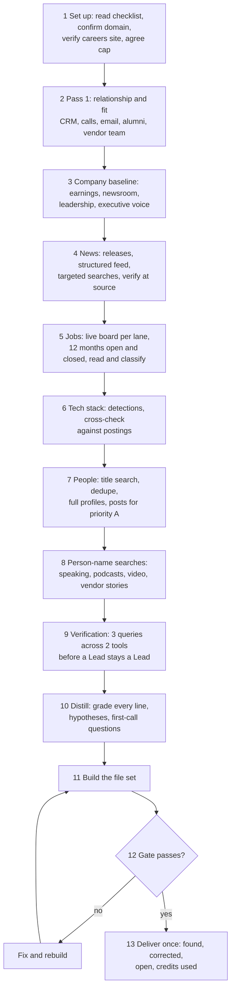
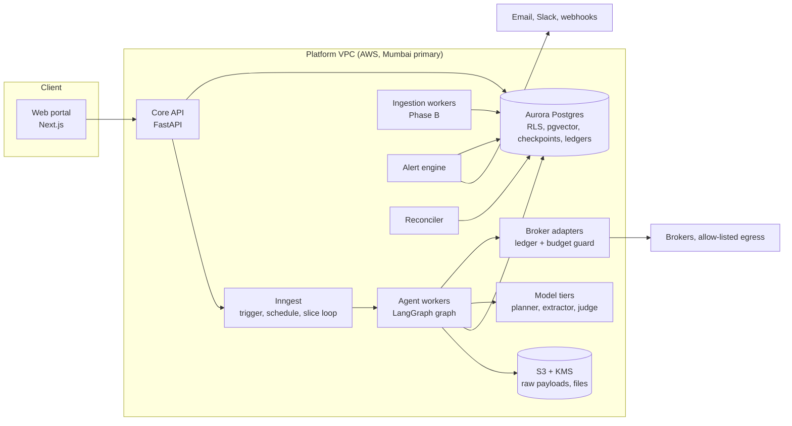
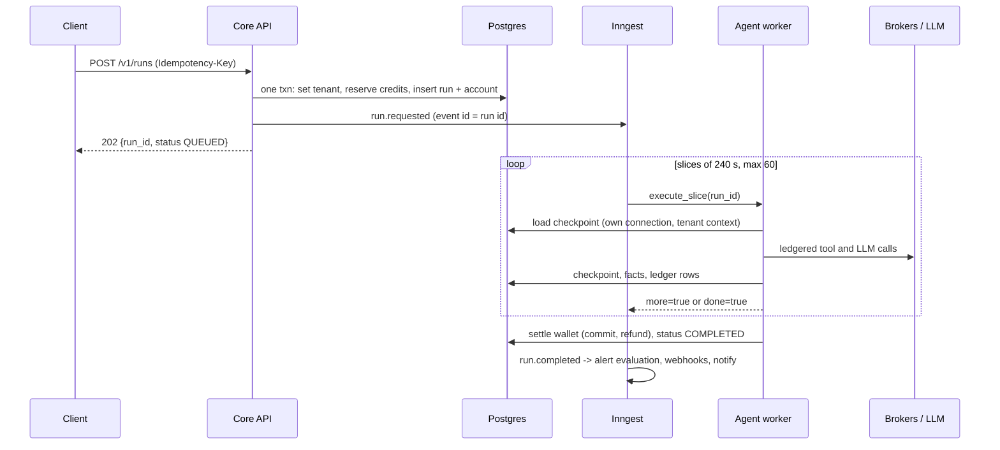

# Account Intelligence: product and architecture overview

Turn one company name into a **sourced, graded account brief** and an **actionable senior people list**, then keep it fresh with **scheduled refresh and change alerts**. Built first as a single-operator research skill, now being turned into a **multi-tenant SaaS**.

This document explains how the project works and how the workflow runs, end to end. It is written from three source documents (listed at the bottom). Where those documents disagree, section 16 says which one this project follows.

> **Internal document.** It names internal data providers and cost figures, so it is for the 6th engineering team only. Per rule 3 in section 17, it must not be shared with clients or placed in any client-facing package.

> **Status of numbers.** Time savings, costs, targets and effort estimates in the source documents are working assumptions or illustrative figures. They are repeated here only where useful and are marked as such. Nothing here is a measured client outcome.

---

## 1. The problem

Sellers of enterprise platform services (Salesforce, ServiceNow, SAP, Tableau, Veeva, data and AI work) are asked to open conversations at large accounts with almost no usable knowledge: an old CRM record, a partner portal showing one vendor rep, a few LinkedIn profiles, and what the account executive remembers.

A real account brief takes one to two person-days. It is rarely sourced, rarely graded, and never refreshed. So:

- outreach is generic, because nobody knows which platform the account builds on, who owns it, or what executives said last quarter;
- buying groups are guessed from titles;
- signals that would open a door (a new build role, a leadership change, a facility expansion, a vendor customer story) are noticed late or never;
- pursuits start on hypotheses that one job posting would have contradicted.

## 2. What the product does

**Job to be done:** turn one company name into a sourced, graded account brief and an actionable people list, covering every source type a seller would want checked, with every claim carrying the link that proves it and a tracker showing what was and was not searched.

| Persona | Needs | Gets |
| --- | --- | --- |
| Partner sales leader | Accounts worth pursuing, with a defensible reason | Graded Account Summary, active platform lanes, first-call questions |
| Account executive / manager | Who to call and what to say | Deduplicated people list (Director and above), confirmed facts, hypotheses to test |
| Alliances / partner marketing | Proof of fit for a vendor co-sell | Tech stack evidence, job posting evidence, vendor customer stories, executive voice |
| GTM consultancy (6th) | A repeatable, auditable process | The skill, living checklist, lessons log, build scripts, per-account workspace |

**The core idea is the grade.** Every fact is graded and carries its URL. Only facts graded **Confirmed** may be said to a prospect; everything else becomes a question to ask. This removes the most common cause of a bad first call: a confident claim that was really a guess.

**Two offers, kept separate.** *Account Intelligence* is the research phase (this project). *Open Door (Signal Radar)* is the later execution phase (signal-based engagement). This project leaves room for Open Door (it can read the same account state and alerts) but does not build outreach. **The system never sends outreach of any kind.**

---

## 3. How it works today (the proven process)

Today the capability is a Claude skill (`abm-account-research`, version 1.5) running in claude.ai with connected data brokers and Google Workspace connectors. One operator, one account per conversation, manual trigger, manual refresh. After nine account runs in September 2026 the process has settled. The skill folder holds: `SKILL.md` (process and rules), `references/` (living checklist, lessons log, signals reference, tools playbook, output spec), `scripts/` (row check, document checks, third-party scan, tool-name stripper) and `assets/` (Word builder library, people and jobs workbook logic).

### 3.1 Inputs to a run

| Input | Required | Notes |
| --- | --- | --- |
| Account name and domain | Yes | Domain resolved; the careers site URL is verified by visiting it, never constructed |
| Pursuing client | Ask once | Decides whose references, CRM history, email and calls are checked |
| Platform lanes | Default set | Salesforce (incl. field service), ServiceNow, SAP, Tableau and analytics, Veeva, Data and AI |
| Credit cap | Yes | One number across all tools; within the cap the run does not stop to ask |
| People scope | Default set | Director and above, Head, Senior Manager, global; security, IT compliance and IT audit excluded |

### 3.2 The 13 steps of a run



### 3.3 The grading scheme (product language)

| Grade | Meaning | Use |
| --- | --- | --- |
| **Confirmed** | Read in a primary source this run | May be stated to a prospect |
| **Probable** | Inferred from one or two sources, reasoning stated | Becomes a question |
| **Hypothesis** | The system's synthesis, with a confirming question | Becomes a question |
| **Lead** | Seen in a secondary source, not verified | Becomes a question; aggregators labelled |

Related rules: a keyword match is a lead, not a finding; matched job postings are *read*, not inferred from titles; **absence of evidence is weak evidence** and is graded Hypothesis; a Lead needs three differently worded queries across two tools before it stays a Lead; sensitive findings (breach, layoff, lawsuit) are preparation, never openers.

### 3.4 Coverage tracker

Every run carries 33 coverage rows (5 in Pass 1, 28 in Pass 2; priorities High, Medium, Optional). Each ends **Done, Partial, Not done, Blocked or None**, with proof: the queries run, the tool category and the result count. **Silent omission is a defect.** The tracker is the control for a skipped source; the gate scripts catch structural defects only.

### 3.5 Deliverables per account

| File | Format | Contents |
| --- | --- | --- |
| Account Summary | Word | Plain-language narrative, caveats, graded tables per lane, key people, findings from LinkedIn, executive voice, hypotheses with confirming questions, first-call questions, tracker (most valuable open work first) |
| Sources and Evidence | Word | Every source with a stable ID, link, date, grade and the exact sentence relied on |
| People List | Excel | Deduplicated senior people: title, level, lane, priority, profile URL, source; Summary sheet of exclusions and counts |
| Job Postings | Excel | 12 months of open and closed postings with class, platform sentence, full description, link |
| Tech Stack and Teams | Excel | Technology detections and team structure, cross-checked against postings, with dates |
| Workspace zip | Zip | Restore note, deliverables, build scripts, raw data with neutral names, notes. Client shareable |
| Internal-only file | Word, separate | Anything from calls, emails or internal conversations naming client or account-team people. Never in the share, never in the zip |

### 3.6 Quality gate (blocks delivery)

Every Word file converted to PDF and checked so no table row is lost at a page break; zero orphan citations, banned dashes, stale phrases or excluded names; workbooks recalculated with zero formula errors; tracker tally recomputed from rows; a third-party scan of the unzipped package (XML, relationships, workbook cells, properties) for **zero data broker names and zero credit counts**; every number said in chat checked against the files. Redelivery ships the complete set with one line on what changed.

### 3.7 Known limits of the current system (the reason for the SaaS)

Single operator; manual trigger and refresh; nothing watches an account between runs; a run stops when a broker runs out of credits (workaround: pre-pulled files by hand); sequential execution (about one working day per account); quality depends on the model following the checklist.

---

## 4. The target platform

The SaaS keeps the **process layer** (skill, checklist, gate) and the **data layer** (the five brokers) and builds everything around them: tenants, an orchestrator that runs the process as durable jobs, partitioned storage, a scheduler, an alert engine, a billing wallet and a client application.

Three properties decide whether it can be sold to serious customers, so the architecture makes them true **by construction**:

1. **Isolation that holds even if an LLM agent is manipulated** (the database enforces tenancy).
2. **Durability** (multi-hour runs survive failures without paying twice).
3. **Evidence quality** (every claim traceable and graded).



### 4.1 Tenant model and isolation

Isolation is the requirement that decides the architecture. Two clients may pursue the same account; public facts can be shared, but everything *derived* (lanes, references, relationship history, hypotheses, people priority, internal material) belongs to one tenant and is never visible to or influenced by another.

**Six layers of defence in depth** (L3 to L6 hold even if the application layer has a bug):

| Layer | Control |
| --- | --- |
| L1 Edge and identity | JWT signature and tenant claim, WAF, SSO/SAML, short-lived tokens |
| L2 Service authorization | RBAC (admin, seller, viewer); tenant taken from the token only, never from the payload |
| L3 Database RLS | `FORCE ROW LEVEL SECURITY`, non-owner role, transaction-local `set_config`, fail-closed policies |
| L4 Vector and checkpoint isolation | Hash partitions by tenant, `thread_id = tenant:run` prefix policy |
| L5 Cryptographic isolation | Per-tenant KMS keys for private text and objects; crypto-shredding on offboarding |
| L6 Output firewall | Visibility labels, public-role renderer, independent leak detector |

Hard rules: every row, file, embedding and job carries a tenant id; a query without tenant context returns **nothing**; model calls never mix tenants in one context window; no cross-tenant fine-tuning or shared memory; search is scoped to the tenant **before** retrieval; agents get **no SQL tool**; support access needs a logged, time-boxed grant.

**Isolation tiers:** Pooled (default), Bridge (dedicated vector partitions and KMS key), Silo (dedicated Aurora cluster) for regulated or very large buyers.

**Data classes:** public source material (optionally in a shared public cache); tenant configuration, derived research and relationship history (never shared); internal material (own vault, own key, never shared and never in client files); process rules (checklist, lessons: shared, contain no account facts). The **public cache** is optional: a per-tenant setting, default off for enterprise tenants, and no tenant may see anything revealing another tenant's interest in an account.

---

## 5. How a run flows (the SaaS workflow)



**Research graph** (LangGraph): `baseline` → `plan` → `budget_guard` → parallel fan-out (`news+events`, `jobs+hiring`, `people+leadership`, `tech+firmographics`, `private RAG` in Phase B) → `quarantine_extract` → `merge` + dedupe → `distill_grade` → `verify` → `render_public` / `render_internal` → END (emit `run.completed`). A planner loop may fill gaps at most twice.

**Run states:** `QUEUED → RUNNING → DISTILLING → VERIFYING → COMPLETED`, plus `AWAITING_APPROVAL` (human gate), `PARTIAL` (some facts Blocked), `BUDGET_EXCEEDED`, `FAILED`, `CANCELED`. Terminal states settle the wallet. Transitions are single `UPDATE ... WHERE status = expected`, so duplicate deliveries are harmless.

**Who retries what (one owner per failure class):**

| Failure | Owner | Behaviour |
| --- | --- | --- |
| Broker 429/5xx, LLM overload | LangGraph node retry policy | 3 attempts, backoff with jitter, then the fact is **Blocked** (run continues) |
| Pod eviction, OOM, deploy | Inngest step retry + checkpoint | Next slice resumes from the last checkpoint; ledger prevents re-billing |
| Slice time budget | Runner | Return `more=true`; next slice scheduled |
| Poison input / schema failure | Node, then run | No retry; fact Blocked with reason; run may end PARTIAL |
| Budget exceeded | In-graph budget guard | Stop fan-out, distil what exists, `BUDGET_EXCEEDED` |
| Lost event / workflow outage | Reconciler | Re-sends events for runs QUEUED > 60 s (idempotent: event id = run id) |

**Exactly-once billing.** Every paid call goes through `ledgered_call()`, keyed by a hash of tool and canonical arguments, unique per run. A replay finds the stored response and does not call the vendor. Precisely: exactly-once *billing*, not exactly-once *side effects*; a crash between the vendor call and the ledger insert can repeat one call.

**Budgets and breakers** (enforced *inside* the graph before the call): credits reserved at run creation; broker spend cap per run (default $5.00 hard); LLM token cap per tier; 60 tool calls; 2 planner loops; 4-hour wall clock; per-tenant daily spend cap; per-broker concurrency via a Redis token bucket.

**Version safety.** Graph version is pinned on the run at creation; workers carry several versions at once; state carries `schema_version`; prompts ship with the graph and are never loaded from a mutable store.

---

## 6. Evidence and grading in the platform

Facts are stored as **entity + attribute key + normalised value** (e.g. `exec.cto.name`) with a **fingerprint** = hash(entity, attribute, normalised value). Normalisation happens in code, not in the model, so equal facts always collide and deltas are exact. Facts are append-only with a `superseded_at` marker.

The engine computes confidence from independent evidence:

- **Source tiers (starting weights):** T1 primary 0.90; T2 curated structured brokers 0.75; T3 reputable news 0.70; T4 scraped or aggregated 0.40.
- **Recency decay:** `r = 0.5 ^ (age / half-life)`; half-lives: hiring 21 days, technology 90, leadership 180, funding 365.
- **Lineage groups:** two sources derived from the same upstream count as one (take the max, not the sum).
- **Confidence (noisy-OR):** `c = 1 − Π over lineage groups (1 − w_i × r_i)`.

| Engine grade | Rule | Display |
| --- | --- | --- |
| A | c ≥ 0.85 and ≥ 2 independent lineage groups, one T1 or T2 | Verified |
| B | c ≥ 0.70 | Likely |
| C | c ≥ 0.50 | Indicative |
| D | c < 0.50 | Unverified (shown, labelled) |
| Conflicting | Two independent groups assert different values, both c > 0.50 | Both shown |
| Blocked | Required source failed after retries | Reason shown, never omitted |

*Worked example:* a CTO name on the company site (T1 0.90) and in a curated broker (T2 0.75), independent: `c = 1 − 0.10×0.25 = 0.975` → grade A. The same name from two aggregators copying one upstream: one group, `c ≤ 0.40` → D.

The product-language grades (Confirmed, Probable, Hypothesis, Lead) and the engine grades (A to D) must be reconciled; see section 16.

---

## 7. Refresh and alerts

**Refresh** starts from the previous tracker. High-priority rows and signals past their shelf life are re-run, expired signals move to history (never deleted), source IDs are reused, and the new Summary **opens with what changed**.

**Cadence follows shelf life**, not one fixed schedule: job board by lane weekly; job feed monthly; news weekly; technology detections monthly; leadership changes weekly; earnings and filings quarterly (aligned to reporting); senior people quarterly; priority A profiles quarterly, posts monthly (only for recent activity); speaking, podcasts, content monthly; review sites and communities quarterly.

**Probe, then escalate.** A probe calls only the cheapest high-signal sources (job postings, news and event feeds) and escalates to a full run only when the delta score crosses a threshold or the brief exceeds its maximum age. *Illustrative:* a $5.60 full run, a $0.30 probe and 15% escalation gives about $1.14 expected refresh cost, roughly 80% below refreshing everything.

**Alerts** are produced from the **delta record** (new items, expired items, regraded items, count changes with base), so every alert traces to a graded, sourced row. Each alert has a dedupe key `(rule, account, fingerprint)` and is delivered by email, Slack/Teams or a signed webhook, batched into a digest when volume is high.

| Rule | Tier | Noise control |
| --- | --- | --- |
| New build or admin/owner role in a tenant lane | Immediate | Debounce: a vanished posting must be absent on two probes before REMOVED |
| Technology or commercial leadership change | Immediate | Two sources or one T1 source |
| Tier-one news (expansion, acquisition, divestiture, major program, regulatory action) | Immediate, after source verification | Per-account daily cap |
| New technology detection in a lane | Weekly digest | Ignore changes below grade C |
| Exec announced as speaker; priority A person posts after a quiet period; Lead regraded up | Weekly digest | |
| Material fact drops a grade | Digest only | Never real-time |
| Budget: run above estimate, wallet below next refresh | Immediate, to tenant admin | |

Sensitive signals (breach, layoff, lawsuit) are alerted as **preparation, never as an outreach hook**.

---

## 8. The enhanced version: private context (Phase B)

Clients hold the best evidence about an account: last year's discovery call, the proposal that lost, CRM notes, the vendor-rep email thread. Phase B brings it into the tenant's **per-account vault** so research can use it, without it leaking into any client-facing file or another tenant.

**Ingestion pipeline:** connector fetch or presigned upload (authorized by a tenant user) → **quarantine bucket** + virus scan → type router → parse (documents) or transcribe with speaker labels (audio) → classify (type, date, account mapping, sensitivity) → **redaction** per tenant policy (Strict / Standard / Minimal) with a stored redaction map (the original is kept) → chunk (structure-aware for documents; 60 to 90 s speaker-turn windows for calls; one note per chunk for CRM) → embed (1536-dim `halfvec`) → extract candidate facts graded **Internal** (never Confirmed from internal material alone unless the client marks the source authoritative).

**Retrieval:** scoped by tenant (RLS) and account (filter); hybrid (vector top-50 + full-text top-50, reciprocal rank fusion) then rerank; top 8 returned with document id and character span. Private snippets enter prompts **only inside the quarantine boundary**, because documents can contain instructions too.

**The two-output rule** (a product rule, structural not prompt-based):

| Output | Audience | Contains |
| --- | --- | --- |
| Client-facing file set | Anyone the client shares with | **Public evidence only.** Internal material only in neutral form ("Client", call notes with a date, email by date and subject, no link). No people names from internal sources, no recordings, no links to internal systems |
| Internal view ("Internal Only") | Named users with the internal role | Everything: internal passages, named people, relationship state per person, full source list. Portal view plus a separate Word file marked Internal Only; never in the shared folder or the workspace zip |

Enforced by: a database role (`public_reader`) that has **no grant** on private rows; visibility labels; and an **independent leak detector** (n-gram and embedding similarity against private content, plus the tenant's redaction maps and internal source IDs) that blocks release the same way a broker name does today.

---

## 9. API, roles and billing

**Roles:** admin (everything), seller (create/cancel runs, configure alerts, view internal brief, upload documents), viewer (read public brief and facts only). Tokens come from an external identity provider with `sub`, `tenant_id`, `role` claims; membership is re-checked against the database (cache about 60 s) so removed users lose access quickly.

**Key endpoints** (`/v1`): `POST /runs` (Idempotency-Key, returns 202), `GET /runs/{id}`, `POST /runs/{id}/cancel`, `GET /accounts`, `GET /accounts/{domain}/brief` (public only), `GET /accounts/{domain}/brief/internal` (Phase B, never exported), `GET /accounts/{domain}/facts`, `GET /accounts/{domain}/changes`, `PUT /accounts/{domain}/watch`, `POST /knowledge/uploads`, `DELETE /knowledge/documents/{id}`, `GET /wallet`, `POST /wallet/topups`, `GET /audit`. Conventions: problem-details errors, per-tenant idempotency enforced by a unique constraint, Redis token-bucket rate limits, HMAC-SHA256 signed webhooks.

**Billing is a reserve / commit / refund wallet ledger.** Credits are reserved atomically at run creation (a single conditional `UPDATE`), settled at the terminal state (commit actual, refund the rest). Invariants checked nightly: balance equals ledger sum; no negative balance; every terminal run has exactly one settlement. `BUDGET_EXCEEDED` commits up to the cap and shows partial results rather than an empty failure. Clients see credits and categories (people, postings, news, pages read), **never vendors**. Pricing: a platform fee per active account per month plus metered credits (broker cost plus margin).

---

## 10. Quality, testing and release

- **Isolation suite is a hard CI gate:** cross-tenant read, cross-tenant write, unset context (returns zero rows), context does not leak through the pool, checkpoint prefix policy, partition leakage with planted canary vectors.
- **Evals:** golden set (50 accounts at MVP growing to 200, stratified, every label dated and re-verified quarterly); judge model differs from the generator; paired comparison with confidence intervals; adversarial injection and leakage corpus must pass 100%.
- **Initial gates:** precision of grade A ≥ 0.95 and B ≥ 0.85; coverage of expected attributes ≥ 0.80; citation validity ≥ 0.97; calibration error ≤ 0.05; cost per run within 10% and p95 duration within 15% of baseline.
- **Layers:** unit (80% coverage, 100% on grading and billing), integration (real Postgres and Redis), contract (recorded broker cassettes plus nightly live smoke with spend caps), end-to-end, load, chaos (kill a worker mid-slice, lose the workflow engine, force DB failover, poisoned page, cache invalidation), security.
- **Release:** canary 5% / 25% / 100% with automated analysis and auto-rollback; graph versions pinned per run; migrations expand-then-contract; signed images; same artifact digest promoted dev → staging → prod.
- **SLOs:** API 99.9% and p99 under 500 ms; 95% of runs reach COMPLETED or PARTIAL within the p95 target; zero isolation violations; DR with RPO under 60 s and RTO 30 minutes (targets to be proven by quarterly game-days).

---

## 11. Security and compliance

STRIDE threat model and OWASP LLM Top 10 mapping; **prompt-injection defence by structure** (a tool-less *quarantine extractor* is the only component that reads raw web text and must emit schema-validated JSON; typed tool arguments; no tool accepts a tenant id; no SQL, shell or arbitrary-URL tools; canary instructions; nothing that reads untrusted text can send, write or fetch); egress through an allow-listed proxy with SSRF protection; secrets in a secrets manager mounted as files; per-tenant KMS keys; append-only audit log archived under Object Lock; crypto-shredding on offboarding. Compliance: SOC 2 evidence from MVP (Type I around month 6), India's DPDP Act and, where applicable, GDPR (people data about identifiable individuals), broker and website licence review, annual penetration test. This is not legal advice; counsel review is required.

Broker names appear to a client in **one place only**: the sub-processor list in the data processing agreement.

---

## 12. Cost, in one paragraph

Under the illustrative model, per-run LLM cost is about $1.12 and broker cost $3.25 to $4.50, so **brokers dominate, not tokens** (about 64 to 70% of total cost). Optimisation effort therefore pays most in: probe-then-escalate refresh, not re-fetching attributes whose half-life has not expired, negotiating volume pricing from ledger data, and (where licences allow) sharing public broker payloads across tenants. Prompt caching helps the LLM line but cannot rescue a broker-heavy cost structure. All figures are illustrative and tagged to be re-verified.

---

## 13. Roadmap

| Phase | Weeks | Scope | Exit criteria |
| --- | --- | --- | --- |
| **0 Prove** | 1 to 3 | Spikes: isolation (RLS, pooled connections, canary vectors); durability (kill mid-fan-out, resume, exactly-once ledger); prompt-cache ratio on real prompts; broker cost per run on 20 real accounts; autoscaling burst | All spike pass criteria met, or the design is amended |
| **1 MVP (concierge)** | 4 to 11 | Infra baseline, durable graph with grading, operator console, wallet ledger, evidence UI, golden set v1, observability baseline | Operators run 100 accounts end to end; grade calibration measured; zero isolation test failures |
| **2 V1 (self-serve)** | 12 to 19 | SSO and onboarding, RBAC, billing and top-ups, scheduled probes and delta alerts, webhooks, warm standby region and first game-day, SOC 2 evidence | 10 paying tenants; SLOs met for 30 days; DR rehearsal passed |
| **3 Scale (Phase B)** | 20 to 28 | Private vault, redaction tiers, hybrid retrieval, internal view, leak detector, DSAR flows, bridge and silo tiers | Leakage canaries at zero; recall targets met; SOC 2 Type I issued or scheduled |

Sequencing logic: isolation and durability first (retrofitting is expensive); the billing ledger before self-serve (free runs with real broker costs lose money fastest); the eval harness built alongside the first graph; Phase B last because it adds the highest-risk data class. Team: six engineers (architect/tech lead, two backend, AI/ML, frontend, platform/DevOps) plus part-time security from Phase 2. Effort figures in the source documents are assumptions.

---

## 14. Target repository layout

The layout the platform grows into. The current layout is in the [README](../README.md#repository-layout).

```
account-intelligence/
├── .github/workflows/ci.yml        lint, migrate, isolation gate, tests, scan, eval gate
├── deploy/ terraform/ helm/        network, eks, aurora, s3-kms, iam, observability; charts
├── migrations/                     alembic (expand/contract); RLS migration
├── src/
│   ├── api/          main, auth, runs, accounts, wallet, knowledge
│   ├── core/         config, logging, errors
│   ├── db/           session (tenant_txn), models
│   ├── orchestrator/ Inngest: trigger, slice loop, waits
│   ├── agents/       graph, runner, grading, normalise, prompts/, tools/
│   ├── ingestion/    connectors/, parse, redact, chunk, embed     (Phase B)
│   └── render/       public, internal, leakcheck
├── tests/ isolation/ unit/ integration/ contract/ e2e/ chaos/ eval/
└── Dockerfile  compose.yml  pyproject.toml  uv.lock
```

Stack: Python 3.12, FastAPI, SQLAlchemy async + psycopg, Alembic, LangGraph with the Postgres checkpointer, Inngest, Postgres 16 with pgvector, Redis, S3, Next.js portal, Terraform and Helm on EKS.

## 15. Running it locally

See the [README](../README.md#getting-started) for current commands. Target developer experience:

```bash
docker compose up -d db redis inngest     # pgvector/pgvector:pg16, redis:7, inngest dev server
uv sync --frozen
uv run alembic upgrade head               # as the migrator role; also runs checkpointer setup()
uv run pytest tests/isolation -x          # the hard gate; must pass before anything else
uv run uvicorn account_intelligence.api.main:app --port 8080
```

Tests use **recorded broker fixtures** and synthetic tenants only. Production data never enters lower environments.

The starter code already runs its own isolation and integration tests today (20 passing, plus 2 expected failures that document known gaps). See `.claude/skills/account-intelligence-platform/assets/starter/README.md`; it needs PostgreSQL 16 with a recent pgvector (0.6.0 has no `halfvec`; 0.8.0 does).

---

## 16. Where the source documents disagree, and what this project follows

| # | Topic | What the documents say | This project follows |
| --- | --- | --- | --- |
| 1 | Workflow engine | SaaS doc: Temporal **or** Inngest. Architecture v2: LangGraph checkpoint as durability truth plus Inngest as outer trigger/loop; Temporal kept as the documented alternative | **Architecture v2.** Switch to Temporal only if Phase 0 spike 2 (durability) fails |
| 2 | Grade vocabulary | PRD and SaaS doc: Confirmed / Probable / Hypothesis / Lead (plus Internal in Phase B). Architecture v2: grades A to D by noisy-OR confidence, plus Conflicting and Blocked | **Both.** The engine computes A to D; the product keeps Confirmed / Probable / Hypothesis / Lead as the client-facing contract. The exact mapping is **an open product decision** (see D-01); a proposal is in the skill |
| 3 | When tenancy arrives | SaaS doc: full tenant model from day one, do not defer. Architecture v2: RLS and isolation tests in the MVP | **Tenant id and forced RLS from the first migration.** Any plan that defers tenancy to a later phase is wrong |
| 4 | Platform stack | SaaS doc: Vercel, WorkOS/Clerk, Supabase/Neon, R2. Architecture v2: AWS (Mumbai primary, Hyderabad standby), EKS, Aurora, S3 | **Architecture v2** for the build; the SaaS stack list is the alternative set. Any OIDC provider that issues `tenant_id` and `role` claims fits |
| 5 | Phase plan | SaaS doc: phases 0 to 3 (now, concierge, self-serve, enhanced). Architecture v2: 0 Prove, 1 MVP, 2 V1, 3 Scale/Phase B, with weeks | **Architecture v2 weeks**, SaaS doc naming. They describe the same sequence |
| 6 | Internal-only file | PRD names it after an operator; SaaS doc calls it "Internal Only" | **"Internal Only"**; never name a person in a product or file name |
| 7 | Run duration | PRD: about one working day today. Architecture v2: p50 under 10 min, p95 under 45 min as targets | Treat Architecture v2 numbers as **targets to be proven** by Phase 0 spikes; the "standard" depth may cover fewer sources than the full PRD scope |
| 8 | Alert rules | SaaS doc: tiers (Immediate / Digest). Architecture v2: rule types with noise controls | **Merge them** (section 7) |
| 9 | Shared public cache | SaaS doc: optional, per-tenant setting, default off for enterprise. Architecture v2: share public broker payloads across tenants only where licences allow | **Per-tenant setting, default off**; raw public payloads only; never anything derived or private |
| 10 | Shape of a fact | PRD: narrative rows each with a stable source ID (S-0001...). Architecture v2: entity, attribute key, normalised value, fingerprint | **Both**: structured fact rows for computation and deltas, and stable per-account source codes that every export cites |

### Problems found in the architecture document's starter code

The architecture document includes starter code (its chapter 18). It says the code was compile-checked but never run. While building the skill, the code was extracted and run against a real PostgreSQL with pgvector, and the results are in `.claude/skills/account-intelligence-platform/assets/starter/`:

- **Private facts leak to the public renderer.** The row-level-security pattern in the listing has no role clause, so the public-facing database role can also read private rows. This breaks the two-output rule at the database layer. Reproduced; fixed by scoping each policy to its role; a test and a lint rule now guard it.
- **The research graph crashes on its first parallel step.** The spend total is written by four branches at once with no reducer, and LangGraph rejects that. Reproduced; fixed.
- **The billing ledger has a concurrency gap.** The document is honest that a crash can repeat one paid call. But the code also lets two concurrent workers on the same run both pay (for example a retried step while the earlier one is still running), so that "one repeat per crash" limit does not hold. Reproduced; documented as a known gap with a failing-by-design test. The Phase 0 durability spike must close it with a per-run lease.
- Smaller items: the listings use tables that are never defined (a first migration is now provided), credits and dollars are mixed in one field, a replayed idempotency key is not checked against the request, and several pieces the text describes (settlement, reconciler, outbox) are not in the listings.

The wallet logic itself held up: ten parallel runs against a wallet that covers five produced exactly five successes and five "insufficient credits" responses.

## 17. Rules that must never be broken

1. **Never send outreach** of any kind. No code path may send email or messages to prospects.
2. **Never delete or overwrite** an operator's or client's records. New rows, new files, status columns.
3. **Client-facing output never names a data broker, a credit count, a call recording, a client staff member or another account.** Attribution is "6th agents". (Only the DPA sub-processor list names brokers.)
4. **Tenant isolation is enforced by the database**, not only by application code; a query with no tenant context returns nothing.
5. **No fact without a source, no source without lineage, no grade without a formula.** Every fact carries its URL and the exact sentence relied on.
6. **Only Confirmed facts are stated to a prospect.** Absence of evidence is Hypothesis.
7. **Untrusted text is read only by the tool-less quarantine extractor.** No SQL tool, no tenant id in any tool argument.
8. **Pull once, work from stored rows.** Every paid call is ledgered, capped and attributable to a run and a tenant.
9. **No silent omissions.** Blocked, Unverified and Conflicting are explicit states with reasons.
10. **Internal material never enters a client-facing file, the public cache, or another tenant's context.**
11. **One account per file set.** Another account's name never appears in an account's files.
12. **Ask before spending beyond the agreed cap**, and report spend at the end.

## 18. Open decisions

| ID | Decision | Default until decided |
| --- | --- | --- |
| D-01 | Mapping between engine grades (A to D) and product grades (Confirmed / Probable / Hypothesis / Lead) | Keep both; `Confirmed` requires a primary source read this run (proposal in the skill) |
| D-02 | Model split per workflow step | Tiered routing by config (planner, extractor, judge); decide on measured gate-failure rate |
| D-03 | BitScale alone vs BitScale plus Sumble for people | Keep both behind the adapter; measure fill rate and cost per usable senior person over ten accounts |
| D-04 | List price per run or credit, and depth tiers | Unset |
| D-05 | Required data residency for the first ten customers; silo tier on day one? | Single region (Mumbai) with Hyderabad standby from V1 |
| D-06 | Which people-data attributes are in scope for the brief, given privacy review | Business contact data only, pending counsel |
| D-07 | Is the operator console a long-term product surface? | Treat as a real surface in MVP |
| D-08 | First Phase B connectors | Grain first (already in use), then CRM and Drive |
| D-09 | Commercial policy when two tenants pursue the same account | Isolation handles data; written position needed before phase one |
| D-10 | Broker terms on resale and derived data | Confirm before phase one |
| D-11 | How lineage groups are decided (which sources share an upstream) | Own group per source, flagged for review; the sources do not say how to decide |

Items in the architecture document tagged **[VERIFY]** (model IDs and prices, cache lifetimes, Aurora region support, pgvector version, Inngest limits, vendor retention terms, OWASP edition, DPDP/GDPR applicability) must be resolved before the dependent decision is locked.

---

## Sources

| Short name | Document |
| --- | --- |
| **PRD** | *Account Intelligence: Business use case, product requirements and how the current system works* (6th, September 2026) |
| **SaaS** | *Account Intelligence as a Service: Multi client SaaS design, scheduled refresh and alerts, and the enhanced version* (6th, September 2026) |
| **Architecture v2** | *Account Intelligence SaaS: Architecture & Implementation Specification v2.0* (49 pages) |

The accompanying skill (`.claude/skills/account-intelligence-platform/`) turns this into instructions for building it step by step. It contains `SKILL.md` (how to work and what never to break), reference files, data assets, helper scripts with a self-test, and tested starter code. Copies of the PRD, SaaS design, and Architecture v2 sources are kept locally in the gitignored `docs/sources/` folder.
