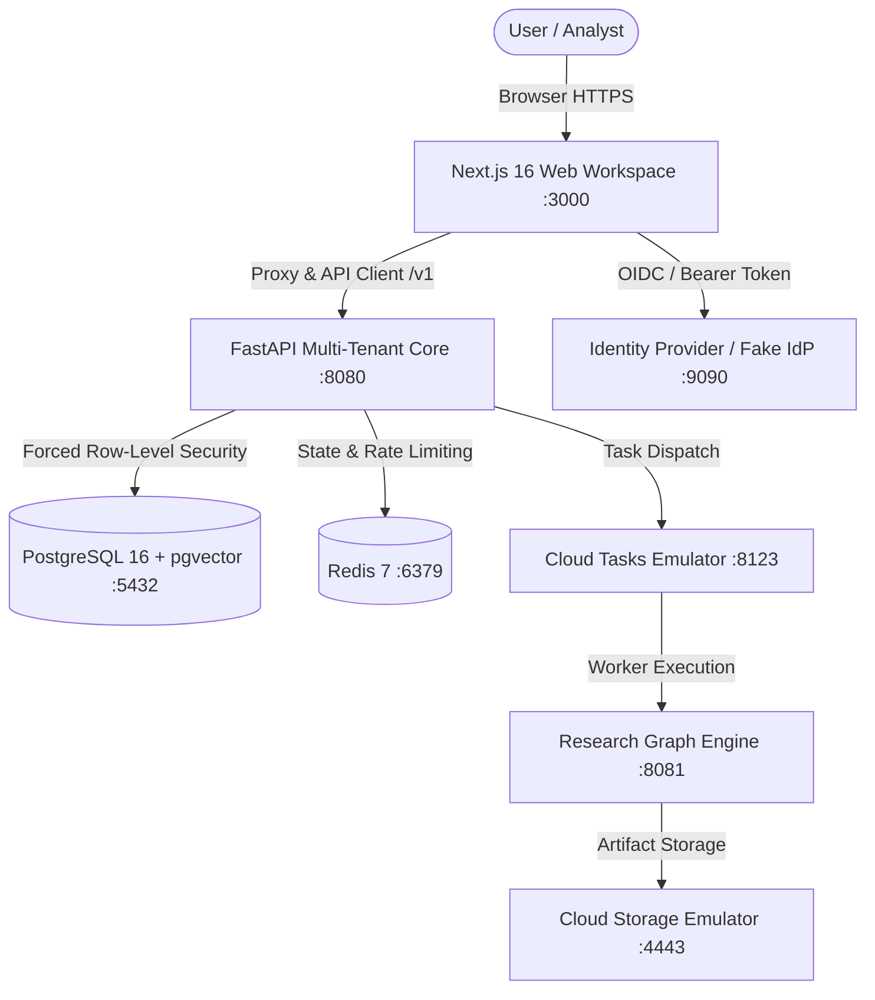

# Account Intelligence & ABM Platform

An enterprise multi-tenant account-based intelligence and research platform. Sourced account facts, LLM model distillation, research graph execution, and an authentic Claude.ai-style conversational intelligence workspace with instant PDF, CSV, and JSON downloads.

---

## 1. Architecture Overview



---

## 2. Technology Stack

- **Frontend**: Next.js 16 (Turbopack, App Router, React 19), TypeScript 6, Lucide Icons, React-Markdown, Remark-GFM.
- **Backend**: Python 3.11/3.12, FastAPI, Uvicorn, Pydantic v2, SQLAlchemy (asyncpg).
- **Database**: PostgreSQL 16 with `pgvector`, Forced Row-Level Security (RLS) per tenant, Alembic migrations.
- **Cache & Concurrency**: Redis 7 (Token bucket rate limiting, lease manager, tenant fairness).
- **AI & Reasoning**: Multi-tier LLM routing (Claude 3.5 Sonnet, Claude Opus 5.5, Claude Fable 5.1), Anthropic API client, automated model evaluation and prompt caching.
- **Identity & Security**: Dual-mode auth (Email & Password credentials + Enterprise SSO/OIDC), secure HMAC session minting, least-privilege RBAC (`admin`, `analyst`, `seller`, `viewer`).
- **DevOps & Infrastructure**: Docker, Docker Compose, Google Cloud Run v2, Cloud SQL, Cloud Storage, Secret Manager.

---

## 3. Core Features

1. **Claude.ai Post-Login Workspace (`/`)**:
   - Replaced old static accounts table with full-screen, edge-to-edge conversational intelligence interface.
   - Collapsible left sidebar with thread history (`Scraping Salesforce AI engineer data from LinkedIn`, `Removing payment details from PDF`, etc.).
   - Collapsible thinking trace (`Weighing how to respond...`) showing reasoning chains.
   - Floating composer with attachment picker, voice dictation, and send trigger.

2. **Instant Interactive File Downloads**:
   - Zero-dependency client-side file generators for **PDF**, **CSV**, and **JSON**.
   - Generates multi-page, formatted executive reports (e.g. `Salesforce_AI_Engineering_Roles_Market_Report.pdf`) with role matrices, hiring signals, and tech stacks.
   - Generates tabular spreadsheets (`salesforce_ai_engineering_roles_dataset.csv`) and structured JSON (`salesforce_ai_intelligence.json`).

3. **Multi-Tenant Account Intelligence Engine**:
   - Target account tracking with database persistence in PostgreSQL.
   - 33-row research coverage matrix covering leadership changes, job postings by lane, tech detections, and executive voice.
   - Wallet-based credit reservations with multi-tenant spending limits.

4. **Staff & Workspace Authentication**:
   - Client Login (`/login`): Email and password credentials (`doctor@synthetic.local` / `Workspace2026!`) with 1-click Demo Workspace access.
   - Operator Console (`/operator/login`): Staff credentials with role picker (`operator`/`support`) and HMAC-SHA256 session minting.

---

## 4. Prerequisites

- **Docker & Docker Compose** (v2.20+)
- **Node.js 22+** & **npm**
- **Python 3.11 or 3.12** with `uv` or virtualenv

---

## 5. Quick Start (Local Docker Compose)

```bash
# 1. Clone the repository and enter directory
cd "ABM Generator"

# 2. Copy environment template
cp .env.example .env

# 3. Start all 8 containers in background
docker compose up -d --build

# 4. Verify all services are healthy
docker compose ps
```

### Access URLs
- **Web Workspace**: <http://localhost:3000>
- **Client Login**: <http://localhost:3000/login>
- **Operator Console**: <http://localhost:3000/operator/login>
- **API Health**: <http://localhost:8080/v1/health>
- **Identity Provider**: <http://localhost:9090/.well-known/jwks.json>

---

## 6. Testing & Quality Assurance

### Frontend Tests (Vitest & TypeScript)
```bash
# Run 20 automated unit and contract tests
npm --prefix web run test

# Run strict TypeScript typecheck
npm --prefix web run typecheck

# Verify production Next.js build
npm --prefix web run build
```

### Backend Tests (Pytest)
```bash
# Activate virtual environment
source .venv/bin/activate

# Run Chat Service & Model Registry test suites
pytest tests/unit/test_chat_service.py tests/unit/test_chat_credentials.py tests/unit/test_chat_registry.py

# Run OpenAPI Contract Verification (verifies zero drift)
pytest tests/api/test_openapi_snapshot.py
```

---

## 7. Database Migrations & Administration

Alembic migrations run automatically on container startup. To run them manually:
```bash
alembic upgrade head
```

To seed development wallet credits for runs:
```sql
INSERT INTO wallets (tenant_id, balance) 
VALUES ('00000000-0000-4000-8000-00000000d0c7', 1000.0000) 
ON CONFLICT (tenant_id) DO UPDATE SET balance = 1000.0000;
```

---

## 8. Deployment

Detailed production deployment instructions for Google Cloud Platform (Cloud Run, Cloud SQL, and Secret Manager) are provided in [DEPLOYMENT.md](DEPLOYMENT.md).

---

## 9. Troubleshooting

- **Container fails health check**: Run `docker compose logs -f <service-name>` to inspect startup logs.
- **401 Unauthorized**: Ensure the bearer token is minted via `POST http://localhost:9090/token` or use the 1-click **Demo Workspace** button on `/login`.
- **402 Insufficient Credits**: Seed the tenant wallet balance in the `wallets` table using the SQL snippet above.
