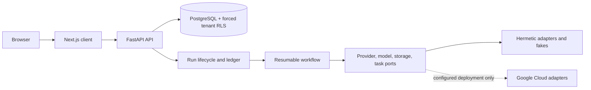

# Account Intelligence

**Internal and proprietary. Keep this repository private.** Product and source specifications are
local-only under `docs/sources/` and are not committed.

Account Intelligence is a multi-tenant research platform that stores sourced account facts, grades
claims, tracks coverage, and supports tenant and operator workflows. The current checkout is **not
production-ready**: the configured backend suite passes, but Compose does not start the complete
web/API/worker/identity stack and authenticated user flows have not been proven. Read [the release
report](docs/RELEASE_REPORT.md) before using it beyond synthetic local development.

## Current status

| Traceability status | Requirements |
|---|---:|
| Done | 1 |
| Partial | 161 |
| Missing | 13 |
| Blocked by external input or environment | 6 |

The matrix is in [docs/TRACEABILITY.md](docs/TRACEABILITY.md). It maps requirements to code and
proofs; `Partial` means the full requirement has not been demonstrated.

## Architecture



`src/account_intelligence/app/container.py` selects adapters. The database is the source of truth
for tenant isolation and run lifecycle. Local Compose currently provides only PostgreSQL, Cloud
Storage and Cloud Tasks emulators, and Redis; it does not run the complete stack shown above.

## Local development

Requires Python 3.12, `uv`, Docker Compose, Node.js 22, and npm. From the repository root:

```bash
cp .env.example .env
uv sync --frozen
make up
make migrate
make run
```

Then in a separate terminal, install and run the web app with `npm --prefix web ci && npm --prefix
web run dev`. The local Compose stack does not seed fake OIDC users; authenticated browser flows are
not currently proven end to end. Keep all data synthetic.

## Checks

```bash
make lint
make static
uv run --frozen pytest tests/unit -q
npm --prefix web run typecheck && npm --prefix web run lint && npm --prefix web test
uv run --frozen python scripts/wiring_audit.py --check
```

Three captured post-fix full backend runs passed. Each isolation phase passed 378/378. The latest
run passed 3,343 tests, skipped 12 provider-source verification cases, deselected 2 eval tests, and
reported 94.17% coverage. An earlier run also skipped three local-service checks while the
emulators were offline; a follow-up passed those 9/9. Browser E2E, API fuzz, full accessibility,
production load, and backup/restore remain unproven. See
[docs/RELEASE_REPORT.md](docs/RELEASE_REPORT.md) for exact evidence and remaining gates.

## Project docs

- [Deployment preparation and required owner inputs](docs/DEPLOY.md)
- [Operations guide](docs/OPERATIONS.md) and [runbooks](docs/runbooks/)
- [Current status](docs/STATUS.md), [open items](docs/open-items.md), and
  [decision/conflict registers](docs/decisions/conflicts.md)
- [Static frontend/backend wiring inventory](docs/WIRING.md)
- [Build history](BUILD_LOG.md)

## External inputs that remain

Before any real deployment or pilot, the owner must provide Google Cloud project IDs, region,
billing and residency choices, Workload Identity Federation setup and approvers, identity-provider
and Workspace details, provider/model registrations and secrets, retention/legal decisions, and
on-call ownership. A real provider call, real identity-provider login, cloud deployment, production
load test, external penetration test, or pilot-tenant run has not been performed.

Do not use real tenant data or credentials in local tests. See [SECURITY.md](SECURITY.md) for
security reporting.
