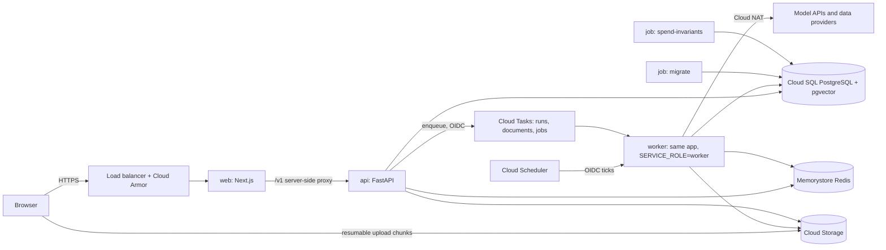

# Architecture

Account Intelligence (by 6th) researches a sales account and returns a sourced, graded brief,
people list and alerts. Each client is a sealed workspace (a tenant), and inside it every user's
accounts, files, chats and runs are their own. This page is the map: what runs, how a request
flows, how tenancy and private workspaces are enforced, and where each kind of data lives. It
points to the detailed documents instead of repeating them.

| For | Read |
| --- | --- |
| The Google Cloud layout, sizes, connections arithmetic and cost | `docs/deploy/ARCHITECTURE.md` |
| Deploy, rollback, secrets, restore, checks after a deploy | `docs/deploy/RUNBOOK.md` |
| Every environment variable, by profile | `docs/ENVIRONMENT.md` (generated) |
| Every route the web app calls, and what each does | `docs/WIRING.md` (generated), `docs/api/openapi.json` |
| Module boundaries | `docs/architecture/module-map.md` |
| Every loop and its cap | `docs/architecture/loops.md` (generated) |
| Decisions | `docs/decisions/ADR-*.md` |
| The product as the owner specified it | `docs/build/REPLICA_PROMPT.md` |

## 1. Services

| Service | What it is | Code |
| --- | --- | --- |
| web | Next.js 16 (App Router, server components). Renders every screen; proxies `/v1/*` and the operator API server side, so the browser talks to one origin; sets the per-request nonce CSP. | `web/` (`web/proxy.ts`, `web/app/v1/[[...path]]/route.ts`, `web/lib/gen/` generated client) |
| api | FastAPI. Sign-in, sessions and CSRF, every `/v1` route (tenant plane) and `/operator/v1` route (6th staff), rate limits, enqueues work. | `src/account_intelligence/api/` |
| worker | The same application with `SERVICE_ROLE=worker`: serves `/tasks/*` for Cloud Tasks and Cloud Scheduler only, runs research slices, document parts and research jobs, and the sweepers. | `src/account_intelligence/api/routes/tasks.py`, `src/account_intelligence/runs/`, `src/documents/`, `src/agents/` |
| migrate job | `alembic upgrade head` with the migrator identity, before each rollout. | `migrations/` |
| spend-invariants job | Nightly ledger checks. | `src/account_intelligence/worker/` |
| Parser sandbox | A child process per document part: isolated Python, resource limits, an audit hook and a seccomp filter that refuse network, processes and writes. | `src/documents/sandbox.py`, `sandbox_child.py` |

Locally the replica stack (`compose.replica.yml`) runs the same services on hermetic stand-ins:
the fake model (`LLM_FAKE=hermetic`), synthetic providers (`CONNECTORS=hermetic`), a dev object
store and a fake identity provider. The cloud profiles refuse every one of those switches at
start-up.

## 2. How a request flows

- **Pages and API calls.** The browser loads pages from web; client code calls `/v1/...` on the same
  origin. Web checks the origin (`web/lib/same-origin.ts`), caps the body, forwards only the
  session cookies and allowed headers to the api, and never forwards query strings to its logs.
  The api authenticates the session, checks CSRF on every state-changing call, and runs the
  route inside a database transaction bound to the caller's tenant and user.
- **Research.** A confirmed research creates a run and enqueues a slice on the `runs` queue. The
  worker runs one time-boxed slice of the agent graph per task (checkpointed in PostgreSQL), then
  enqueues the next, so a run survives restarts and can be resumed. Provider and model calls go
  through the research cache, the per-run dollar cap and the repeated-search stop. The builder and
  the quality gate produce the deliverables.
- **Files.** The browser uploads straight to Cloud Storage in resumable 32 MiB chunks (never
  through web or api). On completion the api scans and types the file, plans it into parts, and
  the worker reads each part in its own sandbox child, indexes the passages, and resolves which
  company the file is about.
- **Ask.** Answers stream back sentence by sentence, each checked against its sources; grounding
  reads the user's tracker facts, files and earlier deliverables, all within their workspace.
- **Scheduled work.** Cloud Scheduler calls the worker for the schedules tick, the nightly
  isolation check, access expiry and the mail-and-drive sync.

## 3. Tenancy and private workspaces

- Every tenant table carries `tenant_id`; most also carry `owner_user_id`. Row-level security is
  enabled and **forced** on all of them, with a policy that admits a row only when
  `tenant_id = app_tenant()` and `owner_user_id = app_user()` (migration 0063, the owner rule;
  `scripts/check_rls_catalog.sql` and the skill's migration lint enforce it).
- The application connects as `app_rw` (NOBYPASSRLS, owns no table). Each transaction sets the
  tenant and user from the verified session only; no route takes a tenant id from the request
  (`scripts/check_route_catalog.py`).
- Cross-tenant work (sweepers, schedules, spend checks) goes through SECURITY DEFINER lookups that
  return identifiers only, owned by NOLOGIN roles (`sweeper_definer`, `tombstone_writer`,
  migration 0070), then re-enters each tenant through its own transaction. Every such path is
  catalogued in `src/tenancy/catalog.py`.
- A new user starts with an empty workspace. Client admins see counts, never content; 6th staff
  see platform data and, with a client's grant, a read-only, audited "view as a client".
- Proof: the isolation suite (`tests/isolation/`, including the route matrix and the
  same-client second-user probes), and the nightly isolation check
  (`src/account_intelligence/replica/isolation.py`, the console's pill).

## 4. Where each kind of data lives

| Data | Where | Notes |
| --- | --- | --- |
| Accounts, runs, facts, people, signals, chats, limits, audit events | PostgreSQL tables, under forced RLS | `migrations/` |
| Research run state (agent graph checkpoints) | PostgreSQL (`CHECKPOINT_DATABASE_URL`) | lets a run resume |
| Document passages and their vectors | PostgreSQL with pgvector | indexed per owner |
| Uploaded files, while unscanned | Cloud Storage `quarantine/...` | lifecycle rule deletes abandoned ones |
| Upload chunks in progress | Cloud Storage `uploads/...` and the session URL in the uploader's browser (per user, cleared at sign-out) | lifecycle rule for abandoned sessions |
| Accepted files | Cloud Storage `tenants/{tenant}/documents/{id}/raw` | read by the worker from a read-only mount |
| Raw provider responses | Cloud Storage `tenants/{tenant}/accounts/{account}/runs/{run}/raw/` | never in downloads |
| Deliverables and exports (Download everything) | Cloud Storage `tenants/{tenant}/...runs/...`, `tenants/{tenant}/exports/{job}/` | links work for an hour |
| Research cache index, rate limits | Memorystore Redis | no tenant content |
| Secrets (model and provider keys, session and CSRF keys, OAuth client secrets) | Secret Manager, one reader per secret | names in `docs/deploy/RUNBOOK.md` 1.4 |
| Audit archive | A separate bucket with a 7-year retention (locked by the owner) | Phase 5 wires the export |
| Logs | Cloud Logging; prompts, document text, emails and tokens are never logged | `src/obs/logging.py`, `src/obs/scrub.py` |
