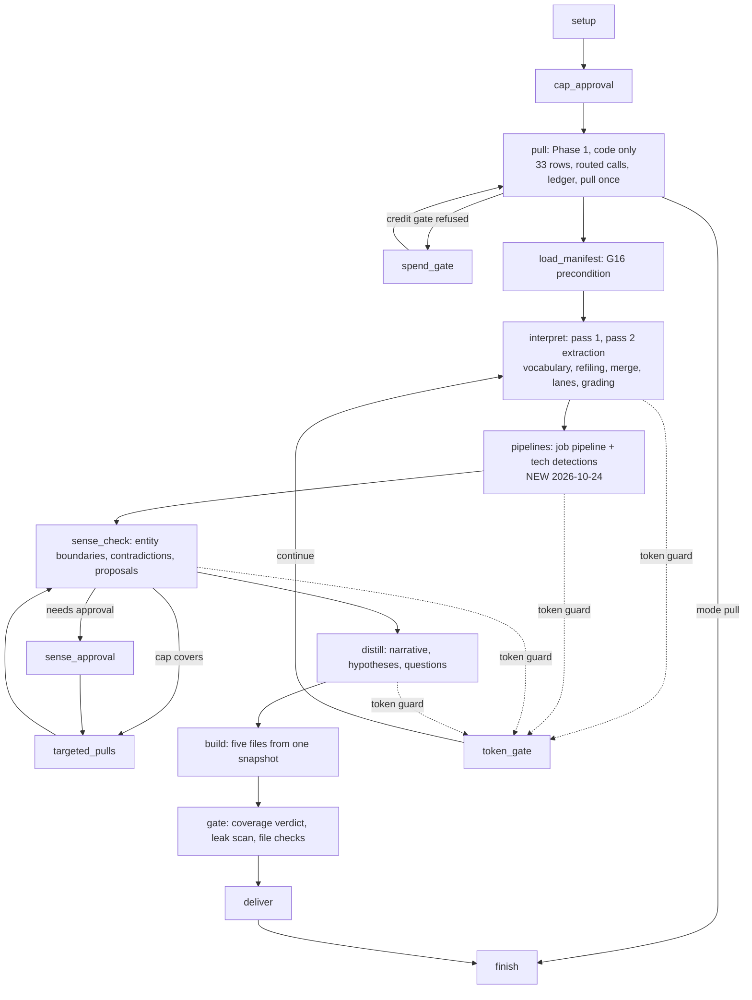
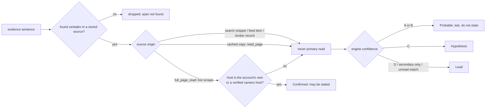
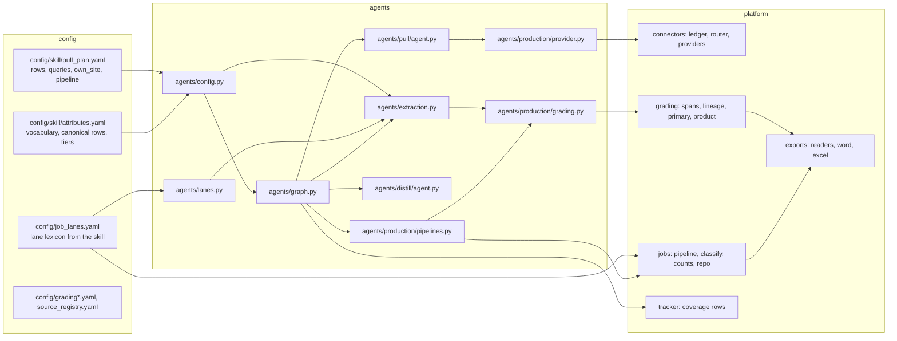

# Web research: architecture audit and rebuild (2026-10-24)

This document audits the research run end to end against the owner's ABM account research
skill (v1.11 plus the companion session document), names each defect found with its evidence,
and records what was rebuilt. Every diagram is of the code as it is after the rebuild; the
"before" state is described in the defect table. Diagrams are Mermaid (render in GitHub, VS Code
or any Mermaid viewer).

## 1. What the skill does, and where the platform does it

| Skill step (checklist.md section 3) | Where it runs now | Owner |
| --- | --- | --- |
| 1 Read the checklist, lessons, tools | `agents/skill_context.py` puts the skill text into every model call's cached system block | code |
| 2 Confirm account and domain, resolve the careers site by visiting it | `setup` node; `interpret._careers` picks a visited page; `pipelines` records it (`datamodel.careers`, visited never constructed) | code + model choice among visited pages |
| 3 Pass 1 summary homework (five rows) | `pull` (Phase 1, code only) then `interpret` pass 1 extraction | code + extractor model |
| 4 Company baseline, newsroom, leadership page, releases re-opened | `pull`: own-site searches and full reads for `own_site` rows (`pull_plan.yaml`), newsroom queries beside the news feed (**new**) | code |
| 5 News: releases, structured feed, targeted searches | `pull`: `structured_signals` feed + own-site newsroom reads; `sense_check` proposes targeted pulls; `targeted_pulls` runs them | code + planner model |
| 6 Jobs: board per lane keyword, 12 months open and closed, platform sentences read, classified | `pipelines.run_jobs` → `jobs.stage.run_jobs` (**new in the ABM graph**): lexicon from the skill, Build / Admin and owner / Working tool / User, counts from rows, one graded claim per classified posting and platform | code + extractor for ambiguous postings |
| 7 Tech stack: detections with first and last seen | `pipelines.write_detections` → `tech_detections` rows (**new**); a date range is a lead by rule | code |
| 8 People (title search, merge, level, lane, priority), 8a profiles, 8b executive voice | People pipeline runs in the `pipelines` node under the tenant's consent (**switched on 2026-10-24**): association search per lane, merge, scope, counts, the People List; title search waits on a BitScale grid, profiles and posts on a connector operation; executive voice runs as pass 2 rows with own-site reads | code + consent |
| 9 Person-name searches (speaking, podcasts, video, articles) | `person_searches` node: the executives the reading step found are searched by name for the speaking, podcast and video rows (fixed templates, at most ten people); the people list itself is still off | code (**new**) |
| 10 Review sites, vendor communities | pass 2 rows, open web searches | code + extractor |
| 11 Distill: grade every line, hypotheses with a confirming question, first-call questions | grading engine (code) + `distill` (planner model, every claim tied to fact ids; narrative states only Confirmed facts, asks the rest) | code + planner model |
| 12 Build the standing files | `exports` (Summary, Evidence, People, Jobs, Tech workbooks, workspace zip) from one snapshot | code |
| 13 Pre-delivery gate | `gate` node: coverage verdict, leak scan, dash and phrase checks, row checks; file-level defects withhold that file only | code |
| 14 Deliver once | `deliver` node (never outreach) | code |

## 2. The run graph after the rebuild



## 3. How one coverage row travels

```mermaid
sequenceDiagram
    participant Pull as pull (Phase 1)
    participant Prov as ConnectorProvider
    participant Led as connector ledger
    participant Pay as payload store
    participant Ext as extractor model
    participant Code as agents.extraction
    participant Eng as grading engine
    participant Doc as exports
    Pull->>Prov: call(need, query, row)
    Prov->>Led: open web search
    Prov->>Led: full reads of own pages (scrape, live)
    Prov->>Led: first off-site pages (page read)
    Prov->>Led: own-site search + full reads (own_site rows, NEW)
    Led-->>Prov: records with URLs and text
    Prov->>Pay: one payload per source item
    Pull->>Pull: manifest row: queries, call refs, cost
    Note over Ext,Code: Phase 2
    Code->>Ext: group of payloads + attribute vocabulary (NEW)
    Ext-->>Code: candidates (attribute, value, quotes, event_date, lane)
    Code->>Code: G4 quotes verbatim; attribute → canonical row;<br/>merge repeats; infer lane from platform names
    Code->>Eng: proposals (attribute key class.row.attribute)
    Eng->>Eng: verify URL + span in stored source; tier; primary read?; grade
    Eng->>Doc: facts with lane and event_date (NEW)
```

## 4. Grades and why Confirmed was unreachable



Before the rebuild a run's open web searches rarely returned the company's own pages, and the
three generic phrasings per row were built from the row label. The quidelortho run of
2026-10-12 (run 2dab4361, 185 facts) had evidence origins: 138 feed items, 35 search snippets,
12 cached copies, zero full page reads of a primary host. Result: zero Confirmed facts, so the
narrative could state nothing and the Summary opened with questions. Own-site rows now search the
account's own site for every query and read the pages found in full (live scrape, origin
`full_page_read`), which is the one path to Confirmed.

## 5. Defects found and what changed

| # | Defect (evidence) | Cause | Change |
| --- | --- | --- | --- |
| 1 | Zero Confirmed facts in every run (run 2dab4361: 0 of 185; Tolmar and athenahealth runs the same) | Open web searches seldom return the company's own pages; only a live scrape of a primary host counts | `own_site` rows (`config/skill/pull_plan.yaml`): own-site search per query and full reads; newsroom and leadership queries beside the feeds (`agents/production/provider.py`) |
| 2 | The same headquarters fact four times under four rows; the CEO under "lead verification"; the COO under three attribute names | The model named attributes freely and filed facts under the row the page was pulled for | Attribute vocabulary with canonical rows (`config/skill/attributes.yaml`, 68 attributes), refiling, merge of repeats within a call and across groups (`agents/extraction.py`, `agents/graph.py`) |
| 3 | Every Summary lane table row under "Unassigned lane" (facts.lane NULL for all 185) | No code wrote the candidate's lane; the grading proposal dropped it | Lane and event date written with the fact's insert (facts are append-only); lane inferred by code from platform names when the model gave none (`agents/lanes.py`, `grading/repo.py`) |
| 4 | Job Postings workbook empty after an ABM run; postings became count facts ("openings.engineering.count = 7") | The job pipeline (classification, counts) ran only under Workflow v1; the ABM graph fed feed text to the extractor | `pipelines` node runs `jobs.stage.run_jobs` with the engine grading its claims; posting rows are not read by the extractor (`agents/production/pipelines.py`) |
| 5 | MuleSoft, S/4HANA, Vault, Power BI never matched a posting; Salesforce lane label still names ServiceMax | `config/job_lanes.yaml` had bare platform names and no keywords (D-17 TODO) | Lexicon from the skill: aliases per lane, board keywords, ServiceMax, Siebel and Databricks never terms. The client-facing label stays (owner decision D-100) |
| 6 | Tech Stack workbook always empty; detections appeared as "technology.detected = Workday" lead facts, duplicated, without dates | Nothing wrote `tech_detections` | `pipelines.write_detections` writes dated rows from the feed, registers the evidence page as a source |
| 7 | Reading step spent most of its calls on job descriptions and detection text (Tolmar: 121 extraction calls) | Pipeline rows were extracted like any other | Pipeline rows skipped by `extraction.groups` |
| 8 | No dates or tiers on facts; the narrative could not order news | FactCandidate carried no date; tiers lived only in prose | `event_date` on candidates (stored in `facts.value_json`), tier from the vocabulary; both given to the sense check and distill (`StoredFact`) |
| 9 | Distill prompt had no section order | Prompt said "a short narrative" | Prompt follows output-spec.md: account picture, what stands out (tier 1 and 2, newest first), lane meaning marked as interpretation, how it could be wrong, how to sharpen |
| 10 | Posting feed pulled twice (Phase 1 and the job pipeline) with different keys | Day-anchored window in the pipeline, month-anchored in the provider | Both anchored to the run's month (`jobs/adapters.py`, `provider.as_of`) |

## 6. What is still open (needs the owner)

1. **People by title, profiles and posts.** The people step is on (consent gated; the Team page grants it), but the active people source is Sumble: people come from the association search per lane. BitScale's external API runs pre-built grids only, so people by title (the skill's first source) needs a grid configured in the BitScale workspace and its id supplied; profiles and posts need a connector operation with a sourced contract.
2. **Lane label.** `config/lanes.yaml` still says "Salesforce (including field service such as ServiceMax)" in client files; the skill removed ServiceMax from scope on 2026-09-29 (D-100 is the owner's call because it changes the export rules hash).
3. **`read_page` as a primary read.** The grading policy treats an extract read as a cached copy (minimum live fetch age 600 s), so a results release read off the company's domain (a wire service, sec.gov) can be Probable at best. The source registry has no T1 entries for filings or wire hosts (D-15). Scraping those hosts live would make them Confirmed; the decision is the owner's.
4. **Workday and other non-lane platforms.** The skill's Platform Ranking sheet ranks every platform named in postings; the lexicon covers the six lanes. Workday is not a lane and is not counted.
5. **Phase B internal history** (prior customer status, alumni) stays Blocked `no_internal_access` until the connector search binding exists (D-98).

## 7. Code map of the research core



## 9. The skill-built workspaces against the platform's exports (uploads of 2026-10-24)

Four archives were compared: two workspaces built by hand with the skill on claude.ai (Vizient,
phase 1 and 2, September 2026; McKesson phase 1, October 2026) and two platform outputs
(the QuidelOrtho "everything" export of 21 October; the Tolmar deliverables of 21 October).

### What the skill-built runs do, step by step, and where the platform stands

| Skill-built run (Vizient, McKesson pull logs) | Platform today | Connector |
| --- | --- | --- |
| Site map of the newsroom (limit 300), the release list scraped, 4 to 52 releases read in full, dated files per release | Own-site search per query and live full reads of the pages found (new); no site map operation in the connector layer | Parallel search + Firecrawl scrape |
| Leadership page scraped; every executive named with title | Own-site leadership queries beside the feed (new); executives become `executive_role` and `appointment` facts | Firecrawl scrape |
| SEC 10-K, 10-Q, proxy, 8-Ks and four earnings calls read; every figure re-read in the release | A filing on sec.gov found by a search is scraped live (first tier, can be Confirmed, new); transcripts on other sites are page reads; not read as a set | Firecrawl scrape, Parallel extract |
| Lane vendor partnership search for 7 to 19 vendors, each logged even when empty | One query per lane vendor on the vendor account team row, each recorded in the manifest (new) | Parallel search |
| News feed, detections feed, 12-month job openings with descriptions, company record with subsidiary domains, connections; subsidiary domains pulled too | News, detections and postings feeds pulled once; company record and subsidiaries not pulled | PredictLeads |
| Careers board verified by visiting; keyword sweep per lane keyword (14 to 48 keywords) on every board; every primary-lane posting read (Vizient: 40 of 40) | Job pipeline now inside the run: board search per lane keyword on the verified host, every matched posting read up to the read cap, four classes, counts from rows (new) | Parallel search + Firecrawl scrape + PredictLeads |
| Keyword counts per lane and tower on posting text, open versus closed | The pipeline's counts per platform, open and closed | code |
| Hidden-title postings: 26 descriptions bought and read because the lexicon matched the body, not the title | The pipeline matches the description, not only the title, with the skill lexicon (new) | code |
| People: two title sources (leadership and platform titles; manager titles), domains only, no seniority filter; 167 + 58 (Vizient), 738 + 235 + 1,528 + 241 (McKesson); gap check per lane; profiles for every senior person; posts for Director and above | On under consent (new): association search per lane through Sumble, merge, scope, People List; title search waits on a BitScale grid, profiles and posts on a connector operation | Sumble (active), BitScale (grid needed) |
| Sense check in writing: entity boundaries (a different Vizient in Iowa; Kaufman Hall as an adjacent CRM; member hospital ERPs are not the account's SAP), legacy employers, duplicate names, program names | Sense check node over graded facts with typed findings; it does not see the people rows or the posting entity labels | planner model |
| Person-name searches: 5 (Vizient) to 119 people x 3 queries (McKesson), events (HLTH, Dreamforce, Knowledge), former executives checked by name | The executives found in the reading step are searched by name for speaking, podcasts and video (new); events and former executives are not | Parallel search |
| Deliverables built from files by scripts, gate scripts run, workspace zip | Builders from one snapshot, gate in code | code |

### What the platform's exports showed

* Tolmar Account Summary (21 October): three narrative sentences; every lane row listed twice
  (L-0001 and L-0002 both "recruiting.ultipro.com"); confirming questions generated from the
  attribute key ("What would confirm the careers.job board host for this account?"); the Job
  Postings, People List and Tech Stack workbooks empty ("None found").
  Fixed: repeats merge in extraction and collapse in the Summary; a Confirmed row carries no
  question; the question text names the finding in plain words; the job pipeline and the
  detections writer fill two of the three workbooks (the People List waits on the people step).
* QuidelOrtho export (21 October, a jobs-scope refresh): 4,706 postings, nearly all "Other, Not
  profiled" (the old lexicon matched almost nothing); the same generic query repeated three
  times across days; the Tech stack table carrying "1", "3", "6" as technologies and the
  People table 5,913 rows of education JSON and skills strings, both imported from the
  uploaded workbook with misread columns.
  Fixed: the lexicon; the deliverable import refuses a key cell that is not a name or a
  technology (numbers, JSON or list literals, long comma lists).

### Still different by decision

The people step (title searches, profiles, posts, person-name searches that follow from it),
the subsidiary domains, the filings and earnings calls as a read set, and the site map of the
newsroom are the remaining gaps between a skill-built run and the platform. The first needs
the owner's decisions listed in section 6; the other three are connector work the audit
recommends next.

## 10. Caps and timeouts with the research caps off

Owner order of 2026-10-24: nothing the platform controls may stop a research. One switch,
`RESEARCH_CAPS=off` (set on the staging worker and api), now lifts every cap in the table; the
hard limits of the cloud platform remain and are handled by the slice loop.

| Cap or timeout | With the caps off |
| --- | --- |
| Run credit budget, tool-call cap, platform dollar cap, repeat-call limit, credit pool, plan limits | Lifted (since 2026-10-21) |
| Pagination (pages, items, bytes per feed) | Lifted |
| Posting reads and extractor calls, people, profiles, posts, technologies per lane | Lifted |
| Agent token, call and time budgets; slice count | Lifted |
| Token-guard pause at three times the estimate | Off (new; `TOKEN_GUARD=on` keeps it) |
| Provider HTTP read and total timeouts | 900 s and 1200 s or more (new) |
| Rate-limit wait and cooldown | 1800 s (new) |
| Asynchronous provider jobs | 10,000 polls within 7200 s (new) |
| Retries of a retryable provider error | 10, the config ceiling (new) |
| Off-site pages read per search; text kept per page | Every page the search returned; 120,000 characters (new) |
| Person-name searches | Every executive found (new) |
| Export row caps | Ten times higher (new) |
| Cloud Run request | 3600 s on api, worker and web (the platform maximum) |
| Cloud Tasks dispatch | 1800 s (the platform maximum): a run is sliced at 1650 s and resumes from its checkpoint |
| Cloud Tasks retries of a failed slice | 5 today; `gcloud tasks queues update ai-staging-runs --location us-central1 --max-attempts=unlimited` lifts it |
| One model reply | 21,000 tokens, from the provider's ten-minute non-streamed request limit; a cut-off reply is asked again from where it stopped |

## 11. The live runs of 2026-10-24 and what each stop taught

| Time (UTC) | Stop or error | Cause | Closed by |
|---|---|---|---|
| 05:42, 05:58, 06:11 | reading step crashed | facts are append-only; lane written by UPDATE | lane and event date on the INSERT (rel-47ca28f) |
| 07:25 | `NotOwner` in the sense check | gate downgraded a row it did not own | `mark_partial` leaves Not done and None rows alone (rel-3423b63) |
| 08:15 | 30 `llm.batch_wait_cancelled` | slice boundary at 1650 s | expected: 26 batches re-attached and finished in the next slice |
| 07:58 to 08:20 | 4 bare `RuntimeError` | async generator closed while running (batch results stream, metrics task) | results stream drained and closed; scrubber names the library frame and logger |
| 08:38 | `exports.build_failed missing_url` | a detection without a public evidence page failed the set | rows without a link are withheld per file and counted; the set is delivered |
| whole run | 12 postings, 0 read | no feed text matched the lexicon; unmatched postings are never read | excerpt reads when caps are off; a read needs a link; the event states matched and exits |

The export rule that changed: B4 (every row cites a registered source) is kept by omission,
never by invention. A posting, detection or person without a public link, or whose link the
source registry never saw, is left out of its workbook, listed in the manifest as
`<file>:<row>:<rule>`, and counted on the Counts sheet ("Postings not listed (no posting
link)", "Detections not listed (no public evidence page)", `people.withheld`). A stored source
code the registry does not know still fails the build.

## 12. The master prompt v2 against the platform (2026-10-24, evening)

The owner's "Madrid ABM account research master prompt v2 (gap closing)" and the helper zip
are the specification. Section by section, what the platform does now and where it does it.

| Prompt | Platform | Where |
|---|---|---|
| 0 Fixed scope: lanes, also tracked, never report, windows, seniority, exclusions | one config file, read everywhere | `config/skill/scope.yaml`, `SkillConfig.scope` |
| 1.1 and 3 Entity lock before any pull; `accept()` on every record; look-alikes | graph node `entity_lock` after `setup`; home page read live, brand search; mismatch ends the run unpaid; allowed domains and blocked hosts travel in `RunContext`; stored on `accounts.entity_lock` | `agents/entity.py`, `agents/graph.py`, `production/provider.entity_lock`, migration 0083 |
| 1.2 A snippet is not a record: real names, dates from the page | `people.names.looks_like_person`; scraped pages carry `publish_date`; a calendar date is a dateline, a zone-less time is untrusted | `people/pipeline.py`, `connectors/providers/p_scrape.py`, `grading/adapters.record_published` |
| 1.3 Read before you count | unchanged: Confirmed needs a live full read of a T1 host; matched postings are read; with the caps off, short feed texts are read too | `grading/primary.py`, `jobs/pipeline.py` |
| 1.4 and 10 Dedupe keys | sources by canonical URL (utm, fragments, trailing slash removed), people by profile URL then name, postings by job id or URL, detections by technology and dates, queries by the ledger key | `account_intelligence/urls.py`, `people/merge.py`, `jobs/dedupe.py`, `connectors/ledger.py` |
| 1.5 Grade every line | product grades Confirmed, Probable, Hypothesis, Lead from the engine | `grading/product.py` |
| 1.6 and 11 Tracker Done only with proof; consistency rules | tracker rows derive from evidence; the five consistency rules are applied before export (this pass) | `account_intelligence/tracker/` |
| 1.7 Every fact carries its URL | B4, now by omission: a row without a public link is withheld per file, never invented | `exports/readers/common.code_or_withhold` |
| 1.8 A lead is not dead after one search | every Lead's state from the run's own queries (3 distinct, 2 tools) | `grading/leads.lead_states_from_fetches`, `production/grading._lead_states` |
| 1.9 Absence is weak evidence | an absence fact is a Hypothesis at most (unchanged) | `grading/product.py` |
| 1.10 Aggregator claims are claims | T2 feeds and unlisted hosts never make a fact Confirmed | `grading/lineage.py`, `config/source_registry.yaml` |
| 1.11 Sensitive items | the fixed caution sentence; alerts never raise them | `config/export_rules.yaml`, `alerts/sensitive.py` |
| 1.12 No tool names or credits in client files | third-party scan on every file, the word credits fails the build (this pass) | `exports/verify.py` |
| 1.13 and 14 Writing rules, counts with bases | D-24 prose rules, NumberRegistry | `exports/policy.py`, `exports/readers/common.py` |
| 7.3 Platform ranking | the Platform Ranking sheet, first in the Tech workbook, from the posting dictionary | `config/platform_dictionary.yaml`, `exports/readers/tech.py` |
| 9.1 to 9.5 The five files | section order, parts and columns as specified (this pass) | `exports/word/compose.py`, `exports/excel/*` |
| ServiceMax, Siebel, Databricks | never a search term or lexicon entry; masked in every client file; the Salesforce lane label no longer names ServiceMax (supersedes D-100) | `config/skill/scope.yaml`, `config/lanes.yaml`, `config/job_lanes.yaml` |

Still the owner's: the BitScale grid for people by title (P6 title search), profiles and
posts operations (P7, P8), the client's reference list (P1, tracker row), Drive folders for
internal history (P1), and whether the Ask harness keeps Databricks in its own lexicon.

## 8. Verification

Test runs of 2026-10-24, pasted from the terminal (private scratch databases, `-m "not eval and
not live"`):

| Run | Result |
| --- | --- |
| Complete offline suite on the deployed tree (rel-47ca28f) | 4851 passed, 1 skipped, 7 deselected, 1 xfailed in 30:46 |
| Web type check and unit tests | tsc clean; 233 passed in 42 files |
| Provider connections (live probe with the staging keys) | Parallel, Firecrawl, PredictLeads, BitScale, Sumble, Anthropic, Ollama Cloud: all answered |

Staging after the rollout: api 00083-cqk, worker 00062-49m, web 00046-nj8 (all Ready), the
migration job executed once and succeeded, `/v1/models` answers 401 and the home page 307 to
sign-in. The earlier rollout of rel-7f0c8c6 (worker 00061) crashed every research at the
reading step on the append-only rule; its two stops on 2026-10-24 (05:42 and 05:58 UTC) were
that defect, now fixed.
