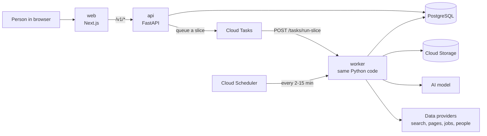

# 1. What this project is (in plain words)

*Part of the [project guide](README.md). Written 2026-10-29 from the code as it stands.*

## The one-minute version

**Account Intelligence** (the folder is called "ABM Generator") is a web application for sales
teams. A person signs in, types the name of a company they want to sell to, and the platform:

1. **researches that company** on the public internet and in the person's own files,
2. **checks and grades every fact** it finds (is it proven, likely, or only a hint?),
3. **hands back finished files**: a Word brief, Excel sheets (people, job postings, technology,
   news), and a zip with everything,
4. lets the person **ask questions** ("Ask") over everything it found, with numbered sources,
5. **re-checks** the company on a schedule and tells the seller what changed.

"ABM" means *account-based marketing*: selling to a chosen list of companies instead of to
everyone.

Every customer ("tenant") is sealed off from every other customer. This is enforced by the
database itself (row-level security), not just by application code.

## The three programs that run

The same code base is built into **three services** on Google Cloud (project `abmgenerator`,
region `us-central1`):

| Service | What it is | What it does |
|---|---|---|
| **web** | the website (Next.js, in `web/`) | The screens. The browser talks only to this. It passes `/v1/*` calls on to the API. |
| **api** | the Python server (FastAPI, `src/account_intelligence/api/`) | Checks who you are, reads/writes your data, starts research, answers questions. |
| **worker** | the *same* Python code, run as a worker | Does the slow background work: research runs, reading uploaded files, scheduled jobs. Google Cloud Tasks and Cloud Scheduler send it work. |

Plus one small **migration job** that updates the database layout before every release.

Behind them: **PostgreSQL** (Cloud SQL) holds all data; **Cloud Storage** holds files and raw
downloads; **Redis** holds rate limits and a lookup index; **Secret Manager** holds keys; an
**AI model** (Claude, and optionally Kimi/Grok) does the reading and writing; and several
**data providers** (web search, page reading, news/job/tech feeds, people lookup) supply facts.



## Words you will meet

| Word | Meaning |
|---|---|
| **Tenant** | one customer company using the product. Their data is invisible to others. |
| **Account** | a *target company* being researched (e.g. `bd.com`). |
| **Job** | the customer's request "research this account". Table `research_jobs`. |
| **Run** | one attempt to carry out a job (`account_runs`). A job can have several runs (resume creates a new run). |
| **Slice** | a run is cut into ~27-minute pieces (1650 s) so no single request lives too long. Progress is saved between slices. |
| **Checkpoint** | the saved state of the research graph (in Postgres) after every step. A crash loses at most the step in flight. |
| **Ledger** | the database record of every outside call and what it cost. Calls already paid for are never paid twice. |
| **Fact** | one thing learned about a company, with its source and grade. |
| **Grade** | how much to trust a fact: **Confirmed** (read at the source this run), **Probable**, **Hypothesis**, **Lead** (a hint). Only Confirmed may be stated to a prospect. |
| **Gap** | a checklist row the research could not fill (shown honestly, not hidden). |
| **Credits** | the customer's allowance for research. 1 credit = $0.05. |
| **Caps** | spending/time limits. Currently **all research caps are switched off** on staging (`RESEARCH_CAPS=off`). The no-progress cut-off stays on. |
| **Operator / 6th staff** | the company's own staff, on a separate admin plane. |
| **Hermetic** | a fully fake mode (fake model, fake providers) for tests and demos. Nothing paid can happen. |

## What lives where (top level of the repository)

```
ABM Generator/
├── src/            all the Python code (see 03-code-map.md)
├── web/            the website (Next.js + TypeScript)
├── config/         ~70 YAML files: rules the code reads as data (see 04-config-map.md)
├── migrations/     the database layout, numbered SQL steps 0001 to 0085 (0069 is skipped)
├── infra/          Terraform: what Google Cloud builds
├── docker/         how the three images are built
├── tests/          automated tests (synthetic data only)
├── scripts/        generators, gates and helper tools (never run in production)
├── ops/ evals/ runtime/   local tools, golden-data evaluations, render tools
├── docs/           the detailed technical documents (this guide is docs/guide/)
├── unwanted-things/   a parking lot: files moved out, never deleted
└── README.md  PROJECT_STRUCTURE.md  DEPLOYMENT.md  RUNBOOK.md  BUILD_LOG.md ...
```

## Where to go next

* How one research actually runs, step by step → [02-how-a-research-runs.md](02-how-a-research-runs.md)
* Which code does what → [03-code-map.md](03-code-map.md)
* Which setting controls what → [04-config-map.md](04-config-map.md)
* Run it, test it, release it, debug it → [05-running-and-deploying.md](05-running-and-deploying.md)
* What is broken or unfinished → [06-known-problems.md](06-known-problems.md)
