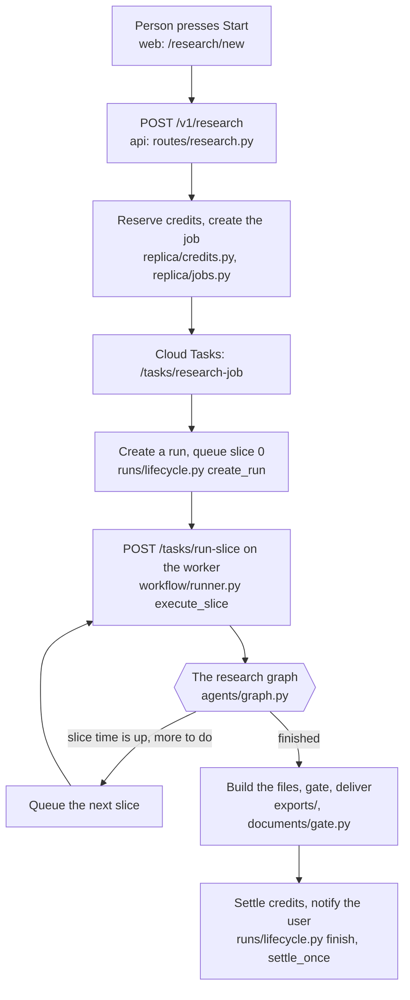
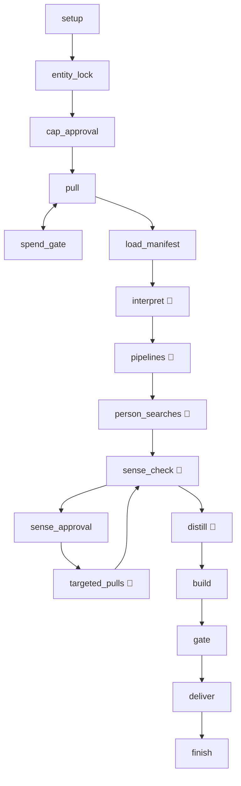
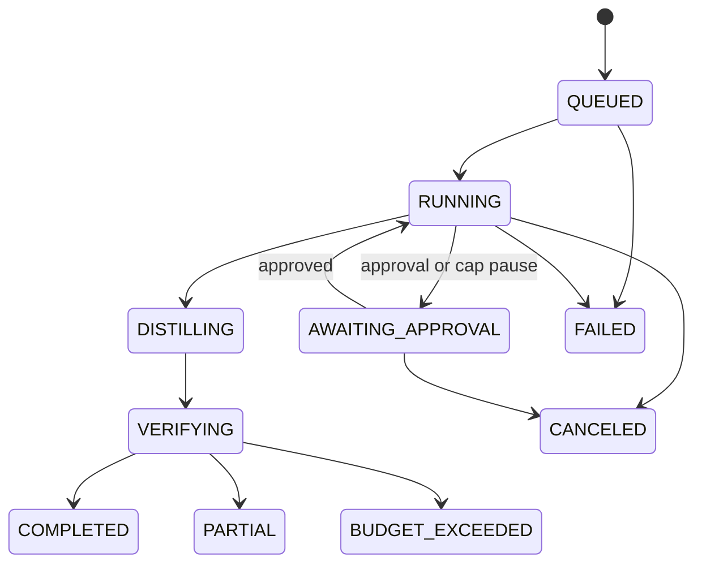

# 2. How one research runs, step by step

*Part of the [project guide](README.md). Written 2026-10-29. Each statement comes from reading the
code; the file or function is named so you can check it.*

## 2.1 The whole story in one picture

## 2.2 Starting: from the click to slice 0

1. **The screen.** `/research/new` in the web app. The user types a company (or uploads a file) and
   sees an **estimate** of credits, tokens and dollars (`GET /v1/research/estimate`).
2. **Confirm.** `POST /v1/research` (`api/routes/research.py`). In one database transaction it
   checks the user's monthly allowance, checks the estimate has not changed (otherwise 409,
   "estimate changed", and the user confirms again), adds the account, and **reserves credits**
   (`replica/credits.py`). The result is a row in `research_jobs` with status `queued`.
3. **Hand to the worker.** `replica/jobs.py` queues a Cloud Task for `/tasks/research-job`.
4. **Create the run.** The worker's `run_job` creates a **run** (`runs/lifecycle.py` `create_run`)
   with the scope, topic, models and the token estimate in its `run_input`, seeds the 33-row
   coverage checklist (`tracker/`), then queues **slice 0** as a named Cloud Task
   (`run-<run>-slice-0`). A duplicate name counts as success, so queueing is safe to repeat.

## 2.3 Slices: how a long job fits inside short requests

Cloud Run requests and Cloud Tasks deliveries are short-lived (a delivery must end inside 1800 s).
Research takes hours. So a run is cut into **slices** of **1650 s** (27.5 minutes), set in
`config/workflow_v1.yaml` (`slice_seconds`). Progress is saved to a Postgres **checkpoint** after
each graph step, so the next slice carries on where the last stopped.

What `execute_slice` (`workflow/runner.py`) does with each delivery:

1. **Take the run lease** (`run_leases`, 1800 s). Only one worker may drive a run. If another holds
   it, answer "busy" (HTTP 503) and Cloud Tasks tries again later. If the slice already began
   (a stale redelivered copy of a slice the run has moved past), answer "noop" (200) and the task
   is dropped. If this slice began but its first copy died with the worker (no later slice begun,
   run still active), the redelivery **resumes** it from the checkpoint (log `slice.resumed`).
2. **Begin the slice**: `begin_slice` adds 1 to `slices_used` in a way that a stale copy cannot
   repeat. A terminal run is a noop; a run waiting for approval waits.
3. **Run the graph under a timer** of `slice_seconds`. It resumes from the checkpoint.
4. **If the timer fires** (`_timed_out`): the slice counts as **progress** if the checkpoint moved
   *or* the run stored new model replies. Otherwise it counts as **empty**.
   **Three empty slices in a row end the run** as `PARTIAL`, reason `no_progress`
   (`max_no_progress_slices`). Everything found so far is kept. This stays on even with caps off.
5. **Queue the next slice** (after releasing the lease), or **end the run** if the graph finished.

Paid calls are written to the **ledger** before they are made, so a slice that dies loses at most
the call in flight, and the next slice **replays** finished calls for free
(`connectors/ledger.py`). Model replies are replayed the same way (`llm/reply_cache.py`).

## 2.4 The research graph (what actually happens)

`agents/graph.py` builds one graph. Boxes with a model call are marked 🧠; the rest is plain code.

| # | Node | What it does in plain words | Model? |
|---|---|---|---|
| 1 | **setup** | Checks the customer's saved settings are valid and picks the careers page from pages already visited. | light |
| 2 | **entity_lock** | Reads the company's own home page and refuses a domain whose home page does not name the company. Stops the run *before any money is spent* if it is the wrong company. (Born from a run that researched the wrong look-alike company.) | no |
| 3 | **cap_approval** | Confirms the spend cap before the first paid call. Skipped in build-only mode. | no |
| 4 | **pull** (Phase 1) | Plans every checklist row, then fetches them side by side through the providers and **stores the raw pages**. No reading, no grading. A row that takes longer than **540 s** is given up on: a row a code pipeline owns (jobs, tech) is handed to that pipeline, which finishes the pull later (`owned_by_pipeline`); any other row becomes a named gap (`provider_slow`). Writes the *manifest* (what was pulled per row). | no |
| 5 | **spend_gate** | If a paid call was refused by the cap in an attended run, pause and ask. | no |
| 6 | **load_manifest** | Checks the pull is complete and not stale before Phase 2 starts. | no |
| 7 | **interpret** | **The reading step.** Drops pages that are not about the company, then asks the model to extract facts, one call per source group, up to 32 at once. The quote must appear **word for word** in the page. Each finding is **graded by code** (see 2.6) and saved. | yes (strong) |
| 8 | **pipelines** | Three code pipelines: **job postings** (`jobs/`), **technology detections**, **people list** (`people/`, only with the customer's people-data consent). | classify |
| 9 | **person_searches** | Searches speaking, podcast and video appearances by the *names* of the executives found (max 10), never by company name. | yes |
| 10 | **sense_check** | A second look across all facts for contradictions and wrong-company mix-ups; proposes follow-up pulls. | yes (planner) |
| 11 | **sense_approval** / **targeted_pulls** | If follow-ups need approval, ask; then run them and read them, and sense-check again. | yes |
| 12 | **distill** | Writes the narrative, hypotheses and first-call questions **from graded facts only**. Only Confirmed facts may be stated as fact. | yes (planner) |
| 13 | **build** | Builds the client files. If there are no graded facts, ends as `no_new_findings`. Scans every file for tool, provider and person names (a hit is a failure). | no |
| 14 | **gate** | The quality gate. A run-level failure holds every file; a **file-level** failure holds only that file (`files_withheld`) and the rest is delivered. | no |
| 15 | **deliver** | Releases the files that passed. Completed only if nothing was withheld and every row is Done, None or a stated gap. | no |
| 16 | **finish** | The only place the credits are settled (once). | no |

`token_gate` can interrupt after any model step: when the next paid call would pass **3×** the
pre-run token estimate, the run pauses and asks. It asks for attended and unattended runs alike,
and stays on even with caps off.

Run **modes** (`agents/modes.py`): `full` (pull then build), `pull` (stop after Phase 1), `build`
(Phase 2 only, on an earlier run's pull).

### Which engine runs a research?

Two engines exist. The **ABM graph** above runs everything started by the research-job engine
(this is the product path). The older **Workflow v1** (`workflow/engine.py`, 13 stages from
`config/workflow_v1.yaml`) is still used for plain `POST /v1/runs` full runs unless the tenant flag
`abm_agents` is on (`agents/production/wiring.py` `uses_abm`). `parallel/` and `verify/` are used
only by Workflow v1.

## 2.5 The states of a run

`COMPLETED`, `PARTIAL` and `BUDGET_EXCEEDED` can only be reached from `VERIFYING`
(`runs/transitions.py`); `FAILED` and `CANCELED` from any active state. **PARTIAL means "stopped
early but kept everything found"**; **FAILED** means nothing usable. All ends go through one
function, `runs/lifecycle.py finish`, which also settles credits (never charging more than the
real spend, and never more than reserved).

## 2.6 How a fact gets its grade

The model proposes; **code decides the grade** (`account_intelligence/grading/`). For each
finding:

1. The cited page must be one this run stored, and the **quote must appear verbatim** in it.
2. The value must be in the quote. Hostile text (a page trying to instruct the model) drops it.
3. The source is rated by tier (T1 first-hand company pages … T4 unknown) and freshness, and sources
   from the same origin count once. This gives an engine score A–D.
4. **Product grade**, first rule that fires wins (`grading/product.py`, order in
   `config/grading_policy.yaml`):

| Grade | When |
|---|---|
| **Confirmed** | read in a first-hand (T1) page *this run*, quote verified |
| **Lead** | a keyword/date match that was **not read** this run (even if sources conflict), or only a data-feed/aggregator source, or a weak score |
| **Probable** | good score (A or B) without a first-hand read |
| **Hypothesis** | middling score, a synthesis, or a proven absence |
| **Internal Only** | built from the customer's own files |

A second model checks the claim against its quote (**the judge**); it can only lower a grade.
Guard **G2** raises an error if code ever gives an unread match any grade except Lead, which is
what ended a run on 2026-10-28 (the conflict rule had been promoting such a claim to Probable;
fixed the same day).

## 2.7 The ways a run can stop

| How it ends | State | Reason code (examples) | Does the system restart it? |
|---|---|---|---|
| Finished normally | COMPLETED | | |
| Finished, some files held back | PARTIAL | `files_withheld`, `gate_failed`, `build_failed:*` | no |
| Three empty slices | PARTIAL | `no_progress` | no — the owner presses **Resume** |
| Worker died mid-slice | (stays RUNNING) | | **yes**: the redelivered slice resumes it |
| Worker died, lease expired (>600 s), no redelivery | PARTIAL / FAILED | `worker_lost` | **yes**, automatically (limit 5) |
| Marked stalled (no heartbeat) | PARTIAL / FAILED | `stalled` | **yes**, automatically (limit 5) |
| Model provider unavailable | PARTIAL | `model_unavailable` | **yes**, automatically (limit 5) |
| Model refused / no credits / no key | PARTIAL | `model_auth_failed`, `model_credits_exhausted`, … | no — owner must fix |
| Token guard Stop | PARTIAL | `token_guard_stopped` | no |
| A guard fired (a code defect) | PARTIAL | `unread_match_promoted` (G2), `sense_check_stale`, … | no |
| User pressed Stop | CANCELED | `canceled_by_user` | no |
| Approval waited > 24 h | CANCELED | approval timeout, full refund | no |

### The stall sweeper and auto-resume

Every 5 minutes Cloud Scheduler calls `POST /tasks/sweep` on the worker
(`api/main.py sweep_pass`). It does four things, each independent:

1. clean up documents stuck in processing,
2. **end orphaned runs** — lease expired more than 600 s ago → `worker_lost`
   (`runs/sweeper.py`),
3. **mark stalled runs** (heartbeat not moving) and notify the owner,
4. **auto-resume** (`replica/auto_resume.py`): for a company-mode run that stopped for
   `worker_lost`, `stalled` or `model_unavailable`, within 24 h, with no live worker lease, start a
   **continuation job** (`resume_from` = the stopped run). **At most 5 automatic continuations per
   chain** (`MAX_AUTO_RESUMES`; it was 2 until 2026-10-29). After that the owner must press **Resume**.

A continuation is a *new run* that starts again from `start` but reuses every finished pull and
model reply of the stopped run at no cost (the research cache). That is why you see the pull
stage "run again" after a resume: it is replaying, not re-paying.

## 2.8 A worked example: what happened on 2026-10-28

This is the real sequence from the staging logs, as a lesson in how the pieces interact.

| Time (UTC) | What happened | Which rule |
|---|---|---|
| 05:31 | New research started; slice 0 ran | |
| 06:26–07:21 | Slices 1–3 sat in `pull`, all "empty" → run ended PARTIAL `no_progress` | one hung provider call held the whole `pull` node past the slice |
| 07:46 | **Fix 1 deployed**: 540 s ceiling per pulled row | `PULL_ROW_CEILING_S` in `agents/graph.py` |
| 09:46–10:26 | Run progressed; then `unread_match_promoted` killed it | G2 + the conflict rule |
| 10:38 | **Fix 2 deployed**: conflict rule no longer promotes an unread match | `grading/product.py` |
| 12:12, 14:00, 15:44, 18:32 | Worker stopped answering its health check about 25 min into `person_searches` and was killed (the last time with a segfault) | see 06-known-problems.md |
| 12:40, 14:26 | Auto-resume restarted the research twice; then the limit was used up | `MAX_AUTO_RESUMES` was 2 (now 5) |
| 2026-10-29 | **Fixes 3–6**: grading config cached (the freeze), a dead slice's redelivery resumes the run, auto-resume bound 5, crash-safe stall dump | `grading/config.py`, `workflow/runner.py`, `replica/auto_resume.py`, `obs/stalldump.py` |

Next: [3. Code map](03-code-map.md).
