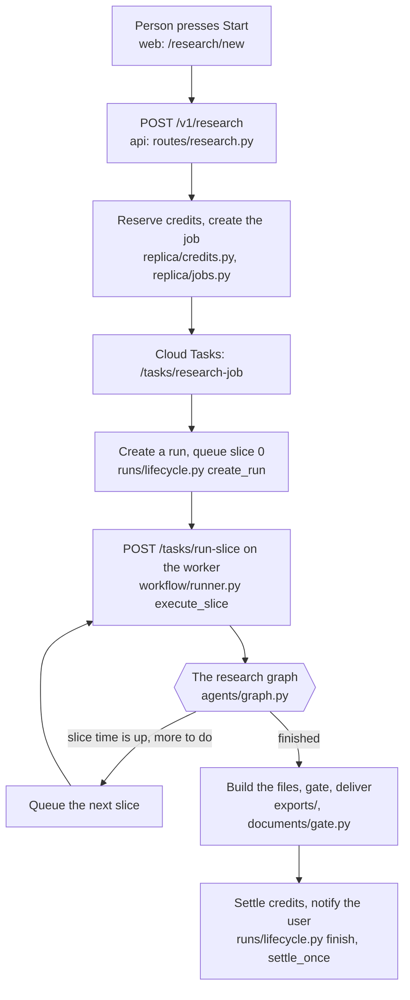
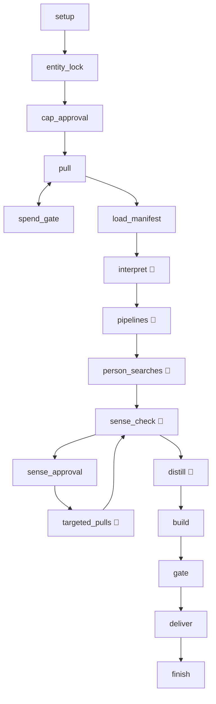
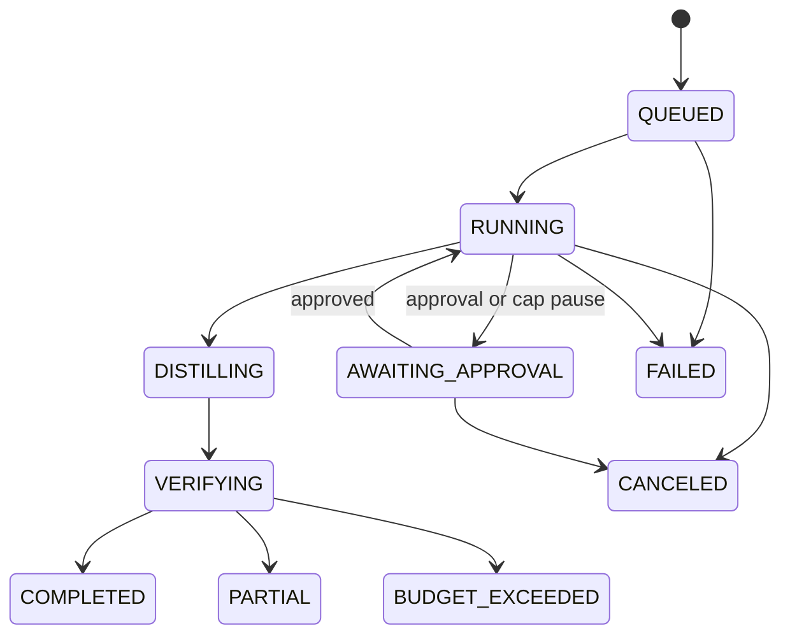

# 2. How one research runs, step by step

*Part of the [project guide](README.md). Written 2026-10-29. Each statement comes from reading the
code; the file or function is named so you can check it.*

## 2.1 The whole story in one picture

## 2.2 Starting: from the click to slice 0

1. **The screen.** `/research/new` in the web app. The user types a company (or uploads a file) and
   sees an **estimate** of credits, tokens and dollars (`GET /v1/research/estimate`).
2. **Confirm.** `POST /v1/research` (`api/routes/research.py`). In one database transaction it
   checks the user's monthly allowance, checks the estimate has not changed (otherwise 409,
   "estimate changed", and the user confirms again), adds the account, and **reserves credits**
   (`replica/credits.py`). The result is a row in `research_jobs` with status `queued`.
3. **Hand to the worker.** `replica/jobs.py` queues a Cloud Task for `/tasks/research-job`. The job
   is committed *before* this call, so a queue that cannot be reached is logged and the caller still
   succeeds; the sweeper hands a job that is still `queued` to the worker again (see 2.7,
   "Hand-off recovery").
4. **Create the run.** The worker's `run_job` creates a **run** (`runs/lifecycle.py` `create_run`)
   with the scope, topic, models and the token estimate in its `run_input`, seeds the 33-row
   coverage checklist (`tracker/`), then queues **slice 0** as a named Cloud Task
   (`run-<run>-slice-0`). A duplicate name counts as success, so queueing is safe to repeat. If
   the queue refuses slice 0 the run stays `QUEUED` and the job stays running (it is *not* settled
   failed): the sweeper enqueues slice 0 again.

## 2.3 Slices: how a long job fits inside short requests

Cloud Run requests and Cloud Tasks deliveries are short-lived (a delivery must end inside 1800 s).
Research takes hours. So a run is cut into **slices** of **1650 s** (27.5 minutes), set in
`config/workflow_v1.yaml` (`slice_seconds`). Progress is saved to a Postgres **checkpoint** after
each graph step, so the next slice carries on where the last stopped.

What `execute_slice` (`workflow/runner.py`) does with each delivery:

1. **Take the run lease** (`run_leases`, 1800 s). Only one worker may drive a run. The runner
   **renews the lease every 20 s** while the graph runs (`_drive`; every paid-call claim renews it
   too), and a lease whose owner has **not renewed it for 90 s may be taken** by another worker
   even though the 1800 s have not run out (`config/providers.yaml` `ledger.lease_heartbeat_s`,
   `lease_stale_after_s`; `connectors/ledger.py _upsert_lease`). Why: when a worker is killed (out
   of memory, a deploy) Cloud Tasks retries that slice at about +10, +30, +70 and +150 s, then
   +310, +610 and +910 s (eight attempts since 2026-10-30, five before; 10 s backoff that
   doubles four times, 300 s at most; `infra/stack/main.tf`, queue `runs`). Before, those retries met the dead
   worker's lease (live for up to 30 minutes, renewed only by paid-call claims) and were dropped,
   so the run waited for the sweep (30–40 minutes). Now the retries at +10 to +70 s answer "busy",
   and the one at +150 s, past 90 s of silence, takes the lease and resumes the run (three more
   retries remain if that one fails too). The 1800 s ttl
   stays on purpose: a live worker that merely stalls keeps its epoch, so its calls in flight are
   not re-issued (paid twice). A worker that stalls for more than 90 s and then finds its lease
   taken stops its slice at once (`LeaseLost`, log `slice.lease_lost`): two workers never drive
   one run.
   If another worker holds the lease: a copy of the run's **last begun slice** answers "busy"
   (HTTP 503) so Cloud Tasks retries it (it may be the retry of a slice whose worker died); a copy
   of a slice the run has moved past, or of a slice already running in this process, answers
   "noop" (200) and is dropped. If this slice began but its first copy died with the worker (no
   later slice begun, run still active, lease free), the redelivery **resumes** it from the
   checkpoint (log `slice.resumed`). If that first copy had stopped the graph at an approval or
   pause and died before recording the wait, the redelivery records the wait (the run goes to
   `AWAITING_APPROVAL`) instead of reading the unanswered pause as an approval.
2. **Begin the slice**: `begin_slice` adds 1 to `slices_used` in a way that a stale copy cannot
   repeat. A terminal run is a noop; a run waiting for approval waits. A run past `max_slices`
   (8, plus one for every wait for a person: approvals, spend pauses and token-guard pauses are not
   research time) **ends `PARTIAL`, reason `slice_ceiling`, keeping everything it found** and
   charged for its real spend; only a run that holds nothing usable ends `FAILED` with a full
   refund (the same rule as every other early stop).
3. **Run the graph under a timer** of `slice_seconds`. It resumes from the checkpoint. When the
   run was waiting at an approval or a pause, the graph is resumed with the **decision**: `yes`
   when a person approved, `no` when the wait lapsed (24 h) or the spend pause was declined. A
   token-guard pause nobody answered therefore stops the run (`token_guard_stopped`) instead of
   raising its own spend guard.
4. **If the timer fires** (`_timed_out`): the slice counts as **progress** if the checkpoint moved,
   *or* the run stored new model replies, *or* provider calls finished in it. Otherwise it counts
   as **empty**. **Three empty slices in a row end the run** as `PARTIAL`, reason `no_progress`
   (`max_no_progress_slices`). Everything found so far is kept. This stays on even with caps off.
   A slice that ended because the provider governor granted no slot in its bounded wait
   (`SlotUnavailable`) is **queueing, not stalling**: it never counts toward the three, and the
   next slice starts 30 s later (`slot_retry_delay_s`). It does count against `max_slices`.
5. **Queue the next slice** (after releasing the lease), or **end the run** if the graph finished.

Paid calls are written to the **ledger** before they are made, so a slice that dies loses at most
the call in flight, and the next slice **replays** finished calls for free
(`connectors/ledger.py`). Model replies are replayed the same way (`llm/reply_cache.py`).

## 2.4 The research graph (what actually happens)

`agents/graph.py` builds one graph. Boxes with a model call are marked 🧠; the rest is plain code.

| # | Node | What it does in plain words | Model? |
|---|---|---|---|
| 1 | **setup** | Checks the customer's saved settings are valid and picks the careers page from pages already visited. | light |
| 2 | **entity_lock** | Reads the company's own home page and refuses a domain whose home page does not name the company. Stops the run *before any money is spent* if it is the wrong company: ends `FAILED entity_mismatch` with a full refund (nothing is charged). The home page read and the brand search run at the same time. A home page that never answers within 300 s is "unreadable", not a mismatch. (Born from a run that researched the wrong look-alike company.) | no |
| 3 | **cap_approval** | Confirms the spend cap before the first paid call. Skipped in build-only mode. | no |
| 4 | **pull** (Phase 1) | Plans every checklist row, then fetches them side by side through the providers and **stores the raw pages**. Inside a row the queries run four at a time (`QUERIES_IN_FLIGHT`); inside a query the open search, the account's own-site search and the restricted searches (SEC filings, newswires: `also_on`) run together, then every page they found is read together, own pages by live scrape and other sites' pages by page read, with the stored items written four at a time. What reaches a provider is held to that provider's slots by the research's own gate (`parallel.yaml` ceilings; scrape 4, search 8), so the many waiting calls queue here without a time limit and never in the governor's 30 s wait. An own-site row also follows the links its pages name (releases around a newsroom page, the investor and leadership pages beside a result: `pull_plan.yaml` `follow`, own domains only, a few per query, one level deep). Results are read back in query order, so what a row stores is what the one-at-a-time loop stored (2026-10-30). No reading, no grading. A row that takes longer than **540 s** is given up on: a row a code pipeline owns (jobs, tech) is handed to that pipeline, which finishes the pull later (`owned_by_pipeline`); any other row becomes a named gap (`provider_slow`). Writes the *manifest* (what was pulled per row). | no |
| 5 | **spend_gate** | If a paid call was refused by the cap in an attended run, pause and ask. | no |
| 6 | **load_manifest** | Checks the pull is complete and not stale before Phase 2 starts. | no |
| 7 | **interpret** | **The reading step.** Reads the stored pages back sixteen at a time (`VIEWS_IN_FLIGHT`), drops pages that are not about the company, then asks the model to extract facts, one call per source group, up to 32 at once. The quote must appear **word for word** in the page. Each finding is **graded by code** (see 2.6) and saved. | yes (strong) |
| 8 | **pipelines** | Three code pipelines, run one after another (their source numbers and grading are order-bound): **job postings** (`jobs/`; sixteen postings read and classified at a time, page reads held to the scrape provider's gate, the posting texts written sixteen at a time), **technology detections**, **people list** (`people/`, only with the customer's people-data consent). A *retryable* provider error (429, 5xx) is re-raised to the node retry policy, never swallowed; once its attempts are used the adapters turn it into a stated source failure. Any other failure of a pipeline is logged, counted (`pipelines_*_failed`) and its rows are reported **Partial / Not done with `source_failed`** (never Done), and the run ends `PARTIAL steps_waiting`, never `COMPLETED`. A technology feed handed over at the 540 s ceiling is reported by this node once it is written. A single search or page read is bounded at 300 s (a gap, `source_slow`); the feeds are bounded by the slice only. | classify |
| 9 | **person_searches** | Searches speaking, podcast and video appearances by the *names* of the executives found (max 10), never by company name. Each search is bounded at 540 s; one that never answers is a failed search (`person_searches_failed`). | yes |
| 10 | **sense_check** | A second look across all facts for contradictions and wrong-company mix-ups; proposes follow-up pulls. With no graded fact it makes no paid call (the run ends `no_new_findings`). | yes (planner) |
| 11 | **sense_approval** / **targeted_pulls** | If follow-ups need approval, ask; then run them and read them, and sense-check again. | yes |
| 12 | **distill** | Writes the narrative, hypotheses and first-call questions **from graded facts only**. Only Confirmed facts may be stated as fact. | yes (planner) |
| 13 | **build** | Builds the client files. If there are no graded facts, ends as `no_new_findings`. Scans every file for tool, provider and person names (a hit is a failure). `build`, `gate`, `deliver` and `finish` retry a transient infrastructure error (dropped connection, timeout, deadlock, storage 5xx) up to the node attempt budget; the file set is stored once per set hash, so a retry is safe. | no |
| 14 | **gate** | The quality gate. A run-level failure holds every file; a **file-level** failure holds only that file (`files_withheld`) and the rest is delivered. | no |
| 15 | **deliver** | Releases the files that passed. Completed only if nothing was withheld and every row is Done, None or a stated gap. | no |
| 16 | **finish** | The only place the credits are settled (once). | no |

`token_gate` can interrupt after any model step: when the next paid call would pass **3×** the
pre-run token estimate, the run pauses and asks. It asks for attended and unattended runs alike,
and stays on even with caps off.

Run **modes** (`agents/modes.py`): `full` (pull then build), `pull` (stop after Phase 1), `build`
(Phase 2 only, on an earlier run's pull).

### Which engine runs a research?

Two engines exist. The **ABM graph** above runs everything started by the research-job engine
(this is the product path). The older **Workflow v1** (`workflow/engine.py`, 13 stages from
`config/workflow_v1.yaml`) is still used for plain `POST /v1/runs` full runs unless the tenant flag
`abm_agents` is on (`agents/production/wiring.py` `uses_abm`). `parallel/` and `verify/` are used
only by Workflow v1.

## 2.5 The states of a run

`COMPLETED`, `PARTIAL` and `BUDGET_EXCEEDED` can only be reached from `VERIFYING`
(`runs/transitions.py`); `FAILED` and `CANCELED` from any active state. **PARTIAL means "stopped
early but kept everything found"**; **FAILED** means nothing usable. All ends go through one
function, `runs/lifecycle.py finish`, which also settles credits (never charging more than the
real spend, and never more than reserved).

## 2.6 How a fact gets its grade

The model proposes; **code decides the grade** (`account_intelligence/grading/`). For each
finding:

1. The cited page must be one this run stored, and the **quote must appear verbatim** in it.
2. The value must be in the quote. Hostile text (a page trying to instruct the model) drops it.
3. The source is rated by tier (T1 first-hand company pages … T4 unknown) and freshness, and sources
   from the same origin count once. This gives an engine score A–D.
4. **Product grade**, first rule that fires wins (`grading/product.py`, order in
   `config/grading_policy.yaml`):

| Grade | When |
|---|---|
| **Confirmed** | read in a first-hand (T1) page *this run*, quote verified |
| **Lead** | a keyword/date match that was **not read** this run (even if sources conflict), or only a data-feed/aggregator source, or a weak score |
| **Probable** | good score (A or B) without a first-hand read |
| **Hypothesis** | middling score, a synthesis, or a proven absence |
| **Internal Only** | built from the customer's own files |

A second model checks the claim against its quote (**the judge**); it can only lower a grade.
Guard **G2** raises an error if code ever gives an unread match any grade except Lead, which is
what ended a run on 2026-10-28 (the conflict rule had been promoting such a claim to Probable;
fixed the same day).

## 2.7 The ways a run can stop

| How it ends | State | Reason code (examples) | Does the system restart it? |
|---|---|---|---|
| Finished normally | COMPLETED | | |
| Finished, some files held back | PARTIAL | `files_withheld`, `gate_failed`, `build_failed:*` | no |
| A code pipeline (jobs, technology, people) failed | PARTIAL | `steps_waiting` (its rows say `source_failed`) | no |
| Three empty slices | PARTIAL | `no_progress` | no — the owner presses **Resume** |
| More than `max_slices` research slices | PARTIAL (FAILED + refund if nothing usable) | `slice_ceiling` | no, on purpose (owner decision 2026-10-30) — the owner presses **Resume**; the stop text says so |
| Wrong company (`entity_mismatch`), no pulled data, invalid setup | FAILED, full refund | `entity_mismatch`, `no_pulled_data`, `stale_pulls`, `invalid_setup` | no |
| Worker died mid-slice | (stays RUNNING) | | **yes**: the redelivered slice resumes it |
| Worker died, lease expired (>600 s), no redelivery | PARTIAL / FAILED | `worker_lost` | **yes**, automatically (limit 5) |
| Marked stalled (no heartbeat) | PARTIAL / FAILED | `stalled` | **yes**, automatically (limit 5) |
| A dropped connection / timeout outlasted the node retries | PARTIAL | `OperationalError`, `TimeoutError`, `ConnectionError`, … | **yes**, automatically (limit 5) |
| A data or model provider outage outlasted the node retries (429, 5xx, timeout, open breaker) | PARTIAL | `RateLimited`, `RetryableProviderError`, `ProviderJobTimeout`, `CallInFlight`, `Overloaded`, `CircuitOpen` | **yes**, automatically (limit 5, 24 h window; owner decision 2026-10-30). Credits, key and auth refusals are *not* |
| Model provider unavailable | PARTIAL | `model_unavailable` | **yes**, automatically (limit 5) |
| Model refused / no credits / no key | PARTIAL | `model_auth_failed`, `model_credits_exhausted`, … | no — owner must fix |
| Token guard Stop, or a token-guard pause nobody answered in 24 h | PARTIAL | `token_guard_stopped` | no |
| A guard fired (a code defect) | PARTIAL | `unread_match_promoted` (G2), `sense_check_stale`, … | no |
| User pressed Stop | CANCELED | `canceled_by_user` | no |
| Approval waited > 24 h | CANCELED | approval timeout, full refund | no |

### The stall sweeper and auto-resume

Every 5 minutes Cloud Scheduler calls `POST /tasks/sweep` on the worker
(`api/main.py sweep_pass`). It does five things, each independent:

1. clean up documents stuck in processing,
2. **end orphaned runs** — lease expired more than 600 s ago → `worker_lost`
   (`runs/sweeper.py`; a safety net now: the redelivered slice normally resumes the run first),
3. **mark stalled runs** (heartbeat not moving) and notify the owner,
4. **auto-resume** (`replica/auto_resume.py`): for a company-mode run that stopped for
   `worker_lost`, `stalled` or `model_unavailable`, within 24 h, with no live worker lease, start a
   **continuation job** (`resume_from` = the stopped run). **At most 5 automatic continuations per
   chain** (`MAX_AUTO_RESUMES`; it was 2 until 2026-10-29). After that the owner must press **Resume**.

5. **hand-off recovery** (`runs/recovery.py`, new 2026-10-30): start what was committed but never
   started. A job `queued` for more than 10 minutes is handed to the worker again; a job `running`
   for more than 10 minutes with no run (the worker died between claiming it and creating the
   run) goes back to `queued` and is handed over again; a run `QUEUED` for more than 10 minutes
   that never began slice 0 gets slice 0 enqueued; a run `AWAITING_APPROVAL` more than 15 minutes
   past its deadline (its timeout task was never created or never ran) is expired the way the
   timeout task does (a first-cap approval is cancelled and refunded, a pause resumes). Every
   repeat is a *named* Cloud Task (`job-<id>`, `run-<id>-slice-<n>`), so it is a no-op when the
   task still exists, and a job or slice started twice is claimed once. Cloud Tasks keeps the
   name of a task that ran for about an hour, so a repeat whose task already ran can land up to an
   hour late: late, never lost.

A continuation is a *new run* that starts again from `start` but reuses every finished pull and
model reply of the stopped run at no cost (the research cache). That is why you see the pull
stage "run again" after a resume: it is replaying, not re-paying. A continuation also **keeps the
incremental inputs** (`postings_previous_run`, `postings_since`) of the run it continues, so the
job-feed call it reuses has the same key.

## 2.8 A worked example: what happened on 2026-10-28

This is the real sequence from the staging logs, as a lesson in how the pieces interact.

| Time (UTC) | What happened | Which rule |
|---|---|---|
| 05:31 | New research started; slice 0 ran | |
| 06:26–07:21 | Slices 1–3 sat in `pull`, all "empty" → run ended PARTIAL `no_progress` | one hung provider call held the whole `pull` node past the slice |
| 07:46 | **Fix 1 deployed**: 540 s ceiling per pulled row | `PULL_ROW_CEILING_S` in `agents/graph.py` |
| 09:46–10:26 | Run progressed; then `unread_match_promoted` killed it | G2 + the conflict rule |
| 10:38 | **Fix 2 deployed**: conflict rule no longer promotes an unread match | `grading/product.py` |
| 12:12, 14:00, 15:44, 18:32 | Worker stopped answering its health check about 25 min into `person_searches` and was killed (the last time with a segfault) | see 06-known-problems.md |
| 12:40, 14:26 | Auto-resume restarted the research twice; then the limit was used up | `MAX_AUTO_RESUMES` was 2 (now 5) |
| 2026-10-29 | **Fixes 3–6**: grading config cached (the freeze), a dead slice's redelivery resumes the run, auto-resume bound 5, crash-safe stall dump | `grading/config.py`, `workflow/runner.py`, `replica/auto_resume.py`, `obs/stalldump.py` |

Next: [3. Code map](03-code-map.md).
