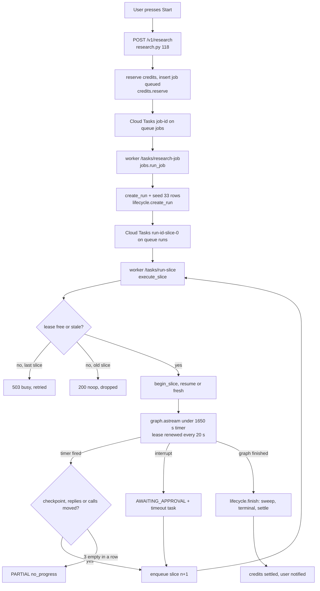
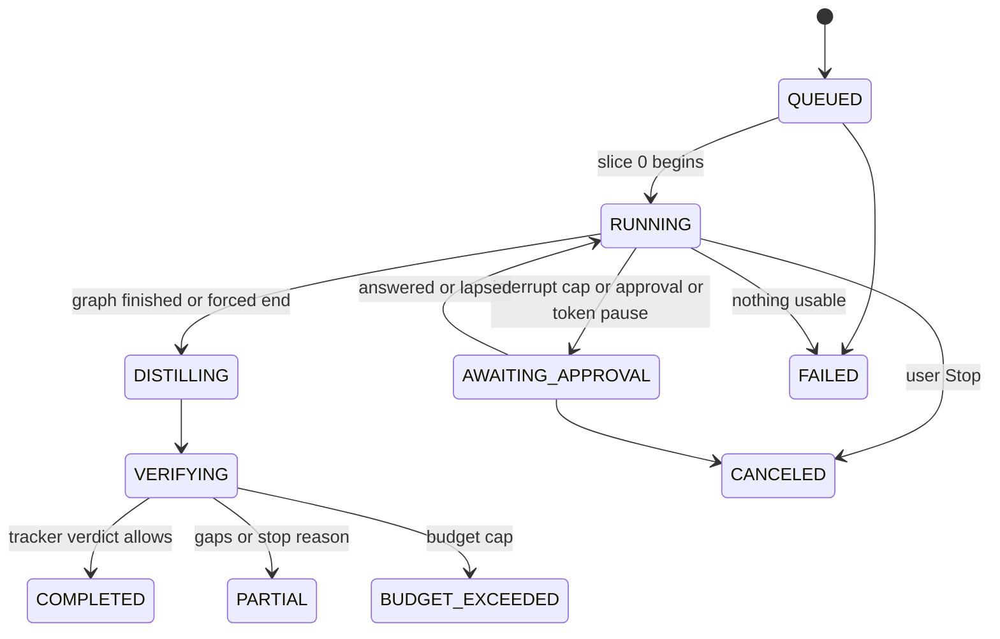
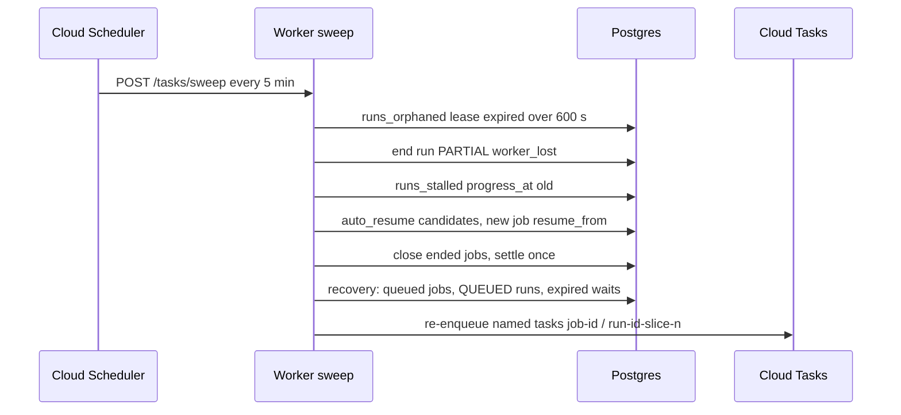
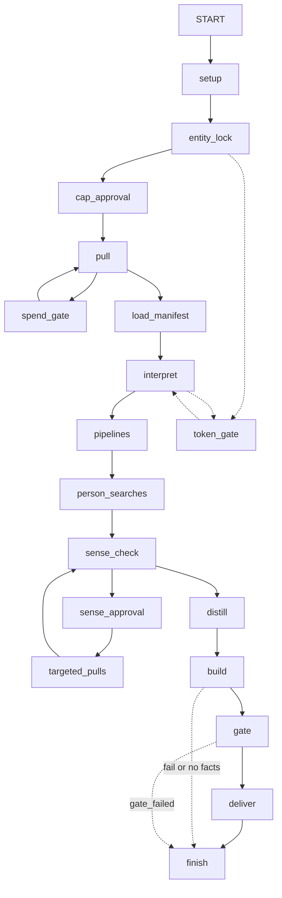
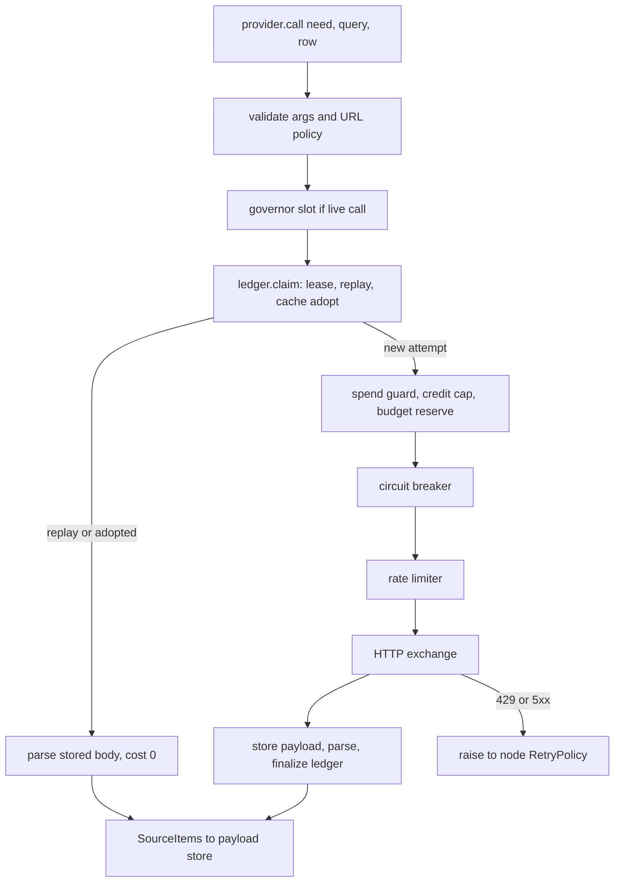
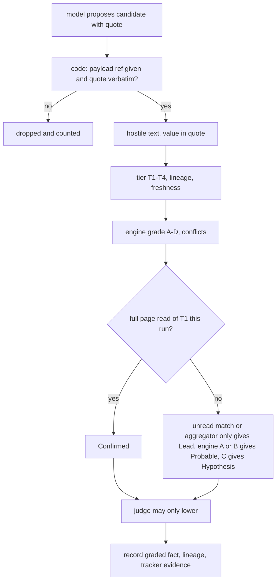
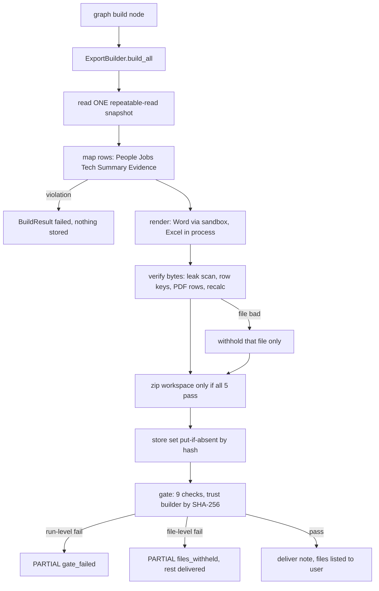
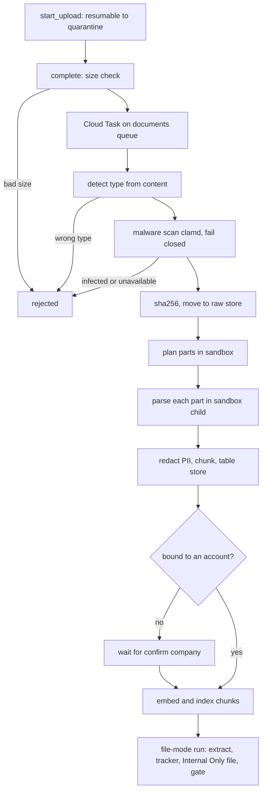
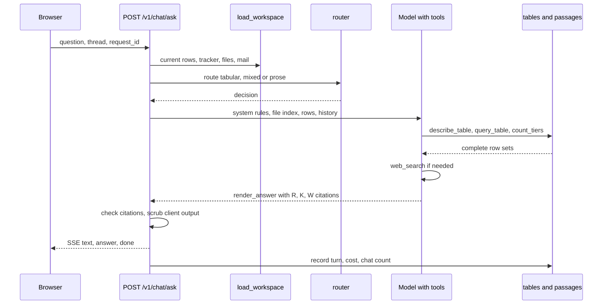
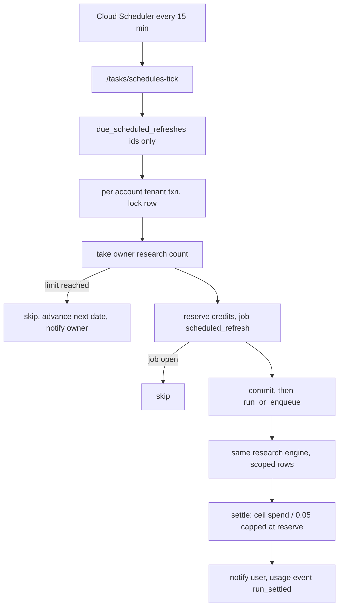

# Core-engine audit: Account Intelligence ("ABM Generator")

Audit date: 2026-11-03. Repo `/home/sakib/ABM Generator`, branch `feat/final-product`, tip `d3831549`.
Method: read-only; every statement below was traced from the code named next to it
(`path:line`, lines as of this tree). Nothing was run, nothing paid for. "unverified" means I did not
confirm it from code or config. All paths are relative to the repo root; `src/` prefix is dropped
for `account_intelligence/...` only when obvious.

Vocabulary for a new owner (the code uses all of these):

* **tenant** = a customer company; **account** = a sales target researched for that tenant.
* **job** (`research_jobs`) = the credit-reserving request; **run** (`account_runs` + `runs`) = the
  execution of a job; **slice** = one 27.5-minute Cloud Tasks delivery of a run; **step / row** = one
  of the 33 coverage-checklist rows.
* **ABM graph** = the LangGraph research graph (`src/agents/graph.py`); **Workflow v1** = the older
  13-stage graph (`src/account_intelligence/workflow/engine.py`), still reachable via `POST /v1/runs`.
* **ledger** = `tool_calls` / `tool_call_events` tables: every paid provider call is written before it
  is made and replayed (free) afterwards.

---------------------------------------------------------------------------------------------------

## 0. Verdict on the existing guide (docs/guide/02, 03, 06)

Overall: **02 and 03 are largely accurate on structure and trace correctly**. The flow, node order,
lease/slice/sweeper/auto-resume rules, and grading order all match the code. But they are
2026-10-29 snapshots and several concrete numbers and claims are now wrong or contradicted by the
code. Corrections, each verified:

| # | Guide says | Code says | Evidence |
|---|---|---|---|
| D1 | 02 s2.3: a run past `max_slices` (**8**, +1 per wait) ends PARTIAL `slice_ceiling` | The YAML value is **16** (raised 2026-10-30). On **staging it is effectively unlimited**: `RESEARCH_CAPS` defaults to `off` there and `_slices()` then sets `max_slices = UNCAPPED` (1,000,000). The ceiling therefore cannot fire on staging; only the 3-empty-slices rule (`no_progress`) bounds a run. | `config/workflow_v1.yaml:13-14`; `account_intelligence/app/container.py:452`; `infra/envs/staging/main.tf:64-67` |
| D2 | 02 s2.4 last paragraph: `token_gate` "asks for attended and unattended runs alike, and **stays on even with caps off**" | With caps off the token guard is **off unless `TOKEN_GUARD=on`** (owner decision 2026-10-24). No `TOKEN_GUARD` is set in infra or compose, so on staging a run is never paused for tokens. (Guide 04 line 41 is right; 02 contradicts it.) | `connectors/spend_guard.py:163-176`; `dev_limits.py:49-56`; grep of `infra`, `compose*.yml` finds no `TOKEN_GUARD` |
| D3 | 02 s2.4 node 16: `finish` "is the only place the credits are settled (once)" | The graph's `finish` node moves **no money**: its wallet port is `RunnerSettles.settle_once -> False`. Settlement is done by the **runner**: `_end -> _finish -> lifecycle.finish -> settle_once -> replica.credits.settle_run`. (The sweeper and `_close_ended_jobs` can also call `settle_once`.) | `agents/graph.py:1526-1535`; `agents/production/delivery.py:179-185`; `workflow/runner.py:142-166,764-821`; `runs/lifecycle.py:734-770,855-929`; `api/main.py:268-272` |
| D4 | 02 s2.4 node 2: entity_lock "stops the run **before any money is spent**" | It makes **two paid provider calls first** (a live scrape of the home page + one brand search, both through the ledger). On a mismatch the run ends FAILED with a **full refund**, so the customer is not charged, but the platform has spent a few cents. | `agents/production/provider.py:285-359`; `agents/production/wiring.py:50-52` |
| D5 | 02 s2.7 "The stall sweeper": "It does **five** things" | `sweep_pass` does **six**: documents, orphaned runs, mark stalled, auto-resume, **close ended jobs** (settle any job whose run already ended; omitted from the guide), hand-off recovery. | `api/main.py:234-276` |
| D6 | 06 s6.2 #16 / credits floor "full 110, people 30, jobs 10, topic 20" | `credits.yaml` now says full **250** (raised from 220 on 2026-10-30), so the full floor is **125**. | `config/credits.yaml:15-20`; `replica/credits.py:160-166` |
| D7 | 03 s3.5 and 01: migrations "0001 to **0085** (0069 skipped)"; "numbered SQL steps" | Latest migration is **0097** (`EXPECTED_REVISION = "0097"`); they are Alembic **Python** files; 96 files. 0069 is still missing. | `migrations/versions/` ; `api/routes/health.py:39` |
| D8 | 06 header: "State as of 2026-10-28 19:50 UTC ... **Nothing below is committed to git yet** ... worker 00077" | Stale. The tree is committed (580 commits, 16 since 2026-10-28; `git status` shows only `unwanted-things/` and two untracked paths). Worker revision per your memory is 00095 / api 00110 (release `rel-fecfb35d`); I cannot see the live revision from here (unverified). | `git status`; `git log` |
| D9 | 06 s6.2 #13: "13 Repeating data - fixed in the tree, not deployed" | Per later work (6.6) it was fixed in `replica/current.py` (`NEWEST_FACT` etc.); deployment state unverified here. Note `NEWEST_FACT` is implicated in the 2026-11-01 DB saturation (your memory), so the "fix" has a performance cost on a 1-core DB. | `replica/current.py`; memory `staging-db-saturation` |
| D10 | 03 s3.2 `parallel/` and `verify/` "used only by Workflow v1" | Confirmed by import counts (`parallel` 4 importers outside, `verify` 1), but Workflow v1 is also what runs for plain `POST /v1/runs` unless the `abm_agents` flag is on, so both are live code, just not on the main product path. | `agents/production/wiring.py:258-286` (`uses_abm`) |
| D11 | Module docstrings of `api/routes/ask.py:5-9` ("Answers never reach the web or a data tool") and `replica/model_answer.py:7` ("The model never goes to the web") and `replica/answers.py:4` ("Nothing here calls the web") | **Outdated.** Ask now has `web_search` / `read_web_page` tools (`ask_web` setting defaults `"on"`; they only exist when the search provider's key is in the API environment). The comments still say the opposite. | `replica/web_tools.py:1-30`; `config.py:218-223`; `api/routes/ask.py:703-729` |
| D12 | 03 s3.3 "`signals/`, `refresh/`, `alerts/`: Scheduled re-checks: turn 'something changed' into one scored event, decide cheap probe vs full refresh, send alerts and a weekly digest" | **Not wired.** `refresh.probe.run_probe` is imported only by tests; `alerts.engine` only by `refresh/probe.py`; the only runtime consumers are the read-only routes in `api/routes/signals.py`. The scheduler entries `retention` and `alert-digest` are `paused = true` **and** point at routes (`/tasks/retention`, `/tasks/alert-digest`) that do not exist. See s6. | `grep` of `src`; `infra/stack/main.tf:768-769`; `api/routes/tasks.py` route list |

Other things the guide gets right and that I re-verified: the 8-attempt `runs` queue and the
+10/+30/+70/+150 s retry arithmetic (`infra/stack/main.tf:244-247`); lease 1800 s, heartbeat 20 s,
stale-takeover 90 s (`config/providers.yaml:36-50`, `workflow/runner.py:346-415`); the 3-empty-slice
rule (`runner.py:549-606`, `container.py:455`); `MAX_AUTO_RESUMES = 5`, 24 h window and the
`ELIGIBLE` set (`replica/auto_resume.py:77-123`); the grading precedence order
(`config/grading_policy.yaml:9-13`, `grading/product.py:65-80`); the 33-row checklist
(`config/checklist.yaml`: 33 rows; `pull_plan.yaml`: 33 rows).

---------------------------------------------------------------------------------------------------

## A. Start of a research, leases, slices, sweeper, auto-resume, state machine

### A.1 Step-by-step trace

**1. Estimate (read-only).** `GET /v1/research/estimate` -> `_estimate` (`api/routes/research.py:62-84`):
`CR.estimate(s, None, "new_research")` (`replica/credits.py:169-202`) returns credits/minutes from
`config/credits.yaml` (new_research = 250 credits, 480 min; 1 credit = $0.05), plus the monthly pool,
per-user account cap and `usage_estimate` tokens/dollars (`replica/usage_estimate.py`).

**2. Confirm: `POST /v1/research`** (`research.py:117-218`), all in one `tenant_txn`:
1. `tenant_settings.ensure_saved` (409 `settings_invalid` if the tenant's saved settings are bad) and
   the **exclusion filter** (409 `excluded_company`) - `research.py:127-147`.
2. `CR.estimate` again; if the client sent `credits` and it differs -> 409 `estimate_changed`
   (`:149-169`). The web UI no longer shows credits, so `credits` is optional.
3. `M.resolve` picks research/analysis model and effort for the user (`:150-160`).
4. `lifecycle.add_account` + `name_account` (`:171-175`) create the account (idempotent by domain).
5. `LIM.take(..."researches")`: the **per-user monthly research limit** is the real gate (owner
   decision 2026-10-14); a repeated `request_id` counts nothing (`:176-181`).
6. `CR.reserve(...enforce_pool=False...)` (`replica/credits.py:269-351`): locks `client_settings`
   `FOR UPDATE` (serialises concurrent reserves), returns the first job on a repeated `request_id`,
   raises `JobOpen` if the account already has an open job (409 `research_in_progress`), inserts the
   `research_jobs` row (`status='queued'`) and a `credit_entries` reserve row. With `enforce_pool=False`
   or caps off (`dev_limits.research_uncapped`) the credit pool never blocks a start - credits are only
   *recorded*.
7. Audit row, commit. **After the commit** `jobs.run_or_enqueue` (`replica/jobs.py:430-445`) asks
   Cloud Tasks for the named task `job-<id>` on queue `jobs` (`platform/gcp/adapters.py:190-202`,
   dispatch deadline `JOB_DEADLINE_S = 600`). A queue failure is **logged, not raised** (the caller
   still gets 201).

**3. Worker `POST /tasks/research-job`** (`api/routes/tasks.py:217-228`) verifies the Google OIDC token
in a thread with a 20 s limit (`:82-109`), acts as the job owner (`_act_as_owner_of`), then
`jobs.run_job` (`replica/jobs.py:380-421`): `claim` flips `queued -> running` atomically
(`credits.claim`, `replica/credits.py:460`); `GraphEngine.run` (`jobs.py:157-263`):
reads the saved tenant settings, builds `run_input` (mode full, scope rows, lanes_off, expected
tokens, topic, goal, models, resume_from, exclusion rules) and calls `lifecycle.create_run`
(`:229`). `create_run` (`runs/lifecycle.py:191-318`):
* idempotent by key `job-<job id>` (a replay returns the existing run; a different body -> 409);
* `add_account`; **incremental-research keys** (`_incremental_keys`, `:149-188`) decided once;
* budget = min(`max_budget_usd` 12.5, credits x $0.05); with caps off it is `UNCAPPED_BUDGET_USD` and
  call cap `UNCAPPED` (`:255-262`);
* inserts `account_runs` (+ the legacy `runs` row), `CR.start_with_run` links job -> run,
  `tracker.seed` writes the 33 coverage rows (`tracker/service.py:115`).
Then `plan_run`/`run_mode_columns`, `settings.pin_run` (pins the settings version) and a
`run_started` usage event (`jobs.py:240-251`). **After commit** it enqueues named task
`run-<run>-slice-0` (`:253`). If that enqueue fails the run stays `QUEUED` and the job stays running
(logged `job_slice_not_enqueued`); `runs/recovery.py` re-enqueues it later.

**4. Slice delivery: `POST /tasks/run-slice`** (`tasks.py:112-156`): authenticate; `_act_as_owner_of`;
`container.deps_for` builds `RunDeps` (connectors, payload store, model router...); choose the graph:
file-mode run -> `FileGraphFactory`; else `uses_abm` (`agents/production/wiring.py:258-286`: pull/build
modes, any run with `run_input.job_id` or `linked_file_run`, or tenant flag `abm_agents`) ->
`AbmGraphFactory`; else Workflow v1. Then `execute_slice` (`workflow/runner.py:245-304`). Outcome
`busy` -> HTTP 503 (Cloud Tasks retries); `LookupError` -> 404.

**5. `execute_slice` anatomy** (`runner.py`):
* **In-process mutex** `_IN_FLIGHT` (`:101,263`): a second delivery of the same run on the same
  process yields (`_yield`, `:307-323`).
* **Run lease** `ledger.acquire_lease` (`connectors/ledger.py:220-275`): `run_leases` row, ttl
  1800 s; renewing by the same owner keeps the epoch; a **new** owner takes it only if the old lease
  expired **or its heartbeat is older than `lease_stale_after_s`=90 s** (`:226-258`). A new epoch
  makes the previous holder's unfinished ("started") calls read as stale/abandoned. `LeaseUnavailable`
  -> `_yield(other_worker=True)`: a copy of an older slice -> `noop` (200, dropped); the **last begun
  slice** -> `busy` (503, retried until the dead worker's lease reads stale).
* `_begin` (`:187-231`): terminal -> noop; `AWAITING_APPROVAL` -> awaiting; `begin_slice` atomically
  does `slices_used = slices_used+1 WHERE slices_used = :expected` (`lifecycle.py:537-558`) - a stale
  copy gets `None`; if `slices_used == slice_no+1` and the run is RUNNING/DISTILLING/VERIFYING it is a
  **redelivery of a slice whose worker died** and it resumes from the checkpoint (`slice.resumed`).
  `QUEUED -> RUNNING`. Ceiling: `used - pause_slices > max_slices` -> `_end_stopped("slice_ceiling")`.
* `_slice` (`:421-525`): opens a **fresh psycopg connection bound to the tenant** for the LangGraph
  `AsyncPostgresSaver` (`platform/checkpoint.py:21-37`, thread id `<tenant>:<run>`), builds the graph,
  decides the input: first slice = initial state; a pending interrupt after a redelivery = **record the
  wait, do not approve** (`slice.wait_recorded`); a pending interrupt with the run back to RUNNING =
  `Command(resume=decision)` where `_resume_decision` (`:528-546`) is `False` if the wait lapsed or the
  spend pause was declined; else `None` (continue from checkpoint).
* `_drive` (`:383-418`): runs `graph.astream` inside `asyncio.timeout(slice_seconds=1650)`; polls every
  2 s for CANCELED (stops within seconds) or for the run having been ended by someone else
  (`LeaseLost`); **renews the lease every 20 s**; a failed renewal -> `LeaseLost` -> slice ends `noop`.
* Timeout/`SlotUnavailable` -> `_timed_out` (`:549-605`): progress = checkpoint mark changed **or**
  new `model_reply_log` rows **or** new completed provider calls (`lifecycle.py:572-620`). A slice
  that ended because the provider governor gave no slot ("queued") and moved nothing never counts and
  delays the next slice 30 s. Otherwise `count_no_progress`; 3 in a row -> `_end_stopped("no_progress")`.
* Graph stopped on its own -> `_end` (`:764-821`): a pending interrupt -> `AWAITING_APPROVAL`
  (`awaiting_kind` approval|cap, 24 h deadline, `note_pause`, named timeout task
  `run-<id>-approval-timeout`); else map the final state through `AbmGraphFactory.target`
  (`wiring.py:359-383`) and `lifecycle.finish`.
* Exceptions: `LeaseLost` -> noop; cancellation/SIGTERM -> `note_interruption` and re-raise (run stays
  resumable); anything else -> `_stop_unexpected` (`:676-703`): PARTIAL with the **exception class as
  reason** if the run `has_usable_output` (a done paid call, fact or deliverable; `runs/stop.py:48`),
  else FAILED + full refund; then re-raise.
* After releasing the lease, `outcome == "continue"` -> `scheduler.enqueue_slice(slice+1)` (named,
  idempotent; `:296-303`).

**6. Run end** `lifecycle.finish` (`:734-770`): terminal re-entry only re-settles; COMPLETED is demoted
to PARTIAL if `tracker.verdict(run).can_complete` is false (`:748-749`); non-COMPLETED ends first run
`tracker.sweep` (all unset rows get a reason); `finish_run` writes the terminal status;
`settle_once` (`:855-929`) -> `CR.settle_run` -> `CR.settle` (`credits.py:382-420`): credits used =
`ceil(spent_usd / 0.05)` **capped at the reserved amount**, `release` entry for the rest; FAILED /
`refund_all` charges 0. Spend = `account_runs.spent_usd` (provider calls) + the larger of
`llm_calls` cost and `model_reply_log` cost. Notifies the requester. `close_spend` stores the spend
report.

**7. State machine** (`runs/transitions.py:26-57`): `QUEUED -> RUNNING|CANCELED|FAILED`;
`RUNNING -> AWAITING_APPROVAL|DISTILLING|FAILED|CANCELED`; `AWAITING_APPROVAL -> RUNNING|CANCELED|FAILED`;
`DISTILLING -> VERIFYING|FAILED|CANCELED`; `VERIFYING -> COMPLETED|PARTIAL|BUDGET_EXCEEDED|FAILED|CANCELED`.
Every non-failed end walks through DISTILLING and VERIFYING (`lifecycle.end_from_active` `:773-802`,
`runner._end` `:808-817`). Updates are optimistic (`WHERE status = expected`).

**8. Sweeper** (`api/main.py:234-276`, called by Cloud Scheduler `*/5 * * * *` -> `POST /tasks/sweep`
`tasks.py:390-402`, and by an in-process loop every `sweep_interval_s=300` while a worker is warm,
`main.py:346-358`):
1. `_sweep_documents`: re-enqueue stuck uploads (`documents/service.py:1107`) + deliverable-import backfill.
2. `sweep_once` -> `runs.sweeper.sweep` (`runs/sweeper.py:56-130`): orphans = lease expired > 600 s
   (`ORPHAN_AFTER_S`, `config.py:314`) via definer function `runs_orphaned`; `_end_one` locks the run
   `FOR UPDATE`, re-checks no live lease, ends PARTIAL/FAILED `worker_lost`.
3. `mark_stalled` (`sweeper.py:133-190`): `progress_at` not moved for `platform_defaults.stall_after_s`
   (default value unverified; editable in the operator console) -> `stalled_at` + notify owner.
4. `auto_resume_pass` (`replica/auto_resume.py:339`): candidates = company runs started by a job, not
   already continued, either `stalled` & still active or PARTIAL/FAILED with reason in `ELIGIBLE`
   within 24 h (`_CANDIDATES`, `:~330`). Refused if a lease is live (`worker_alive`) or the chain
   already has 5 automatic continuations. A stalled active run is first ended PARTIAL `stalled`. Then a
   **new job** `resume_from=<run>` with deterministic request id `uuid5("auto-resume:<run>")`
   (`:122`), budget from `estimate_resume`.
5. `_close_ended_jobs` (`main.py:304-322`): `settle_once` for jobs still queued/running whose run is
   terminal.
6. `_recover_handoffs` -> `runs.recovery.recover` (`recovery.py:75`): job queued > 10 min -> re-enqueue;
   job running > 10 min with no run -> back to queued and re-enqueue; run QUEUED > 10 min -> enqueue
   slice 0; run AWAITING_APPROVAL > 15 min past deadline -> expire like the timeout task.

**9. User Stop / Resume.** `POST /v1/research/{job}/stop` (`research.py:315-402`): bounded lock waits
(15 s lock / 60 s statement -> 503 `research_busy`), `lifecycle.finish(..., CANCELED)`, settle job
canceled (charges only what was spent). `POST /v1/research/resume` (`:231-285`) calls the same
`auto_resume.continue_run` as the sweeper.

### A.2 Inputs / outputs
In: domain, company name, optional goal/models/effort, `request_id` (idempotency). Out: a job id; later
a run with terminal status + reason, 5 client files + zip (if built), credits settled, notifications.
Durable state: `research_jobs`, `credit_entries`, `account_runs`, `runs`, `run_leases`,
`tool_calls`/`tool_call_events`, LangGraph checkpoint tables, `coverage_rows`.

### A.3 Failure modes and what the code does
* Queue unreachable at start/slice-0/timeout: logged, state committed, **sweeper recovers within ~15
  min** (`recovery.py`). Cloud Tasks keeps a finished task's *name* for about an hour (guide 02 s2.7), so a
  repeat of a hand-off whose first task already ran can land late - late, not lost.
* Worker killed mid-slice: retries at ~+10/+30/+70 s answer 503 busy; the +150 s retry finds the lease's
  heartbeat >90 s old, takes it (new epoch) and resumes from the last node checkpoint
  (**checkpoints are per graph node, not per call**: a killed `interpret` re-runs the whole node, with
  finished model replies/provider calls replayed from `model_reply_log`/`tool_calls`).
* Worker alive but event loop blocked (the 2026-10-28 YAML-parse freeze): Cloud Run's liveness probe
  kills the instance; `obs/stalldump.py` writes the main-thread stack. Not fully proven fixed (06 #5).
* Hung provider call: per-row 540 s ceiling in `pull`, 300 s per single call (`SINGLE_CALL_CEILING_S`,
  `connectors/base.py:70`), per-slice timer 1650 s, 3-empty-slice cut-off.
* Duplicate/stale deliveries: all handled by named tasks + `begin_slice` expected-counter + lease.
* `max_slices`: see D1 (non-existent on staging).
* Money: credits are charged from *real spend*, never above the reservation. With caps off the platform
  silently **absorbs any spend beyond the reservation** (`min(used, reserved)` at `credits.py:408`).

### A.4 Diagrams

---------------------------------------------------------------------------------------------------

## B. The research graph (`src/agents/graph.py`)

### B.1 Wiring
`AbmGraphFactory.build` (`agents/production/wiring.py:294-318`) reads `run_input.lanes_off`, builds
`abm_deps(...)` (ports -> production adapters, `:190-255`) and compiles `build_abm_graph(deps,
retry_policy)` on the slice's Postgres saver. `retry_policy_for(config)` (`connectors/service.py:839`)
is the **single retry owner**: `RETRIED_NODES` (setup, entity_lock, pull, interpret, pipelines,
person_searches, sense_check, targeted_pulls, distill) retry a `RetryableProviderError` *or* a transient
infra error; `build, gate, deliver, finish` retry transient infra errors only (`graph.py:365-440`).
State (`AbmState`, `:194-243`) holds ids, flags, counters - no text. `recursion_limit` is 100
(`runner.py:462`). Interrupts exist at `cap_approval`, `spend_gate`, `sense_approval`, `token_gate`.

### B.2 Nodes in order (line = definition in `agents/graph.py`)

| # | Node (line) | What it calls | DB / store writes | Model? | Failure behaviour |
|---|---|---|---|---|---|
| 1 | `setup` (465) | `deps.settings.get`; checks tenant lanes subset of skill lanes | none | no | else `_fail("invalid_setup")` -> FAILED, refund |
| 2 | `entity_lock` (474) | `provider.entity_lock` (`production/provider.py:285`): live scrape of `https://<domain>/` + brand search in parallel; `agents/entity.build_lock` | `records.save_entity_lock` | no | page unreadable -> "unverified" (continues); page read & names another company -> `entity_mismatch` FAILED+refund. A `build`-mode run reuses its parent's lock |
| 3 | `cap_approval` (504) | `credit.propose_cap`, `cap_state` | cap rows | no | attended+cap needed -> `interrupt` (approval). Normally a no-op (caps off / `cap_required` false) |
| 4 | `pull` (525) | `PullAgent.pull_row` per row via `fan_out` (`agents/pull/agent.py:136-218`) -> `ConnectorProvider.call` | payloads to object store + archive row per item; `manifests.save`; ledger rows | **no** | row ceiling 540 s (`row_ceiling_s`), then `provider_slow` gap or `owned_by_pipeline` for jobs/tech rows; `SpendPause` -> `spend_gate`; people rows `owned_by_pipeline`; out-of-scope rows `not_planned` |
| 5 | `spend_gate` (632) | `interrupt({"awaiting":"cap","reason":"spend"})` | - | no | up to `MAX_SPEND_PAUSES=3`, then refusals are recorded as `spend_not_approved` |
| 6 | `load_manifest` (649) | `check_build_precondition` (`agents/manifest.py`) | - | no | `no_pulled_data`/`stale_pulls` -> FAILED+refund |
| 7 | `interpret` (921) | report every non-pipeline row to the tracker; `_views` reads stored payloads 16 at a time; `_interpret` filters off-target pages (`on_target` + entity lock `accept`), then `_extract_steps` | graded facts via `deps.grading.grade` (`_grade_and_record`), people records, drops counted | **yes** (extractor tier: Opus 5.5 `abm_pass1/pass2/people_extract`, 16k max tokens) | `ContextTooLong` per group dropped & counted; `BudgetExceeded` per group dropped; `TokenGuardReached` -> `token_gate`; terminal model failure -> `_fail(model_failure_code)` PARTIAL; on any exception, already-extracted candidates are graded and kept before re-raising (`:748-757`) |
| 8 | `pipelines` (958) | `pipelines.run_jobs`, `write_detections`, `write_stack`, `run_people` (`production/pipelines.py`) | `job_postings`, `tech_detections`, `tech_stack_items`, people rows, graded template claims, tracker rows | classify (extractor) | `RetryableProviderError` re-raised to the node policy; other failure -> counter `pipelines_*_failed`, rows -> `source_failed`, run ends PARTIAL `steps_waiting` (`:1034-1099`); people only with consent (`consent_required` otherwise) |
| 9 | `person_searches` (1107) | `people_named(facts)` -> `person_queries` (<=10 people unless caps off) -> `provider.call("web_search")` per query, 540 s each, then `_interpret` | payloads, facts | yes | slow/failed search counted `person_searches_failed`; never ends run |
| 10 | `sense_check` (1206) | `sense_check` agent (planner tier) over all graded facts; `mark_conflicting` for contradictions; prices proposals with `credit.price`, routes with `spend_route` | `records.save_sense_check` when no follow-ups pending | yes | no facts -> exit `no_facts` (no paid call); `BudgetExceeded` -> `sense_check_budget_exceeded` |
| 11 | `sense_approval` (1280) / `targeted_pulls` (1297) | `credit.request_approval`, `interrupt`; `provider.call` per approved follow-up (540 s), `_interpret` | payloads, facts | yes | declined -> rows Partial `pull_not_approved`; loop back to `sense_check` (rounds per depth: `cfg.follow_up_rounds`, the last round "records" instead of pulling) |
| 12 | `distill` (1342) | `agents/distill/agent.py:distill` (planner/Fable tier) with only `may_state` (Confirmed) facts statable | `records.save_distill` | yes | no facts -> skip; `BudgetExceeded` -> `distill_budget_exceeded`; empty narrative falls back to questions |
| 13 | `build` (1379) | `require_sense_check` (G6), `builder.build(ctx,"client")` and `"internal"` (-> `ExportBuilder.build_all`, section C), `assert_client_clean` on every client file text (G9), optional parity bundle (420 s) | deliverable rows + files (store) | no | `BuildIncomplete` -> PARTIAL `build_failed:<codes>`; leak -> `_fail(code)`; no facts -> COMPLETED with `no_new_findings` |
| 14 | `gate` (1432) | `documents.gate.PreDeliveryGate.check` (via `GateAdapter`), `tracker.rows`, closes unreported rows "Not done not_available_yet", `coverage_verdict` | `run_gate_results` | no | run-level failure -> PARTIAL `gate_failed` (all files held); file-level (`FILE_CHECKS`) -> PARTIAL `files_withheld`, others delivered |
| 15 | `deliver` (1505) | `NoteDelivery.release` writes the delivery note (workflow `deliver` stage) ; computes `complete = not withheld and not broken and all rows Done/None/stated-gap` | delivery note | no | |
| 16 | `finish` (1526) | `RunnerSettles.settle_once` = **no-op** | `settled` flag in state | no | see D3 |

Edges (`graph.py:1576-1615`): START->setup; setup/entity_lock -> finish on failure; entity_lock ->
`load_manifest` directly in `build` mode else `cap_approval`; pull -> spend_gate | finish (pull mode) |
load_manifest; interpret -> pipelines -> person_searches -> sense_check; sense_check ->
distill | sense_approval | targeted_pulls (-> sense_check); distill -> build -> gate -> deliver -> finish;
any model node -> `token_gate` when its token guard fired (`token_paused`), which re-runs that node.

Run modes (`agents/modes.py`): `full` = Phase 1 then Phase 2 on its own manifest; `pull` stops after
`pull` (final PARTIAL `pull_only`, `wiring.py:370-371`); `build` starts at Phase 2 on the parent's manifest.

### B.3 Terminal mapping (`AbmGraphFactory.target`, `wiring.py:359-383`)
failed with `PRE_SPEND_FAILURES` (`no_pulled_data`, `stale_pulls`, `invalid_setup`, `entity_mismatch`) ->
FAILED + refund; `budget_exhausted` counter -> BUDGET_EXCEEDED `budget_cap`; pull-mode -> PARTIAL
`pull_only`; pipeline failure counter -> PARTIAL `steps_waiting`; `outcome == completed` -> COMPLETED
(with reason `no_new_findings` if nothing graded); everything else -> PARTIAL with `error_code` or
`steps_waiting`. Then `lifecycle.finish` may still demote COMPLETED to PARTIAL on the tracker verdict
(two completeness rules exist: `graph.deliver` and `tracker.verdict` - they can disagree).

### B.4 The pull stage and the connector pipeline

`ConnectorProvider.call` (`production/provider.py:361-520`) maps a `need` (web_search, scrape,
page_read, structured_signals, people_by_technology...) to a platform route via
`config/skill/provider_routes.yaml`, builds typed args **in code** (never model text), and for a web
search adds: own-site search (rows with `own_site`), restricted `also_on` searches (sec.gov, newswires),
scrape of own-domain hits, page-read of the first off-site hits (that host allowed for that one read),
link following (own domains, one level). Parallelism is bounded by per-provider semaphores
(`crosscut.gates`; scrape 4, search 8 from `config/parallel.yaml`) so waiting is in-process rather than
in the governor's 30 s wait.

Each underlying call is `connectors/service.call_operation` (`:133-157`):
1. `CANCEL_CHECK`, optional single-flight coalescing per run (`:146-156`).
2. `_call_operation` (`:159-257`): type check (`ARGS_FOR`), re-validate, `connector.supports`,
   `_policy_checks` (plain scrapes only; page reads pass `validate_target_url` - blocks internal
   addresses / enforces account-domain allow-list, `connectors/security.py`).
3. `paginate` (`connectors/paginate.py:66`) loops `_fetch_page` with page/item/byte caps and a deadline.
4. `_fetch_page` (`:326-383`): if a governor exists, a live call takes a **provider slot** (cross-run,
   cross-worker, `provider_waiters` table); replayable/cached calls skip the slot.
5. `_fetch_page_claimed` (`:386-615`): builds `CallKey(args_hash,...)`; **`ledger.claim`**
   (`connectors/ledger.py:281-420`, one DB transaction): takes/renews the run lease (it is also the run
   mutex), **replays** a done call for this run, else (resume or cache on) **adopts a fresh finished call
   of an earlier run of the same tenant** (`_adopt_cached`, TTLs in `config/research_cache.yaml`, 3-30
   days per operation), else handles a stale earlier attempt (`abandoned`, marks `possible_duplicate`),
   then `spend_guard.check_cap` (dollar cap, off with caps off), `check_repeat` (same query paid > 3
   times, off with caps off), `_cap_gate` (credit cap), `budget.reserve`, and inserts the `started`
   event. Then breaker `before_call`, `limiter.acquire` (rate limit), `exchange` (HTTP), response
   checks, `payloads.put` (object store, neutral key), `connector.parse` (spec-checked schema; drift ->
   `SchemaDriftError`), `_finalize_done` (ledger done row, cost) and breaker success.
6. Errors: paid-but-refused bodies are recorded as paid `done` attempts so replays raise the same error
   instead of paying again; `RetryableProviderError` (429/5xx/timeout/open breaker) is **raised to the
   node RetryPolicy** (no retries inside connectors); other `ConnectorError` -> `ProviderFailed` reason
   code (row Blocked/Partial); cap refusal -> `CapPause`.

Model calls (`RunDepsModel.call`, `wiring.py:73-135`): system prompt + JSON schema, structured output,
one re-ask on invalid JSON (twice with doubled `max_tokens` if cut off), a Claude fallback when the
chosen non-Claude model cannot meet the schema; stored replies replay (`llm/reply_cache.py`) keyed by
task/tier/system/user with run id removed (TTL 7 days, cross-run, per tenant). Batch mode: `models.yaml`
`batch.mode: fast` (standard requests; `economy` would use the 50% batch API).

### B.5 Reading / extraction (`agents/extraction.py`)
`groups()` (`:260-293`) makes one `ExtractionInput` per (step, need) with the attribute vocabulary,
splitting at 120k chars (`MAX_CALL_CHARS`); rows owned by a pipeline are skipped. `extract()`
(`:92-165`) calls the agent, then code decides per candidate: evidence payload refs must be ones the
call was given and quotes must appear verbatim (`agents.guards.evidence_problem`); attribute vocabulary
refiles the row (`_place`); named-person facts must name a person; lane inferred by code; origin forced
to a keyword/date match if the payload is one; `read_this_run` only if every evidence payload was a full
page read; duplicates in one call merge (<=5 quotes). People: title/name/tenure must be quoted. Across
groups the same (row, attribute, value) is graded once unless the second read adds a full-page read
(`seen` dict, `graph.py:772-776`). Concurrency: 32 calls in flight over all three steps
(`EXTRACT_CONCURRENCY`), results graded and saved per need as soon as that need's calls return.

### B.6 Grading (`account_intelligence/grading/`)
`EngineGrading.grade` -> `grade_claims` (`pipeline.py:298`): for each proposal `_parse` (schema),
`_check_sourced` (`:192`): hostile-text check on the sentence (a hit drops the claim *and* flags the
URL), `verify_url` + `verify_span` (the sentence must be found in a stored source), `value_support` (the
value must be in the sentence), `profile_for` (tier T1-T4, lineage group, aggregator flag, live-state
vs dated), evidence dating. Per attribute `grade_attribute` (`engine.py`) computes tier-weighted,
age-decayed, lineage-deduplicated confidence per candidate value (deterministic, quantised; conflicting
values -> status `conflicting`) -> engine grade A-D. `read_in_primary_this_run` (`primary.py`) is true
only for a verified quote in a **full page read of a T1 source fetched in this run** (not search
snippet/feed/cache copy). `product_grade` precedence (`product.py:65-80`, order in
`grading_policy.yaml:9`): no_evidence -> Hypothesis; conflicting -> at most Probable but a Lead stays a
Lead; internal-only; primary read -> **Confirmed**; unread keyword/date match -> Lead; aggregator-only
-> Lead; engine A/B -> Probable; C/synthesis -> Hypothesis; D/secondary -> Lead. Leads get a
verification state (`leads.py`: 3 distinct phrasings across 2 tool categories). The **judge**
(`judge.py`, `judge_all`) is required for engine A/B and Confirmed; it sees only claim + sentence; it
can only drop or cap (unavailable/not-configured -> engine C, Probable, flag `unjudged`). It must be a
different model profile than the generator (`integration.judge_profile_ok`, config-level, see G12): the
active arm is `automatic` (extraction on `collection_opus` Opus 5.5, verification on `analysis_fable`
Fable 5.1) so they differ today; the `cost_saving` arm (Sonnet extraction, Opus verification) also differs. Output is sorted by claim hash (deterministic, G10).
Guard G2 (`lead_check`) raises `GuardViolation` if code ever gives an unread match a grade other
than Lead - this killed a run on 2026-10-28.

### B.7 Tracker / coverage (33 rows)
`config/checklist.yaml` lists 33 rows (5 pass-1, 25 pass-2, 3 people per `pull_plan.yaml` steps).
`TrackerService.seed` (`tracker/service.py:115`) creates them per run. `derive_outcome`
(`tracker/derive.py`) turns **ledger call evidence** into status: no calls -> Not done (needs a
reason); only failed calls -> Blocked with the worst error's reason; successes with count 0 -> None if
enough calls & no failure; results -> Done if nothing failed, enough calls had counts and no cap was
hit, else Partial with a reason. `completion.evaluate` (`tracker/completion.py`): hard blocks = unset
row, swept row, missing proof, row-count mismatch; High-priority rows must be Done/None (or a stated
gap reason) to allow COMPLETED. `TrackerAdapter.report` (`production/tracker.py`) is how the graph
reports; the gate force-closes unreported rows.

### B.8 Jobs and People pipelines
* **Jobs** (`jobs/pipeline.py`, driven by `RunPipelines.run_jobs`, `production/pipelines.py:102`):
  (1) live job-board search per lane keyword on the verified careers host, (2) the 12-month postings feed
  pulled once (same ledger key as Phase 1, so it replays; paginates ~20 min for big accounts), (3)
  normalise/dedupe/window (`jobs/normalise.py`, `dedupe.py`, `window.py`), (4) lexicon match
  (`match.py`), (5) read the posting page (escalation read per unread matched posting), (6) classify
  (rules in `heuristic.py`, then extractor with a second pass `second_pass_posting` on the judge tier),
  (7) full-text check, (8) **counts from rows** (`counts.py`), (9) persist + one templated graded claim
  per classified posting & platform. 16 postings in flight (`JOBS_CONCURRENCY`). Reports the 3 posting
  rows to the tracker with ledger evidence. `jobs/incremental.py` makes re-researches fetch only
  postings newer than the previous run (`postings_since`).
* **People** (`people/pipeline.py`, `RunPipelines.run_people` `:251`): title searches per (lane, pass)
  where the active source offers them (`config/people_sources.yaml`), union-find merge, scope (seniority
  rule, exclusions), association search per gap lane, mentions from research resolved to profile URLs,
  profiles for in-scope people, posts for priority-A behind a cost gate, counts from rows (`found =
  distinct + merged_away`), findings via extractor, templated claims; **needs the tenant's people-data
  consent** (G8) or the rows end Blocked `consent_required`.
* Technology: `write_detections` / `write_stack` are pure inserts from replayed feeds (no model).

### B.9 sense_check, distill (above), build/gate/deliver
`sense_check` and `distill` only ever see stored graded facts, validate every model output against
those ids, and cannot change a grade (sense-check contradictions go through the grading repo as
`mark_conflicting`). `distill` further requires that narrative sentences rest only on Confirmed facts
(`may_state`), else it must be a question; it rejects whole outputs containing tool/provider/person
names (G9) and lints the D-24 prose rules (dashes, stale phrases) while the model is still in the loop.
Build/gate/deliver: section C.

### B.10 Failure modes (summary)
Hung provider (ceilings, above); 429/5xx (node retry then `source_failed` + PARTIAL; auto-resume after);
model outage (`model_unavailable` PARTIAL, auto-resume); model auth/credit failure (PARTIAL, needs the
owner); guard violation (code defect, PARTIAL, no resume); worker death (resume by redelivery);
event-loop freeze (liveness kill); memory/size (very large accounts: unbounded fan-out with caps off).

### B.11 Diagrams

---------------------------------------------------------------------------------------------------

## C. Exports: Word (2), Excel (3), zip, leak scan, final workspace

### C.1 Trace
1. Trigger: graph `build` node -> `ExportBuilderPort.build` -> `ExportBuilder.build_all(tenant, run)`
   (`exports/builder.py:1128`). Wiring in `exports/wiring.py:51-82` (python-docx "interim" renderer is the
   production default - `infra/stack/main.tf:315`; the Node renderer is unported and `NotConfigured`;
   LibreOffice PDF/recalc checks enabled by `EXPORT_RENDER_CHECKS=on`, set in `main.tf:299`).
2. `PgContentReader.read` (`exports/readers/pg.py`): ONE `REPEATABLE READ, READ ONLY` snapshot of the
   run's rows (keyset pagination; rows read must equal `count(*)`, rule B1/B3). Exclusions (people/
   companies) applied at read time; the exclusion hash is part of the set identity.
3. `assemble` runs in a **thread** (`asyncio.to_thread`, `builder.py:1158`) to keep the event loop free:
   `map_snapshot` (pure) -> People, Jobs, Tech models, then Summary (authored text checked against the
   numbers the others registered, B6), then Evidence (every source code cited, B5) -> violations
   collected (B15). Files over their row cap or Summary without narrative/coverage are **withheld
   individually** (`_FILE_RULES`); other violations refuse the whole set. `rows_change_note` vs previous
   delivered manifest.
4. `_render_all` (`:499`): Word via the sandboxed renderer subprocess (`exports/word/renderer.py`,
   `compose.py`), workbooks in-process (`excel/people.py|jobs.py|tech.py`), `normalise_package` makes the
   OOXML deterministic (`ooxml.py`).
5. Verify each file from its bytes (`exports/verify.py`, 830 lines): leak scan of every package member
   (B9: `safety/client_output.py` denylist from `config/client_output_denylist.txt`, provider codes
   `p_*`, 64-hex hashes, tenant-forbidden terms, excluded/internal/erased people), row keys re-read
   from the produced file equal the rows selected, once each and in order (B3), PDF row-presence check
   via LibreOffice, workbook recalculation (B12), D-24 prose rules (dashes, stale phrases, orphan
   citations), `third_party_scan` (provider hosts).
6. `_package`/`workspace.build_workspace` (`exports/workspace.py`, `workspace_files.py`): the **zip** only
   if all five files passed (D-25/B13): `RESTORE.md`, `MANIFEST.json` (SHA-256 per member),
   `deliverables/` (5 files), `data/`, `build/`, `notes/`, `data/releases/`. Names are sanitised, no `..`/
   absolute/backslash/symlinks, caps on size, the Internal Only doc cannot enter (name check). Raw broker
   payloads are excluded; `p_org` payloads never.
7. `store.put_set` (put-if-absent keyed by the set hash, B14) -> `PgDeliverableStore` writes rows +
   object-store bytes. A repeat build returns the stored set (`find_set`).
8. Gate (`documents/gate.py`, `PreDeliveryGate.check` `:256`): 9 checks (tracker_rows, fact_citations,
   client_dashes, client_terms, leak_check vs uploaded private material, internal_label, deliverable_set,
   rows_dropped/client_output, third_party_domains). The gate **trusts the builder's record by
   integrity** (SHA-256 of stored bytes equals the manifest hash) and does not re-run its format rules on
   such files (`_builder_verified` `:147`). `FILE_CHECKS` failures withhold only that file (PARTIAL
   `files_withheld`); others fail the run (`gate_failed`).
9. Deliver (`NoteDelivery`): a delivery note; `replica/workspace.deliverables` lists only files the
   gate did not hold. The user's "Download everything" is separate: `replica/downloads.py` runs the
   **repair stage** (`exports/repair/pipeline.py`, tables repaired from raw records: de-duplicated,
   entity-tagged, dated) and zips parts to object storage via `/tasks/download-everything` on the `jobs`
   queue with a heartbeat/takeover protocol (`downloads.py:1-40`).

### C.2 Failure modes
* Any `ExportError` -> `BuildResult(failed)` -> graph `build` returns PARTIAL `build_failed:<codes>`;
  nothing stored (B15). An unexpected exception in a build is caught and reported by **class name only**
  (`builder.py:1165-1178`), so the run's retries do not loop.
* A single file with a banned term, missing narrative, or over its row cap is withheld, the rest ship.
* LibreOffice missing -> the PDF/recalc checks are recorded `not_run` (`obs.check_not_run`), not failed:
  **staging sets `EXPORT_RENDER_CHECKS=on` (`main.tf:299`) but the worker image must contain
  LibreOffice (unverified)**.
* Exclusions added after a run: the set is not served until rebuilt (`exclusion_hash`).

### C.3 Diagram

---------------------------------------------------------------------------------------------------

## D. Documents: upload, scan, sandbox, chunking, file-mode research

### D.1 Trace
1. `start_upload` (`documents/service.py:201`): creates a `documents` row (`awaiting_upload`) with a
   resumable upload to the quarantine key (object storage); bytes never pass through a long API request in
   cloud. `complete` (`:325`): size from storage metadata must equal declared and be under the tenant's
   `max_file_bytes` else `rejected size_mismatch|too_large`; status `quarantined`; enqueue
   `doc-<id>-<nonce>` on the **documents** queue (20 attempts, 10-60 s backoff, `main.tf:249-259`).
2. `POST /tasks/document-process` -> `DocumentService.process` -> `_process` (`:386`): state machine
   quarantined -> scanning -> parsing -> parsed -> indexing -> indexed, each step under a **leased
   step with heartbeat** (`_leased` `:413`), so any number of workers can share parts.
3. `_scan` (`:483`): type detected **from content** (`research_files/detect.py`) vs declared type;
   audio rejected; malware scan (`documents/scan.py`): `ClamdScanner` (INSTREAM over TCP) in cloud, the
   built-in signature scanner locally; **fail closed**: any error/unavailable -> `rejected scan_unavailable`
   and the file stays in quarantine; the parser never sees unscanned bytes. Then sha256; object moved to
   `raw_key(tenant, sha256)` (one copy per tenant+hash).
4. `_plan` (`:547`): `plan_in_sandbox` splits into parts (`document_parts`); `read_parts`/`_read_part`
   (`:571,601`): each part is parsed in its **own sandbox child process** (`documents/sandbox.py`,
   `sandbox_child.py`): empty env, Python isolated mode, resource limits, audit hook refusing network/
   process/writes, wall-clock timeout, capped output. Units -> company evidence -> `redact`
   (PII, `documents/redact.py`) -> `Chunker` (`chunking.py`: 400-800 token passages with 12% overlap for
   prose, 60-90 s windows for call transcripts, **one row per passage for spreadsheets/CRM with typed
   cells in metadata**; a table over the passage cap raises `TableIngestTruncated`, never silently drops)
   -> passages written in batches with per-part number ranges (a re-read part first deletes its own
   passages). Tables go to the table store (`documents/tables.py`, 888 lines) used by Ask.
5. A document with no account stops at `parsed` with detected company candidates; the user confirms
   (`confirm_company`); never guessed. `_index` (`:831`): embeddings (`DOCUMENT_SEMANTIC_EMBEDDER =
   fastembed` on-server) into the private `chunks` index, `_import_deliverables` (reads this product's
   own earlier deliverables back).
6. **File-mode research** (`POST /v1/runs` with `input_mode=file`, `api/routes/file_runs.py`): the run
   researches only the uploaded documents, zero-cost document reads in the ledger. Graph
   `documents/graph.py:96-304`: `setup` (all docs indexed & bound to account) -> `extract`
   (rows by code, prose by model behind the untrusted-content boundary; facts recorded **Internal** with
   document+passage citations via `record_document_fact`) -> `tracker` (33 rows: rows the uploads can
   answer proven by a zero-cost document read; public-source rows "Not done not_searched_file_only") ->
   `internal_file` (Internal Only Word file, labelled "Internal: from your uploaded material") -> `gate`
   -> `deliver` -> `finish`. Optional `enrich_public` creates a **separate linked company-mode run**
   with its own cap approval.

### D.2 Failure modes
Infected/wrong type/oversize/audio -> `rejected` with reason, bytes deleted (except scan_unavailable).
Worker death mid-step -> lease expiry and the 5-minute `_sweep_documents` re-enqueue. Parser child
crash/timeout -> `SandboxFailed(code)` (class only logged), part fails with a reason, other parts go on,
"Try again" requeues the part (`retry_part` `:781`). Two deliveries meeting on a row -> deadlock caught,
503 so the queue retries (`tasks.py:174-181`). Deleting a document removes index rows and flags facts for
re-evaluation; the raw object only when no other document of the tenant shares the sha.

### D.3 Diagram

---------------------------------------------------------------------------------------------------

## E. Ask (chat over the workspace)

### E.1 Trace (`api/routes/ask.py:151-579`, `POST /v1/chat/ask`, SSE)
1. Checks: thread ownership, account existence (404), `M.conversation_model` (the conversation keeps its
   model; effort per turn), a replay of a repeated `request_id` is served from the stored answer through
   the same scrub (`_replay`), else per-user chat limit `LIM.check(..."chats")`.
2. `events()` stream: `status: searching`. Provider = tenant key or platform key
   (`_provider_for_ask`).
3. `A.load_workspace` (`replica/answers.py:285-584`): the caller's accounts and their **current** rows
   (facts, postings, people, signals, tech via the `NEWEST_*` "newest row of the same thing" rule in
   `replica/current.py`), tracker rows, report rows, the caller's own matched mail/drive items,
   uploaded-file rows. `include_closed` only if the question asks.
4. **Routing** (`replica/router.py`): `T.list_tables` (uploaded tables) + `RT.research_tables` (research
   results as tables of the same store). `rule_route` decides `tabular | mixed | prose` from filter words,
   column names and low-cardinality values; if no rule fires, an LLM classifier (Haiku allow-listed) or
   default `mixed`. A provider without tool support forces `prose`.
5. **Tools** (`replica/tools.py`): `AccessTools` offers per route: `list_sources`, `describe_table`,
   `query_table`, `read_rows`, `count_tiers` (platform role tiers counted *in code* from stored class),
   `search`/passage tools, `render_answer` (one strict-JSON call; every answer must carry at least one
   table), `run_python` (only if the tenant admin flag `run_python` is on; sandboxed 60 s, no network),
   archive tools (read the research's stored pages; prose/mixed routes only), web tools
   (`web_search`, `read_web_page`; every route when `ask_web=on` and the search provider key is present).
   Temperature 0 whenever tools are offered.
6. `RP.build` (`read_plan.py`) pre-describes tables the question names and reads small ones whole;
   `COVERAGE`/`FILEMAP` build the "file index" (what was and was not read of each file) that opens every
   prompt; non-tabular routes retrieve passages (hybrid keyword + semantic) and put the best-matching file
   **whole** in a cached system block (`take_whole_file`, `ask_whole_file_max_chars`); history = last 6
   turns of the thread (`ask_history`, `HISTORY_TURNS`); for Sonnet/Haiku "reference answers" from earlier
   Fable turns (`exemplars.py`) and a written reading procedure (`PROCEDURE_RULES`).
7. `stream_with_model` (`replica/model_answer.py:559`): system = `SYSTEM` (workspace vs own knowledge,
   cite `[R#]` for rows, `[K]` for own knowledge, `[W#]` for this turn's web results, tables of EVERY
   matching row, no "rows do not say") + the owner's skill context (`agents/skill_context.py`) + tabular
   rules; the model loops over tool calls; text written before a tool call is **withdrawn** (`discard`).
   Citations: every `[R#]` is checked against the rows that were sent; unknown ids are removed
   (`repair`), a line resting only on removed ids is dropped; no valid citation / bad format -> reply
   discarded -> **local composer** (`compose_local`, code-written from the rows) with a visible notice
   (`FALLBACK_NOTICE` / `RESET_NOTICE`, `ask.py:89-93`). Output cap: the model's own maximum (owner order).
8. Post-processing: `ensure_table`, `A.finish` (numbers citations by first appearance, builds "What this
   answer used", offers a web refresh, follow-ups), `sanitize_client_value` (client-output scrub incl.
   tool/provider/person names) over the **whole** answer before any text is sent (no partial text escapes),
   `refusal_phrase` guard logs when an answer tells the user to re-export a file.
9. Persistence: `record_ask_turn` (chat thread + turn with tokens, cost incl. web lookups priced from
   `providers.yaml`), `touch_activity`, `LIM.take("chats", force=True)` **after** the answer (a failed
   answer costs no chat), audit row. SSE: `text`, `thread`, `answer`, `done` (or `error`). A keepalive
   comment every 15 s keeps relays open (`ask.py:581-615`).

### E.2 Citations, memory, knowledge, web
* Citation kinds: `[R#]` workspace rows/tables/files (checked), `[K]` own knowledge (not checkable; the
  prompt forbids it for employee names, counts, plans), `[W#]` web results (guarded by
  `archive_tools.Guard`: excluded companies/people and provider hosts are blanked). Rows hide excluded
  people (`exclusions`).
* "Memory" = thread history only (6 turns, 3000 chars each, 20k total). There is no cross-thread memory.

### E.3 Failure modes
Model failure/cut-off/bad citations -> local answer with notice (the user still **pays** for the model
turn: cost recorded from `paid_model`); tables-store failure -> prose route; tool misuse -> structured
error to the model; web lookups bounded per turn (`ask_web_searches_max`, `ask_web_reads_max`); anything
unexpected after streaming starts -> SSE `error` event (never a 500). Race: the thread/chat limit is
taken after streaming, so concurrent turns can exceed the limit slightly (unverified magnitude).

### E.4 Diagram

---------------------------------------------------------------------------------------------------

## F. Schedules, refresh, alerts, signals; credits, billing, metering

### F.1 Schedules (live)
* Account setting: `refresh_cadence` in {3d, weekly, 2w, monthly, off}, `refresh_scope` in {jobs, people,
  full, topic}; saving a cadence sets `next_refresh_at` (`replica/schedules.py:1-30`).
* Cloud Scheduler `schedules-tick */15` -> `POST /tasks/schedules-tick` -> `schedules.tick`
  (`schedules.py:148-242`): `due_scheduled_refreshes(now)` (definer function, ids only across tenants);
  per due account in its own tenant txn: `FOR UPDATE`, `CR.estimate(account, scope)`, then in a savepoint
  `LIM.take(owner, "researches")` + `CR.reserve(kind="scheduled_refresh", actor="scheduler",
  wait_if_short=True, enforce_pool=False)`. `JobOpen` -> skip silently; `LimitReached` -> skip this cycle,
  advance `next_refresh_at`, notify `research_limit_reached`. Then `start` (= `jobs.run_or_enqueue`) **after
  commit**. Waiting jobs are promoted when credits free up (`CR.promote_waiting`).
* A scheduled refresh is *the same research job engine* (`GraphEngine`) with a scope: rows outside the
  scope are `not_planned`; incremental keys limit job-posting fetches to new postings.
  **There is no bound on how many due accounts one tick starts** (each becomes a full job; with caps off
  nothing throttles) - a stampede risk (unverified magnitude).

### F.2 Refresh engine / signals / alerts (built, tested, **not wired**)
`src/refresh/` (shelf-life policy, probe plan, debounce of removals, delta record, escalate decision),
`src/signals/` (event fingerprint, cluster, score, webhooks), `src/alerts/` (rules, outbox, digest,
templates, caps, freshness, lint). Orchestration entry: `refresh.probe.run_probe` (`probe.py:149`). Proof it
is dead in production: importers outside `src/refresh` = only `signals/lead.py`, `alerts/rules.py`,
`api/routes/signals.py` (read-only inbox/subscriptions/history routes); `run_probe` appears only in
`tests/phase4/test_ws9_hardening.py` and `tests/fakes/grader.py`. Consequences: no cheap "probe" exists;
**alerts that users see are in-app notifications** from `replica/notifications.py` (research finished /
stalled / failed / limit reached), delivered by `POST /tasks/notify-relay` every 5 minutes (email only if a
mailer is configured; otherwise messages wait). `retention` and `alert-digest` scheduler entries are
paused and point at non-existent `/tasks/*` routes (`infra/stack/main.tf:768-769`). `crm_writeback` is
also dormant (guide 03 s3.4).

### F.3 Credits / billing / metering
* **Credit model** (`replica/credits.py`, `config/credits.yaml`): 1 credit = $0.05; estimate per scope
  (jobs 20, people 60, full 250, topic 40, new_research 250, file_public 250) averaged with the account's
  last 3 done jobs; with caps on never below half the rate (`ESTIMATE_FLOOR_SHARE`); hard cap per job from
  `platform_defaults.credit_cap_per_pull` (default 400, `credits.py:120`). Ledger = append-only
  `credit_entries` (reserve / settle / release) per month period; pool = monthly allowance
  (`client_settings.monthly_credit_pool`) minus used minus held.
* **Settle**: only from real spend, once, never above reservation (`credits.settle`); FAILED or refund-all
  = 0. `ledger_problems` (`credits.py:604`) is an invariant checker; the nightly `spend-invariants`
  Cloud Run job (`main.tf:759`) runs it (content unverified).
* **Limits** (`metering/limits.py`, `replica/limits.py`): atomic conditional counters per dimension
  (accounts, runs, refreshes per period, connectors, per-user researches/chats/archive reads) - `UPDATE ...
  WHERE used+n <= limit`. With `RESEARCH_CAPS=off` all research dimensions become `UNCAPPED`.
* **Usage events** (`metering/events.py`): insert-only, idempotent `run_started`, `run_settled`,
  `account_added`, `export_created`; `metering/reconcile.py` detects drift.
* **Billing**: there is **no payment processor**. `grep -il stripe` finds only a comment in
  `chat/service.py`. `config/billing.yaml` ("prices are open decision D-04", settlement
  "proportional_to_budget_used") is validated by `config_files.py` but its rule is **not** what the code
  does (the code uses `ceil(spend/credit_value)`). Treat "billing" as an internal credit ledger only.
* **Ask cost**: per turn in `chat_turns` (tokens, `cost_usd`), including web lookups; token meter UI.

### F.4 Diagram

---------------------------------------------------------------------------------------------------

## G. Top 15 things that are fragile, unfinished or surprising

Ranked by how likely each is to hurt a new owner. Evidence in parentheses.

1. **Staging runs with every cap off, so the bounds in the docs mostly do not apply.**
   `RESEARCH_CAPS` defaults `off` for staging (`infra/envs/staging/main.tf:64`). Effects (each in code):
   no dollar cap, no repeat-call limit, no per-user research limit, no credit-pool gate
   (`spend_guard.py:129,210`, `credits.py:314`, `metering/limits.py:116`); `max_slices` = 1,000,000
   (`container.py:452`); per-agent token budget unlimited (`contracts.py:93`); people/page-read/job
   pipeline breadth lifted (`people/config.py:355`, `jobs/config.py:211`, `provider.py:574,643`); token
   guard silent (`spend_guard.py:168`). The only hard brakes left are 3-empty-slices and the per-call/row ceilings.
   `credit_cap_per_pull` (default 400) bounds only the *reservation* (`credits.py:200`), not spend: the run's
   own budget becomes `UNCAPPED_BUDGET_USD` (`lifecycle.py:255-262`). A runaway research is limited by clock
   time and whoever notices.
2. **Money settles at `min(real spend, reserved)`** - with caps off the platform eats everything above
   the reservation (`credits.py:408`). Reservations come from `config/credits.yaml` "placeholders"
   (`credits.yaml:1-8`); the file itself says the numbers are illustrative. Past failed runs cost real
   dollars (your memory: ~$500 lost) and there is no spend alarm in code other than the nightly invariant job.
3. **`refresh/` + `signals/` + `alerts/` (the "monitoring product") are not connected to anything.**
   (s F.2.) Alerts, the digest, probes, escalations never run; two scheduler entries are paused and point at
   missing routes. Anyone demoing "alerts" is demoing notifications of research completion.
4. **Checkpointing is per graph node, and the big nodes are huge.** `pull`, `interpret`, `pipelines`, and
   `person_searches` can each outlast a slice (1650 s). A timeout or kill re-enters the *whole node*; all
   saved progress is the ledger/reply-log replays. Everything depends on those replays being exactly
   keyed (`args_hash`, reply-cache key with run id normalised). A change to a prompt, a query template,
   `config/skill/pull_plan.yaml` or URL canonicalisation (`account_intelligence/urls.py`) silently
   invalidates replays and **re-pays** (the memory notes say "changing a rule splits sources, treat as a
   data migration"). (graph.py docstring, `ledger.claim`, `llm/reply_cache.py`).
5. **Two parallel completeness rules.** The graph's `deliver` node (`graph.py:1505-1523`) decides
   completed/partial one way; `lifecycle.finish` (`:748`) re-decides with the tracker verdict
   (High rows Done/None only). A run can look complete in the graph and end PARTIAL, and the 33 rows' reasons
   are produced by three writers (pull report, pipelines, gate closing "not_available_yet").
6. **Hot-path DB load and a single-core database.** Every paid call page does a `claim` transaction that
   also upserts the run lease, reads `tool_calls`, `tool_call_events`, `spend` tables; the ledger is the
   run mutex (`ledger.py:281-420`). Add fan-out of 4 queries x 4 rows x 32 extraction x 16 postings with
   caps off, plus the `NEWEST_*` readers, and the 2026-11-01 DB-saturation incident (your memory) is the
   predictable result. Pool is `size 5 + overflow 5` per process (`main.tf:229`).
7. **Event-loop starvation is a recurring failure class.** The worker has been killed by liveness probes
   at least 4 times because synchronous CPU/IO ran on the loop (YAML parse, certificate fetch, archive
   zip, ledger parse). The `stalldump` (Python thread reading the main stack) is a diagnostic, not a cure
   (06 #5/#6/#10/#11/#12 still open: unexplained 503 after a normal slice end, 500 after 779 s, unlabelled
   urllib3 warnings). `container concurrency = 4` for the worker (`main.tf:227`) means one stuck request
   shares the process with three more.
8. **Staging's quality gate is partly honour-system.** The gate verifies files the builder made by
   comparing SHA-256 and deliberately does not re-run format rules (`documents/gate.py:147,10-20`); the
   builder's LibreOffice checks are on only when `EXPORT_RENDER_CHECKS=on` *and* the image has LibreOffice;
   they log `not_run` rather than fail otherwise (`builder.py:1254-1256`).
9. **Docs/comments in code disagree with code** (D1-D12): the guide's `max_slices`, token guard,
   settlement point, Ask-never-uses-web docstrings, migration counts, credit floors. A new owner reading
   either will mis-model the system. `docs/guide/06` header is a 2026-10-28 snapshot.
10. **Dead or dormant code is large and not marked.** Stubs: `security`, `metrics`, `registers`,
    `unitcost` (6-line files; `src/security/*.py`). Zero importers in `src/`: `privacy`, `quality`,
    `contracts`, `evalgate`, `metrics`, `registers`, `unitcost`, `security`. Unused YAML configs
    (guide 06 s6.3). `SkillEngine`/`engine_state` strings say "executor not built"
    (`replica/jobs.py:305-349`) even though the graph engine is the live one - misleading in the operator
    UI. `src/refresh`, `signals`, `alerts` (above). `crm_writeback` dormant.
11. **Two model-routing systems.** `config/models.yaml` (arms, profiles, `active_arm: automatic`) drives
    the live "legacy" path (`RunDeps._legacy_model`); `config/model_routing.yaml` + `llm.Router` is the
    "router" path that is optional (`workflow/deps.py:122-170`), and its own comment says "no benchmark has
    run". Costs are recorded in two places (`llm_calls` and `model_reply_log`); settlement takes the larger.
    Model IDs live in both files (the R1 rule "only place a model id appears" is false).
12. **Judge independence is enforced in two places and fails soft.** `judge_profile_ok`
    (`grading/integration.py:85`) compares the *profiles* of the `extraction` and `verification` routes of the
    active arm in `config/models.yaml` (today `collection_opus` vs `analysis_fable`: different, so OK), and
    `RunDeps.chosen_model` (`workflow/deps.py:182-215`) picks a different Claude model for the judge at call
    time (`llm/choice.independent_judge`). If an edit to `models.yaml` ever made the two profiles equal, the
    check returns False and every claim needing a judge is silently capped to Probable with flag `unjudged`
    (`grading/judge.py:2-4`): the deliverables would lose their Confirmed facts with no error raised.
13. **Credits and limits are enforced in several places that can disagree.** User-research limit
    (`LIM`), credit pool, per-pull cap, run budget, spend guard, tracker reserve, `enforce_pool=False`
    everywhere in the live path. The UI hides credits (owner decision) but the ledger still records
    them; `credit_cap_per_pull` default 400 vs estimates 250 means the estimate is `min(credits, 400)`.
14. **Ask: correctness depends on prompt rules plus code checks that only cover `[R#]`.** `[K]` (own
    knowledge) and `[W#]` claims are not verified against anything; the model is told not to use `[K]` for
    employee names or counts, but nothing in code enforces it. The local fallback answer is returned when
    the model reply is unusable *after the model was paid* (`ask.py:421-446`). Tools are many (table, tier, source, archive, web, python, render) and the system prompt plus tabular, tier and
    procedure rules is very long (`model_answer.py:90-262`); non-Claude models (Kimi) are only supported via
    tool-call compatibility (memory: determinism not guaranteed). Docstrings in the ask modules still deny
    web access (D11).
15. **Operations are manual and partially undocumented in code.** Releases are one Cloud Build + gcloud
    by hand (memory), Terraform `apply` is the owner's (`slice` queue attempts changed in tree), the
    nightly `isolation-check`, `audit-verify`, `access-expiry`, `spend-invariants` are the only automated
    integrity checks, `retention` is paused (no GDPR retention sweeper running although `privacy/`
    code and `config/retention.yaml`, `config/dsar.yaml` exist - no importer). Tenant erasure is a
    classification table (`config/deletion.yaml`) with a test; no endpoint trigger ("No new trigger
    endpoint", guide 06 s6.6 F3).

Honourable mentions: Cloud Tasks task-name reuse for ~1 h can delay a repeated named hand-off; `scan_unavailable`
leaves the quarantined file in storage; Word renderer is the "interim" python-docx implementation (the Node
renderer is unported, `exports/wiring.py:7-14`); `rag/` and `chat/` modules' production use partly unverified;
`CODEOWNERS`/CI state not inspected (unverified).

---------------------------------------------------------------------------------------------------

## H. What I did not verify (read this before relying on the audit)

* Live cloud state: which revision is deployed, the actual `RESEARCH_CAPS`/`TOKEN_GUARD` values in the
  running services (I read the Terraform *defaults*; `infra/envs/staging/terraform.tfvars` has no override
  for `research_caps`, so the default `off` applies - but the real tfvars may differ in the owner's copy).
* `stall_after_s` default; the contents of `config/skill/*.md` prompts; `agents.yaml` contract budgets.
* Test results (I did not run any test; 501 test files exist).
* Web front-end behaviour; operator console routes (`operator_admin.py`, `admin_console.py`).
* Whether LibreOffice is in the worker image.
* The runtime behaviour of the scrapers/providers (`connectors/providers/p_*.py`), only their ledger plumbing.

---------------------------------------------------------------------------------------------------

## 10-line summary

1. The guide's structure is right (start -> slices -> graph -> grading -> files); I re-verified 6 of its
   mechanisms, and found 12 concrete errors/outdated claims (table D1-D12).
2. A research = job (credits reserved) -> run -> 27.5-min slices over Cloud Tasks; lease + `begin_slice`
   counter + named tasks + sweeper (6 passes every 5 min) make it crash-safe, with checkpoints only at graph-node boundaries.
3. The ABM graph is 16 nodes (+token_gate); only `interpret`, `pipelines`, `person_searches`,
   `sense_check`, `targeted_pulls`, `distill` call a model; pull, build, gate, deliver are code.
4. Facts: model proposes quote, code verifies verbatim, tier/age/lineage engine scores it, "Confirmed"
   needs a T1 full-page read this run; a separate judge may only lower.
5. Exports: one repeatable-read snapshot -> 5 files (2 Word, 3 Excel) -> leak/format/row verification ->
   zip only if all 5 pass -> a gate that trusts the builder by SHA-256; per-file withholding.
6. Documents: quarantine -> content type -> clamd (fail closed) -> sandboxed parts -> redact -> chunk -> index;
   file-mode research is a separate 7-node graph producing only the Internal Only file.
7. Ask: router (tabular/mixed/prose) + tool loop + `[R#]` citation checking + local fallback; now also
   `[K]` own knowledge and web tools (docstrings still say it never uses the web).
8. Schedules are live (15-min tick -> normal research jobs); the refresh/probe/signals/alerts engine is
   built and tested but not wired to anything; two scheduler entries point at routes that do not exist.
9. There is no payment processor; "billing" is an internal credit ledger settling at min(spend, reserved);
   staging runs with every cap off by default, so docs' limits (slice ceiling, token guard, spend caps) do not apply there.
10. Biggest risks: caps off + large fan-out on a 1-core DB, event-loop stalls killing the worker, replay
    keys that break on any config/prompt/URL-rule change (re-paying), and docs that no longer match the code.
