# 01 · As-built architecture and inventory

Audit date 2026-11-10. Branch `feat/final-product`, **working tree with uncommitted changes** (42 modified, 7 untracked files at audit time). Live cloud state read with `gcloud` (read-only `list`/`describe`) in project `abmgenerator`, region `us-central1`.

**Evidence labels used in every document in this folder**

| Label | Meaning |
|---|---|
| **V** | Verified. Followed by `path:line` in the repository, or `gcloud:` and the command whose output showed it. Raw command output is summarised in [Appendix A](#appendix-a-gcloud-commands-run). |
| **I** | Inferred. The basis is stated. |
| **NF** | Not found. Where we looked is stated. |

Code and deployed configuration outrank docs, docstrings and the existing flow map. Where they disagree, the disagreement is listed in section 10.

> **State at audit time.** Staging was switched off: Cloud SQL `ai-staging-pg` was not running (`gcloud sql users list` returned "instance is not running"), all three Cloud Tasks queues were `PAUSED`, and 8 of 9 Cloud Scheduler jobs were `PAUSED` (V `gcloud tasks queues list`, `gcloud scheduler jobs list`). Only one environment exists. It is called staging, but it holds real client accounts (I: ops jobs in the project name client domains, `gcloud run jobs list`), so in this review **staging is treated as production**.

---

## 1. What the system is, in one paragraph

A browser talks only to `web` (Next.js) through a Google global HTTPS load balancer with Cloud Armor. `web` is a backend-for-frontend: it forwards `/v1/*` calls to a private `api` service, adding a Google-signed identity token. `api` and `worker` are the same Python program (FastAPI), started with `SERVICE_ROLE=api` or `worker`. `api` answers users, writes to Postgres under row-level security and puts work on three Cloud Tasks queues. `worker` runs that work (research runs in slices of up to 1650 s, document processing, downloads) and the scheduler ticks. Paid data providers and language models are called from `worker` (research) and `api` (Ask). Postgres (Cloud SQL, private IP, pgvector) is the system of record; Cloud Storage holds raw payloads, uploads and deliverables; Redis holds rate-limit buckets and a cache index.

---

## 2. Inventory

### 2.1 Deployable units

| Unit | Kind | Runs | Ingress / invoker | Scale | Evidence |
|---|---|---|---|---|---|
| `ai-staging-web` | Cloud Run service, gen1 | Next.js 16 standalone (`node server.js`) | `internal-and-cloud-load-balancing`; invoker `allUsers` (only reachable via LB) | min 1, max 3, concurrency 40, 1 vCPU/512 Mi, timeout 3600 s, CPU throttled | V `gcloud run services list`; `web/Dockerfile:46` |
| `ai-staging-api` | Cloud Run service, gen1 | uvicorn, 1 process, `SERVICE_ROLE=api` | `internal`; invoker only `ai-staging-web` SA | min 1, max 3, concurrency 40, 1 vCPU/2 Gi, timeout 3600 s, CPU throttled | V `gcloud run services get-iam-policy ai-staging-api`; `docker/api.Dockerfile:68-76` |
| `ai-staging-worker` | Cloud Run service, gen2, + `clamd` sidecar | uvicorn, 1 process, `SERVICE_ROLE=worker`, graceful shutdown 8 s | `internal`; invoker only `ai-staging-tasks` SA | min 0, max 3, concurrency 4, 4 vCPU/12 Gi, timeout 3600 s, CPU always on; GCS FUSE mount `/mnt/blobs` | V `gcloud run services list`; `infra/stack/main.tf:645-646` |
| `my-service` | Cloud Run service | unknown image from `cloud-run-source-deploy`, created 2026-10-19 | ingress `all`, **no IAM bindings** (not publicly invokable), runs as the default compute SA (which holds `roles/editor`) | default | V `gcloud run services get-iam-policy my-service` → `[]` |
| `ai-staging-migrate` | Cloud Run job | `alembic upgrade head` | n/a | 1 task, 1800 s | V `gcloud run jobs list`; `infra/stack/main.tf:751` |
| `ai-staging-spend-invariants` | Cloud Run job | `python -m account_intelligence.worker spend-invariants` | n/a | nightly 03:17 (paused) | V `gcloud run jobs list`; `src/account_intelligence/worker/nightly.py:1-95` |
| `ai-staging-purge`, `ai-staging-diag`, `ai-staging-reingest-tables` | Cloud Run jobs | ad-hoc ops scripts; `purge` and `diag` have a client domain hard-coded in their args | n/a | manual | V `gcloud run jobs list` |

### 2.2 Edge and network

| Item | Value | Evidence |
|---|---|---|
| Public address | `136.81.60.29`; host name `136-81-60-29.sslip.io` (a wildcard DNS service that maps the IP into a name). No owned domain, no Cloud DNS zone, no domain mapping. | V `gcloud compute addresses list`; `gcloud dns managed-zones list` → `[]`; `gcloud beta run domain-mappings list` → 0 items |
| Load balancer | Global external Application LB (`EXTERNAL_MANAGED`), HTTP→HTTPS 301 redirect, target HTTPS proxy with SSL policy `ai-staging-web-tls`, URL map → one backend `ai-staging-web-be` → serverless NEG → `web` only | V `gcloud compute forwarding-rules list`, `url-maps list`, `backend-services list` |
| TLS | Google-managed certificate for `136-81-60-29.sslip.io`, ACTIVE, expires 2027-01-12 | V `gcloud compute ssl-certificates list` |
| Timeout at LB | Backend `timeoutSec=30` is shown, but for serverless NEG backends the LB uses a fixed 60-minute timeout and ignores `timeoutSec` | V `gcloud compute backend-services list`; Google docs, *Serverless NEGs overview → Limitations* |
| WAF / DDoS | Cloud Armor `ai-staging-web-armor`: Adaptive Protection (L7 DDoS) on; OWASP CRS 3.3 (sqli, xss, lfi, rfi, rce, protocol attack, session fixation, scanner) at sensitivity 1; CVE canary; rate-based ban 30 req/60 s per IP on sign-in paths, 60/60 s on staff sign-in, 1200/60 s per IP overall | V `gcloud compute security-policies list`; `infra/modules/edge/main.tf:59-182` |
| CDN | Off (`enableCDN=false`) | V `gcloud compute backend-services list` |
| VPC | `ai-staging-vpc`, one subnet `ai-staging-run` 10.10.0.0/24 (Private Google Access on, flow logs on), firewall `deny all ingress` | V `gcloud compute networks subnets list`, `firewall-rules list` |
| Cloud Run → VPC | Direct VPC egress (no Serverless VPC Access connector; the API is not even enabled), `vpc-access-egress: all-traffic` on all three services | V `gcloud run services list` (annotation `network-interfaces`); `vpc-access connectors list` → API not enabled |
| Postgres / Redis connectivity | Private Service Access peering range `ai-staging-psa` 10.240.0.0; Cloud SQL private IP 10.240.0.3 (public IP disabled); Redis 10.240.58.3:6378 TLS | V `gcloud compute addresses list`, `sql instances list`, `redis instances list` |
| Egress | Cloud Router + Cloud NAT with one reserved static IP `136.80.128.242` for all subnets: a fixed outbound address for provider allow-listing | V `gcloud compute routers list`, `addresses list` |
| Leftover | The `default` VPC still exists with `default-allow-ssh` and `default-allow-rdp` from 0.0.0.0/0 (no VMs found) | V `gcloud compute firewall-rules list` |

### 2.3 Data stores

| Store | What it holds | Tenancy key | Evidence |
|---|---|---|---|
| Cloud SQL Postgres 16 `ai-staging-pg` (`db-custom-1-3840`: 1 vCPU, 3.75 GB; ZONAL; 20 GB auto-grow; private IP; IAM auth; pgaudit ddl,role; `max_connections=200`; backups 7, PITR 7 days; deletion protection) | System of record: 222 tables (186 with `tenant_id`), LangGraph checkpoints, ledgers, audit chain, sessions, vectors | `tenant_id` + RLS forced on all 186 tenant tables; `owner_user_id` for private workspaces; checkpoints by `thread_id` prefix `<tenant>:` | V `gcloud sql instances list`; `migrations/0002_rls.sql:19-62`; inventory of all up-migrations (notes) |
| pgvector in the same DB | `chunks` table hash-partitioned ×16 by tenant, `halfvec(1536)` and `halfvec(384)`, HNSW (m 16, ef 64, cosine) per partition | RLS on `chunks` (tenant + owner) + SQL `account_id = ANY(:scope)` | V `migrations/0002_rls.sql:88-113`; `migrations/0074_retrieval_indexes.sql:11-20`; `src/documents/retrieve.py:94-121` |
| GCS `ai-staging-data` (UBLA, public access prevention, versioning ON, CMEK, soft delete 7 d) | Raw provider payloads, uploads after scan, deliverables, exports, archives | Object path prefix `tenants/<t>/…` or `<t>/<a>/<r>/deliverables/<sha>`; exceptions `library/…` (platform) and `prepulled/<t>/…` | V `gcloud storage buckets list`; `src/account_intelligence/connectors/payloads.py:20-23`; `src/exports/store.py:122`; `src/spend/upload.py:360` |
| GCS `ai-staging-quarantine` (delete after 1 day, CMEK) | Uploaded bytes before malware scan | `quarantine/tenants/<t>/<doc>/raw` | V `gcloud storage buckets list`; `src/documents/service.py:204-208` |
| GCS `ai-staging-audit-archive` (retention policy ~7 years, **not locked**, CMEK) | Intended tamper-proof audit copy. **Nothing writes to it.** | n/a | V `gcloud storage buckets describe` (no `isLocked`); NF writer: grep `audit-archive`/`ARCHIVE_BUCKET` in `src/`, `scripts/` |
| Memorystore Redis `ai-staging-rate` (BASIC, 1 GB, Redis 7.2, AUTH off, TLS server-auth, no persistence, no replica) | Provider rate-limit buckets and 429 cooldowns; research-cache index `rc:v1:<tenant>:<hash>` (7 d, includes provider response content); sign-in and per-user rate buckets | Keys include tenant id or a hash of tenant+user | V `gcloud redis instances list`; `src/account_intelligence/connectors/ratelimit.py:112-125`; `connectors/cache.py:173-175,258-276`; `src/identity/rate_limit.py` |
| Secret Manager (CMEK) | 15 secrets: anthropic, moonshot, five data-provider keys, CSRF key, DB URLs, Redis CA, staff OAuth secret, SMTP password (mail is removed) | per-secret accessor bindings | V `gcloud secrets list`; `infra/modules/secret_manager/main.tf:74-83` |
| Cloud KMS `ai-staging-keys` | `ai-staging-data` (buckets, secrets), `ai-staging-byok` (tenant-supplied Anthropic keys); 90-day rotation | n/a | V `gcloud kms keys list` |
| Per-instance memory | Circuit-breaker state, membership cache (60 s), read-audit dedupe set | per process | V `src/account_intelligence/connectors/factory.py:172-173`; `api/membership.py:50-79`; `api/guard.py:126-141` |

### 2.4 Queues and scheduled jobs

All three queues dispatch with an OIDC token minted for `ai-staging-tasks` and audience `ai-staging-worker-tasks`, to the worker URL (V `src/account_intelligence/platform/gcp/adapters.py:136-152`).

| Queue | Max dispatch/s | Max concurrent | Attempts | Backoff | Tasks on it | Dispatch deadline |
|---|---|---|---|---|---|---|
| `ai-staging-runs` | 5 | **6** | 8 | 10→300 s | `run-slice` (`run-{id}-slice-{n}`), `approval-timeout` (`run-{id}-approval-timeout`) | 1800 s |
| `ai-staging-jobs` | 5 | 3 | 5 | 10→300 s | `research-job` (`job-{id}`), `download-everything` (`download-{id}`) | 600 s |
| `ai-staging-documents` | 2 | 3 | 20 | 10→60 s | `document-process` (random suffix: never de-duplicated) | 1800 s |

V `gcloud tasks queues list`; `adapters.py:86-226`. There is no dead-letter queue: Cloud Tasks drops a task after its last attempt (I, Cloud Tasks semantics; NF any handling in code).

| Scheduler job | Cron (UTC) | Target | State | What it does |
|---|---|---|---|---|
| schedules-tick | `*/15` | worker `/tasks/schedules-tick` | PAUSED | Scheduled research starts (10 per tick, 3 per tenant), **returns zero unless `RESEARCH_AUTOMATIC_STARTS=on`, which is not set** |
| sweep | `*/5` | worker `/tasks/sweep` | PAUSED | Orphaned runs → PARTIAL `worker_lost`, stalled marks, recovery of queued jobs/runs, settle ended jobs |
| notify-relay | `*/5` | worker `/tasks/notify-relay` | PAUSED | Email outbox relay; no mailer configured → no-op |
| metrics | `*/2` | worker `/tasks/metrics` | PAUSED | Heartbeat metric + stuck-run scan per tenant |
| isolation-check | 02:00 | worker `/tasks/isolation-check` | PAUSED | Cross-tenant probe |
| documents-abandon | 02:20 | worker `/tasks/documents-abandon` | ENABLED | Marks uploads abandoned after 24 h |
| access-expiry | 03:30 | worker `/tasks/access-expiry` | PAUSED | Warn/end idle users |
| audit-verify | 04:15 | worker `/tasks/audit-verify` | PAUSED | Re-hash each tenant's audit chain (first 50,000 rows only) |
| spend-invariants | 03:17 | Cloud Run job (OAuth) | PAUSED | Ledger invariants; exit 1 on breakage |

V `gcloud scheduler jobs list`; `src/account_intelligence/api/routes/tasks.py:283-497`; `src/account_intelligence/replica/schedules.py:221-224`. Every tick goes to the **worker**, not the api (the flow map says both).

In addition, every warm worker instance runs its own sweep loop every 300 s (V `src/account_intelligence/api/main.py:139-143,380-390`).

### 2.5 Outbound integrations

| Integration | Called from | Auth | Timeout | Retries | Rate limit | Breaker | Fallback | Data sent |
|---|---|---|---|---|---|---|---|---|
| Parallel (`p_search`): web search, page read | worker via `connectors.router.call_need` | API key (Secret Manager → env) | 45 s total | 3 (≈10 with caps off) | 10/s (Redis) | in-memory per instance | none | company and person names, objectives, allow-listed URLs |
| Parallel, Ask `web_search` / `read_web_page` | **api**, `replica/web_tools.py:268-321` | same key | 45 s | **none** | **none** | **none** | answer without | **queries written by the model**, which has tenant files in context |
| Firecrawl (`p_scrape`) | worker | bearer | 90 s | as above | 1/s | in-memory | → Parallel read_page | job page URLs |
| PredictLeads (`p_signals`) | worker | key + token | 45 s | as above | 1/s | in-memory | none (blocked) | company domain |
| BitScale (`p_people`) | worker | key | 45 s + async polls ≤150 s | as above | 5/s | in-memory | none | company, titles; **returns personal data** |
| Sumble (`p_org`) | worker | bearer | 75 s | as above | 10/s | in-memory | none | org, technologies; returns personal data |
| Anthropic API | worker (research), api (Ask) | key read from Secret Manager at start; optional tenant BYO key (KMS) | SDK default, streamed | SDK 0; 429 waited; node retries | per-minute pacer | **none** | **none** (owner decision) | scraped text, extracted facts, people rows, **whole uploaded files** |
| Kimi K3 via **Ollama Cloud** (`https://ollama.com/v1`) | worker, api | key | 600 s | node retries | none | none | none | same as Anthropic when chosen |
| xAI Grok | — | **not configured on staging** | | | | | | |
| Identity Platform (tenant JWT, bearer path) | api | public JWKS | default | — | — | — | — | — (path unused behind the BFF) |
| Tenant OIDC/SAML IdPs | api | client secret | default, pinned anti-rebinding client | 0 | — | — | — | auth code, PKCE verifier |
| Google OAuth (staff) | web + api | client secret (web) | — | — | — | — | — | staff email |
| Embeddings | in-process `fastembed` bge-small (ONNX baked into image) | — | — | — | — | — | — | nothing leaves |
| Malware scan | clamd sidecar 127.0.0.1:3310 | — | 120 s | — | — | — | **fail closed** | upload bytes (local) |
| Email (SMTP) | — | **off**: mail removed 2026-11-08, `mail.host` unset | | | | | | |
| Payment / invoicing | — | **NF** (grep `stripe|invoice|paddle|chargebee` in src, config, infra) | | | | | | |

V for every row: `config/providers.yaml:10-223`, `src/account_intelligence/connectors/service.py:133-602`, `connectors/router.py:81-201`, `src/account_intelligence/platform/llm.py:400-444,728-741`, `src/llm/adapters/moonshot_api.py:215-235`, `src/documents/scan.py:43-160`, `src/documents/embed.py:153-215`, `infra/stack/main.tf:147-157,372-399`.

### 2.6 Identity and accounts

| Principal | How it signs in | Evidence |
|---|---|---|
| Tenant user (non-admin) | Email + password (Argon2id), email verified, progressive lockout | V `src/account_intelligence/api/routes/auth.py:143-202`; `config/auth.yaml` |
| Tenant user (any role, incl. admin) | Per-tenant OIDC (state, nonce, PKCE S256) or SAML 2.0 (signed response and assertion, replay table) | V `src/identity/oidc.py:49-157`; `src/identity/saml.py:45-238` |
| Tenant admin | Password sign-in refused; must use SSO with MFA asserted by the IdP | V `auth.py:199-202`; `src/identity/broker.py:396-414` |
| Staff (operator, support) | Google OAuth, allow-listed emails, `hd` = workspace domain or listed external address | V `src/account_intelligence/api/operator.py:101-151`; `gcloud run services list` env `STAFF_EXTERNAL_EMAILS` |
| Cloud Tasks / Scheduler | Google OIDC token, audience and email checked in code | V `adapters.py:249-262`; `tasks.py:101-128` |
| web → api | Metadata-server ID token in `X-Serverless-Authorization` | V `web/lib/serverless-auth.ts:65-119` |
| api/worker → Postgres | Cloud SQL IAM database users via Cloud SQL Python connector; roles `app_api` / `app_worker` (NOBYPASSRLS) | V `src/account_intelligence/platform/gcp/adapters.py:270-354`; `migrations/0101_service_roles.sql:36-140` |

Service accounts (V `gcloud iam service-accounts list`, `gcloud projects get-iam-policy`): `web`, `api`, `worker`, `tasks`, `scheduler`, `job`, `migrate`, `deployer`, plus the default compute SA and Cloud Services SA, both with `roles/editor`. Project owners: two **user** accounts, one of them a personal Gmail address.

### 2.7 Environment variables, flags and secrets

The typed registry is `src/account_intelligence/config.py`, rendered to `docs/ENVIRONMENT.md`. Three variables are read in code but missing from the registry: `CONNECTOR_EGRESS_PROXY` (`connectors/http.py:54`), `DEV_UNCAPPED` (`dev_limits.py:40`), `RESEARCH_BREADTH` (`dev_limits.py:61-63`).

Values that shape behaviour on the live services (V `gcloud run services list`):

| Variable | api | worker | Terraform default | Effect |
|---|---|---|---|---|
| `RESEARCH_CAPS` | off | off | on | Lifts run dollar cap, slice ceiling (16 → 1,000,000), repeat-call limit, credit pool, per-user limits, page limits; raises retries |
| `TOKEN_GUARD` | off | off | on | Lifts the 3× token estimate guard |
| `SERVICE_ROLE` | api | worker | — | Route planes |
| `DB_POOL_SIZE` / `DB_MAX_OVERFLOW` | 5 / 5 | 5 / 5 | 10 / 5 in code | ≤10 connections per process |
| `REDIS_URL` | rediss://10.240.58.3:6378 | same | — | Rate limits, cache index |
| `LLM_ACCESS` | anthropic_api | anthropic_api | — | Direct Anthropic API, not Vertex |
| `MOONSHOT_BASE_URL` | https://ollama.com/v1 | same | — | Kimi through Ollama Cloud |
| `DOCUMENT_SCANNER` | — | clamd | — | Fail-closed scan |
| `METRICS_EXPORT` | cloud_monitoring | same | — | OTel metrics + Cloud Trace |
| `STAFF_EXTERNAL_EMAILS` | a personal Gmail | — | — | Personal account is a staff operator |
| `PUBLIC_BASE_URL` | https://136-81-60-29.sslip.io | same | — | Redirect URIs, origin checks |
| `RESEARCH_AUTOMATIC_STARTS` | unset | unset | — | Scheduled starts and auto-resume off |

Per-tenant feature flags live in the database: `connectors`, `crm`, `monitoring` (404 when off), `abm_agents` (on unless a rule says off), `run_python` (V `src/account_intelligence/api/flags.py:1-36`; `agents/production/wiring.py:341-378`).

Full variable table: see the integrations inventory reproduced in [Appendix B](#appendix-b-environment-variables).

---

## 3. Diagram 1 · System context

Legend for every diagram in this folder: solid border = verified; **dashed border** = inferred or not verified; **red fill** = missing; grey = present but switched off.

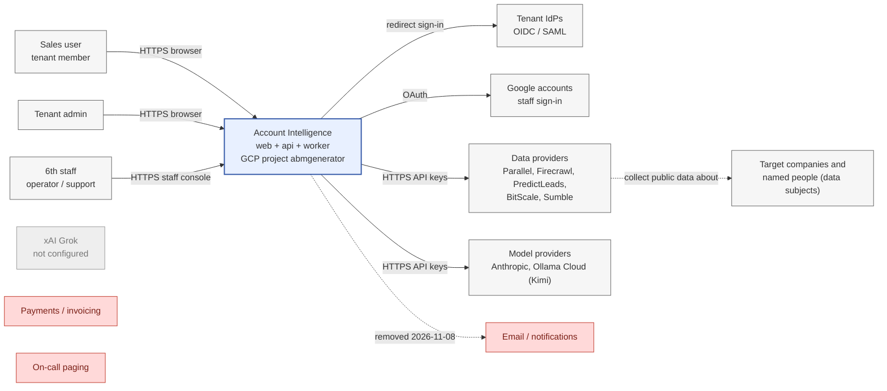

## 4. Diagram 2 · Containers

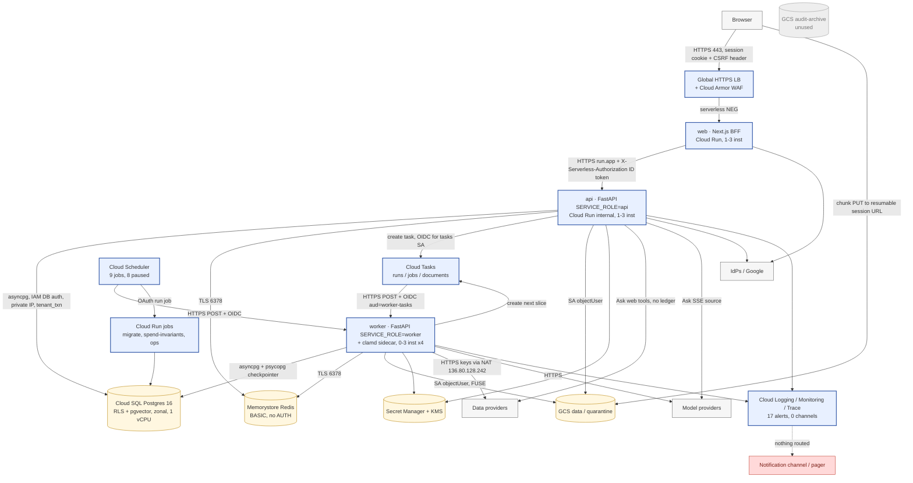

## 5. Diagram 3 · Deployment and network topology

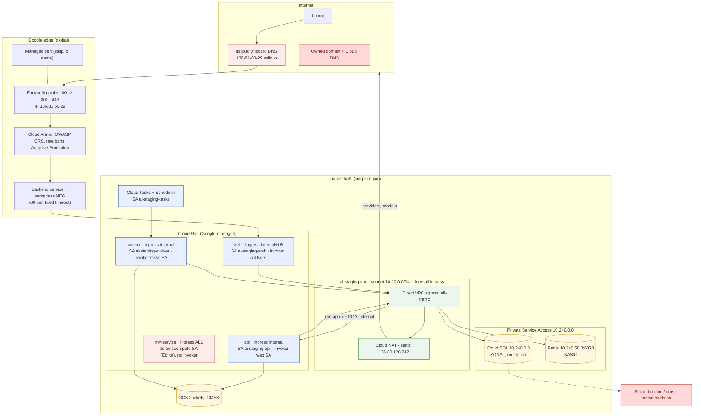

## 6. Diagram 4 · Request routing

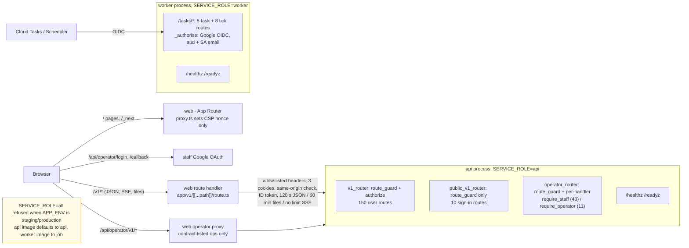

Route totals (V static parse of `src/account_intelligence/api/routes/*.py`): 229 routes: 150 user, 10 anonymous sign-in, 54 staff, 5 task, 8 tick, 2 probe. Every `/v1` and `/operator` route has exactly one policy entry; an unlisted route gets 403 (V `src/account_intelligence/api/guard.py:64-69`). Full table in [section 12](#12-full-route-table).

## 7. Diagram 5 · Sequences

### 7.1 Sign-in (tenant SSO, OIDC)

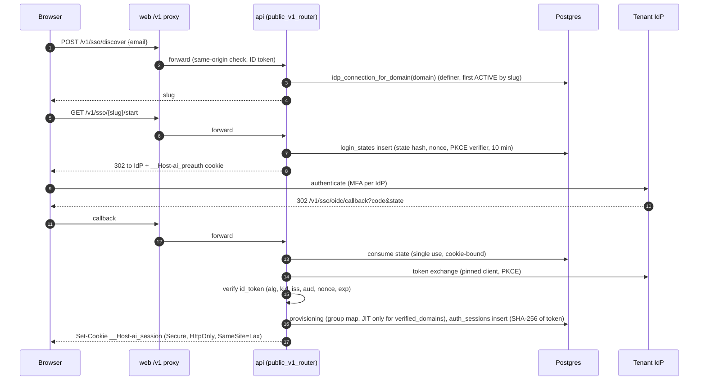

Password sign-in follows the same cookie path through `POST /v1/auth/login` (Argon2id, lockout, admins refused) (V `auth.py:143-243`).

### 7.2 Authenticated API call

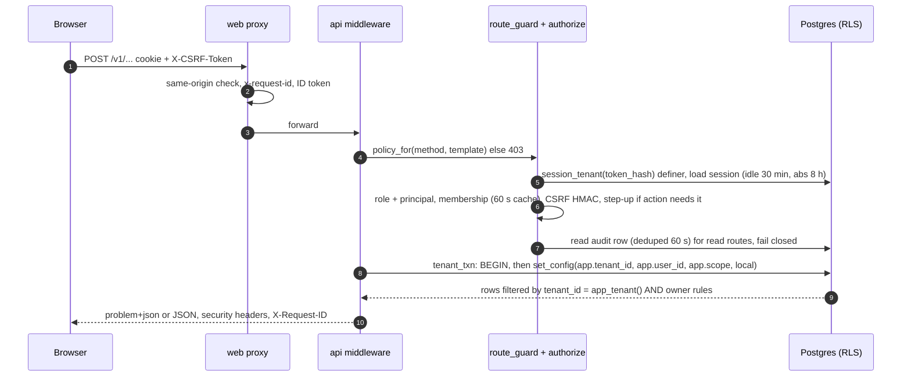

### 7.3 Starting a research run (estimate → first slice)

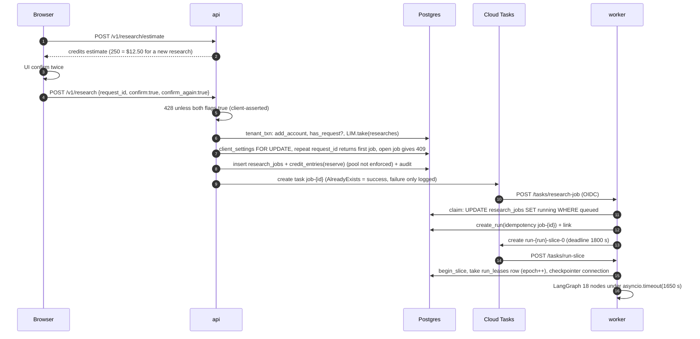

### 7.4 Cloud Tasks delivery to the worker

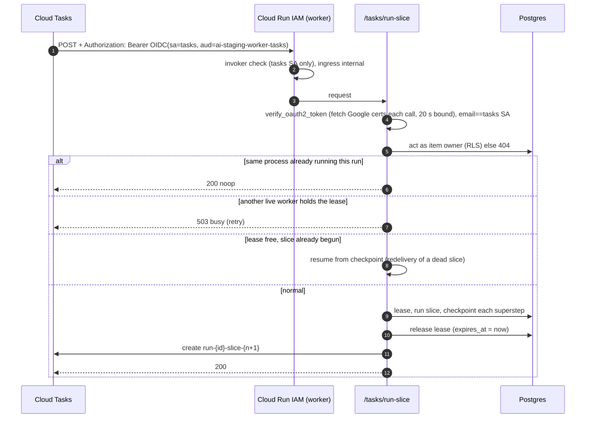

### 7.5 Scheduler tick

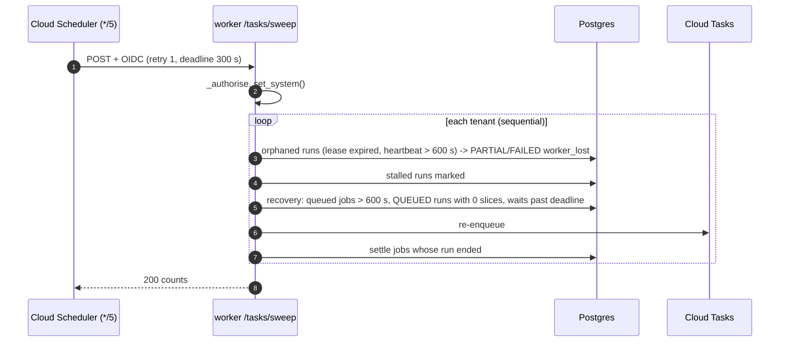

### 7.6 Upload

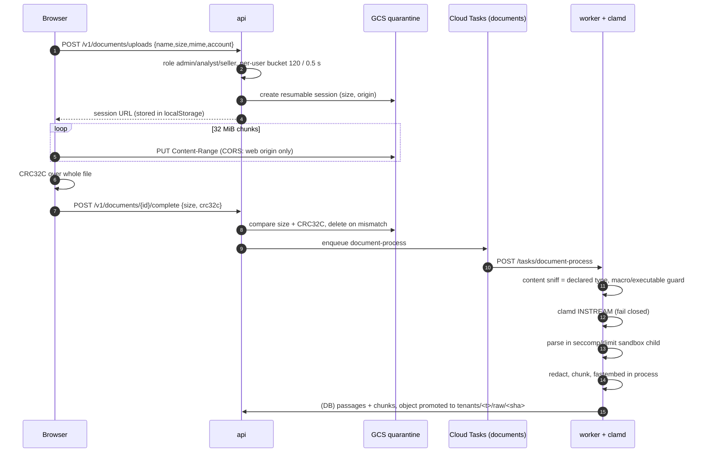

### 7.7 Ask stream

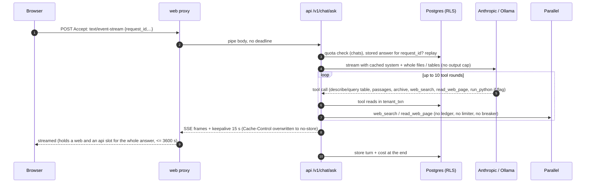

### 7.8 Paid provider call (connector router)

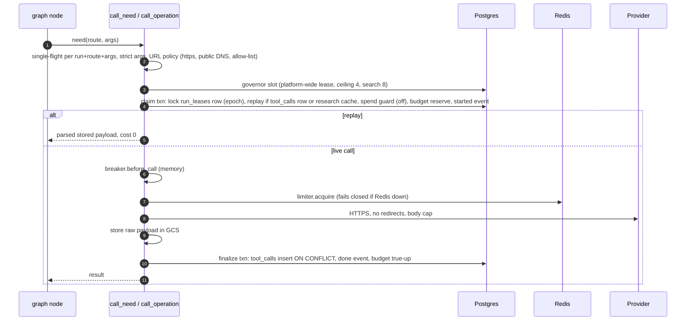

### 7.9 Staff console action

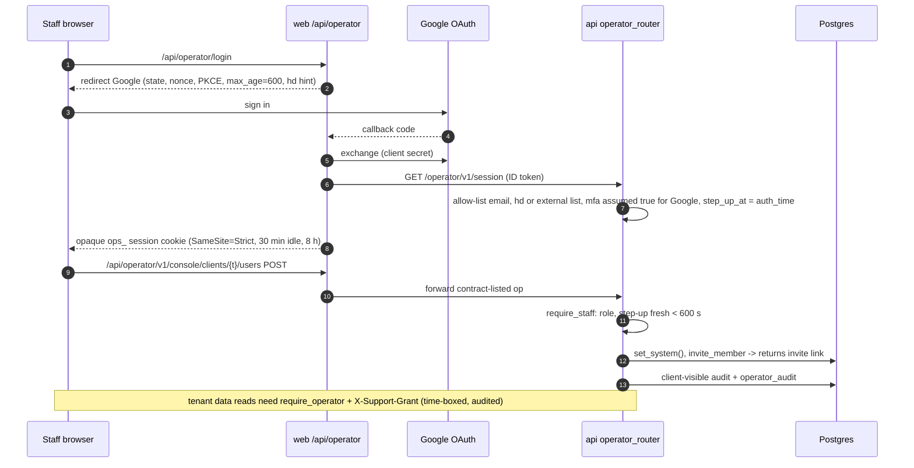

## 8. Diagram 6 · Entity-relationship (core tables)

All tables shown carry `tenant_id` with RLS `ENABLE` + `FORCE`, except `tenants` (scoped by its own `id`) and LangGraph `checkpoints` (scoped by `thread_id` prefix). V `migrations/0002_rls.sql`, `0053_replica.sql`, `0063_private_workspaces.sql` and the data inventory.

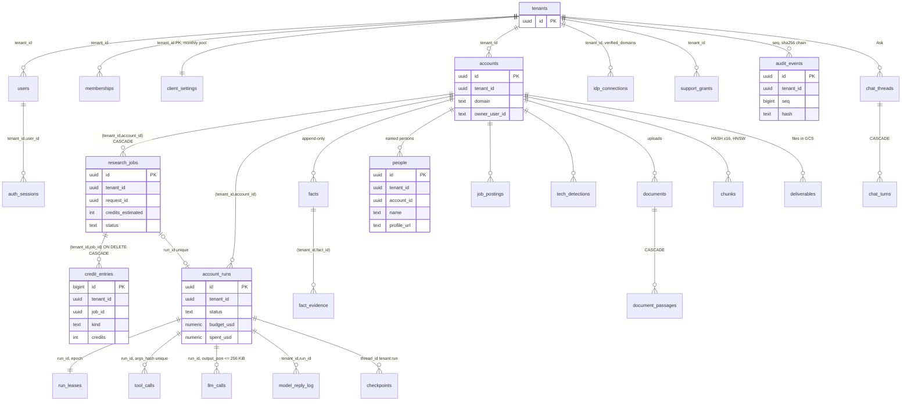

Size of the model: 114 migrations (0001–0115, 0069 absent), 222 tables, one Alembic chain whose bodies are SQL files; all pending revisions run in **one** transaction (V `migrations/env.py:69-83`). Only `chunks` is partitioned. Nothing prunes `checkpoints*`, `tool_calls`, `tool_call_events`, `llm_calls`, `model_reply_log`, `audit_events`, `usage_events`, `credit_entries` (V grep of `DELETE FROM` in `src/`).

## 9. Diagram 7 · Data flow and trust boundaries

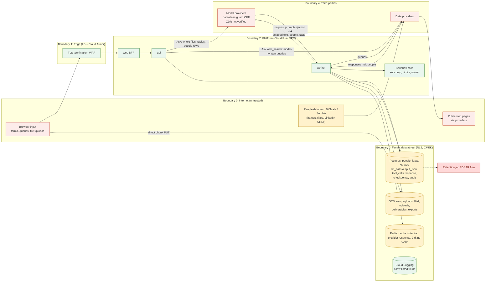

Untrusted input enters at: browser forms and uploads (B0→B1), provider responses including scraped page text and people records (B4→B2), and model outputs (B4→B2). Personal data rests in Postgres (people, facts, chunks, model outputs, checkpoints), GCS (raw payloads, deliverables), Redis (cache index) and model-provider logs (I: depends on provider retention, not verified).

## 10. Diagram 8 · Failure view

| Dependency | What breaks | What the user sees | Detection today | Evidence |
|---|---|---|---|---|
| Cloud SQL (zonal) down | Everything | Pages fail; api `/readyz` fails; runs stop | Uptime check alert → **no channel** | V `gcloud sql instances list` (ZONAL); `gcloud beta monitoring channels list` → `[]` |
| Redis down | Every paid provider call fails (limiter has no fallback); uploads, resume, exports, downloads return 503; sign-in falls back to per-instance buckets; cache misses | Research stalls and ends `no_progress`/PARTIAL; 503 on file actions | `rate_limit_degraded` log metric → no channel | V `connectors/ratelimit.py:163-184`; `identity/rate_limit.py:121-194` |
| Cloud Tasks paused/unavailable | No slices, jobs or document processing | Research "queued" forever; sweeper later ends runs `worker_lost` | Task backlog alert → no channel | V `gcloud tasks queues list` (PAUSED) |
| Worker instance killed (liveness 45 s, deploy, crash) | Up to 4 in-flight slices cut after 8 s | Run continues after ≈150 s Cloud Tasks retry; worst case ended `worker_lost` ≈40 min later | runs_worker_lost metric → no channel | V `infra/stack/main.tf:645-646`; `config/providers.yaml:35-49`; `runs/sweeper.py:120-163` |
| Anthropic down / 429 | Research model nodes; Ask | Run ends PARTIAL/FAILED (no fallback by owner decision); Ask error | None specific | V `src/llm/adapters/anthropic_api.py:44-55` |
| A data provider down | That lane | Blocked result with neutral reason, PARTIAL "steps waiting" | In-memory breaker per instance | V `connectors/router.py:73-78` |
| clamd down | Uploads not parsed | Document stays unavailable (fail closed) | None | V `src/documents/scan.py:1-11,153-160` |
| Google certs endpoint slow | Every task auth (fetched per call) | 503 → Cloud Tasks retry | None | V `adapters.py:255-258`; `tasks.py:76-79` |
| IdP down | Sign-in for that tenant | Cannot sign in; existing sessions continue | None | I |
| Region us-central1 down | All | Full outage; restore from same-region backups | None | V single region in all listings |

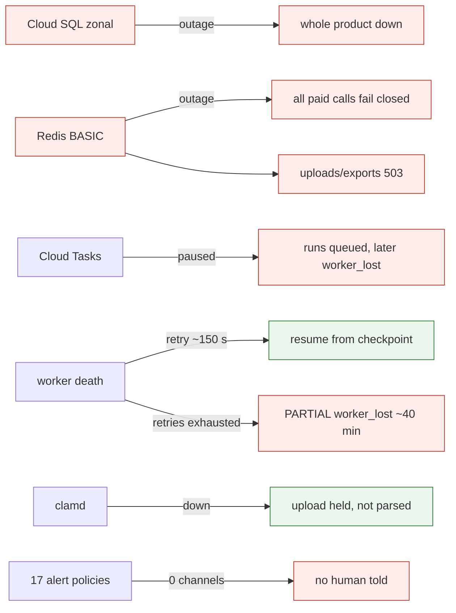

## 11. Disagreements between code, config and docs

| Claim (source) | What the code/config does | Evidence |
|---|---|---|
| Flow map: ticks go to api and worker | All 9 scheduler jobs target the worker or a Cloud Run job | V `gcloud scheduler jobs list` |
| `web/next.config.ts:2`, `web/lib/api.ts:1`: "/v1 is rewritten to the API" | A route-handler proxy; no rewrites | V `web/app/v1/[[...path]]/route.ts` |
| `api/main.py:5-8`: SIGTERM flips readyz and the slice runs to its checkpoint | Cloud Run has no readiness probe; uvicorn cuts work after 8 s | V `infra/modules/cloud_run/main.tf:198-216`; `infra/stack/main.tf:645-646` |
| `docs/registers/retention.yaml`: "enforced by the retention job" | No retention job or route; scheduler entry removed | V `infra/stack/main.tf:817-820`; `runs/sweeper.py:33-35` |
| `docs/privacy/subprocessors.md:10-16` | Lists data providers only; Anthropic, Ollama Cloud, Google Cloud missing | V |
| `docs/data-handling-people-data.md:28-35`: no raw delete rule; region asia-south1 | Raw payloads expire at 30 days; region us-central1 | V `gcloud storage buckets list` lifecycle; `gcloud sql instances list` |
| `src/admin/support.py:7`: "no break-glass path" | Operator invite returns a usable link | V `admin_console.py:400-425`; `api/team_invites.py:8-9` |
| `src/audit/chain.py:74`: "head is checked next pass" | Each pass restarts at seq 0, capped at 50,000 rows | V `chain.py:69,75`; `tasks.py:349` |
| `api/policy.py:285-289`: pause decisions need step-up | Entries have no `action`, so no step-up | V `guard.py:100-107` |
| `operator_sessions.py`: 30 min idle, 8 h | Every staff route needs a Google sign-in < 600 s old | V `operator.py:257,285` |
| `infra/stack/main.tf:245-256` and ADR-0130: worker concurrency 1 | Live worker concurrency 4 | V `gcloud run services list` |
| `adapters.py:93`: 1200 s slice; `tasks/main.tf:4`: 240 s slice | 1650 s | V `config/workflow_v1.yaml:13` |
| `config/providers.yaml:42-43`: five attempts | Runs queue `maxAttempts` 8 | V `gcloud tasks queues list` |
| `connectors/cache.py:15-16`: index holds no payload text | Index stores `tool_calls.response` | V `cache.py:258-276` |
| `api/idempotency.py`, `pagination.py`, `etag.py` read as platform contracts | No route uses them | NF importers in `src/` |
| `config/routing.yaml` | Disagrees with `providers.yaml` (route names, Parallel "paid: false"); code loads providers.yaml | V `routing.yaml:5-11`; `container.py:225` |
| Memory note: worker 6 vCPU/16 GiB | Live 4 vCPU/12 GiB | V `gcloud run services list` |

---

## 12. Full route table

Generated by static parse of the route modules and the policy catalog (V `src/account_intelligence/api/routes/*.py`, `src/account_intelligence/api/policy.py`). Columns: SERVICE_ROLE that registers the route; class; auth; the policy entry; handler location.

### health / module `health.py`

| # | method | path | SERVICE_ROLE | class | auth | policy entry | handler |
|---|---|---|---|---|---|---|---|
| 1 | GET | `/healthz` | probe (all roles) | probe | none | NONE | health.py:30 `healthz` |
| 2 | GET | `/readyz` | probe (all roles) | probe | none | NONE | health.py:138 `readyz` |

### operator_router (route_guard only) / module `admin_console.py`

| # | method | path | SERVICE_ROLE | class | auth | policy entry | handler |
|---|---|---|---|---|---|---|---|
| 3 | GET | `/operator/v1/console/clients` | api | staff | Depends(require_staff) | admin_console.py:104 operator_route('read', tenant='none', roles=OPS) | admin_console.py:228 `clients` |
| 4 | POST | `/operator/v1/console/clients` | api | staff | Depends(require_staff) | admin_console.py:104 operator_route('admin', tenant='none', roles=OPS) | admin_console.py:306 `add_client` |
| 5 | GET | `/operator/v1/console/clients/{tenant_id}` | api | staff | Depends(require_staff) | admin_console.py:104 operator_route('read', tenant='operator_target', roles=OPS) | admin_console.py:469 `client_detail` |
| 6 | PUT | `/operator/v1/console/clients/{tenant_id}` | api | staff | Depends(require_staff) | admin_console.py:104 operator_route('admin', tenant='operator_target', roles=OPS) | admin_console.py:497 `change_client` |
| 7 | POST | `/operator/v1/console/clients/{tenant_id}/invite` | api | staff | Depends(require_staff) | admin_console.py:104 operator_route('admin', tenant='operator_target', roles=OPS) | admin_console.py:365 `renew_invite` |
| 8 | GET | `/operator/v1/console/clients/{tenant_id}/people-consent` | api | staff | Depends(require_staff) | admin_console.py:104 operator_route('read', tenant='operator_target', roles=OPS) | admin_console.py:548 `client_people_consent` |
| 9 | POST | `/operator/v1/console/clients/{tenant_id}/people-consent` | api | staff | Depends(require_staff) | admin_console.py:104 operator_route('admin', tenant='operator_target', roles=OPS) | admin_console.py:559 `set_client_people_consent` |
| 10 | POST | `/operator/v1/console/clients/{tenant_id}/rebuild-files` | api | staff | Depends(require_staff) | admin_console.py:104 operator_route('admin', tenant='operator_target', roles=OPS) | admin_console.py:604 `rebuild_files` |
| 11 | POST | `/operator/v1/console/clients/{tenant_id}/users` | api | staff | Depends(require_staff) | admin_console.py:104 operator_route('admin', tenant='operator_target', roles=OPS) | admin_console.py:398 `invite_client_user` |
| 12 | GET | `/operator/v1/console/defaults` | api | staff | Depends(require_staff) | admin_console.py:104 operator_route('read', tenant='none', roles=OPS) | admin_console.py:971 `defaults` |
| 13 | PUT | `/operator/v1/console/defaults` | api | staff | Depends(require_staff) | admin_console.py:104 operator_route('admin', tenant='none', roles=OPS) | admin_console.py:1003 `change_defaults` |
| 14 | GET | `/operator/v1/console/overview` | api | staff | Depends(require_staff) | admin_console.py:104 operator_route('read', tenant='none', roles=OPS) | admin_console.py:180 `overview` |
| 15 | GET | `/operator/v1/console/requests` | api | staff | Depends(require_staff) | admin_console.py:104 operator_route('read', tenant='none', roles=OPS) | admin_console.py:772 `limit_requests` |
| 16 | POST | `/operator/v1/console/requests/{tenant_id}/{request_id}/approve` | api | staff | Depends(require_staff) | admin_console.py:104 operator_route('admin', tenant='operator_target', roles=OPS) | admin_console.py:857 `approve_request` |
| 17 | POST | `/operator/v1/console/requests/{tenant_id}/{request_id}/decline` | api | staff | Depends(require_staff) | admin_console.py:104 operator_route('admin', tenant='operator_target', roles=OPS) | admin_console.py:869 `decline_request` |
| 18 | GET | `/operator/v1/console/runs` | api | staff | Depends(require_staff) | admin_console.py:104 operator_route('read', tenant='none', roles=OPS) | admin_console.py:899 `runs` |
| 19 | GET | `/operator/v1/console/runs/{tenant_id}/{run_id}` | api | staff | Depends(require_staff) | admin_console.py:104 operator_route('read', tenant='operator_target', roles=OPS) | admin_console.py:1048 `run_detail` |
| 20 | GET | `/operator/v1/console/users` | api | staff | Depends(require_staff) | admin_console.py:104 operator_route('read', tenant='none', roles=OPS) | admin_console.py:692 `users` |
| 21 | PUT | `/operator/v1/console/users/{tenant_id}/limits` | api | staff | Depends(require_staff) | admin_console.py:104 operator_route('admin', tenant='operator_target', roles=OPS) | admin_console.py:745 `change_limits` |
| 22 | POST | `/operator/v1/console/users/{tenant_id}/re-enable` | api | staff | Depends(require_staff) | admin_console.py:104 operator_route('admin', tenant='operator_target', roles=OPS) | admin_console.py:888 `re_enable` |
| 23 | POST | `/operator/v1/console/users/{tenant_id}/terminate` | api | staff | Depends(require_staff) | admin_console.py:104 operator_route('admin', tenant='operator_target', roles=OPS) | admin_console.py:877 `terminate` |

### operator_router (route_guard only) / module `feedback.py`

| # | method | path | SERVICE_ROLE | class | auth | policy entry | handler |
|---|---|---|---|---|---|---|---|
| 24 | GET | `/operator/v1/pilot/aggregate` | api | staff | Depends(require_staff) | feedback.py:39 operator_route('read', tenant='none', roles=_OPS) | feedback.py:138 `aggregate` |

### operator_router (route_guard only) / module `library.py`

| # | method | path | SERVICE_ROLE | class | auth | policy entry | handler |
|---|---|---|---|---|---|---|---|
| 25 | GET | `/operator/v1/library` | api | staff | Depends(require_staff) | library.py:54 operator_route('read', tenant='none', roles=OPS) | library.py:120 `library_list` |
| 26 | POST | `/operator/v1/library/uploads` | api | staff | Depends(require_staff) | library.py:55 operator_route('admin', tenant='none', roles=OPS) | library.py:127 `library_upload` |
| 27 | POST | `/operator/v1/library/{library_account_id}/publish` | api | staff | Depends(require_staff) | library.py:57 operator_route('admin', tenant='none', roles=OPS) | library.py:166 `library_publish` |
| 28 | POST | `/operator/v1/library/{library_account_id}/unpublish` | api | staff | Depends(require_staff) | library.py:57 operator_route('admin', tenant='none', roles=OPS) | library.py:190 `library_unpublish` |

### operator_router (route_guard only) / module `operator_admin.py`

| # | method | path | SERVICE_ROLE | class | auth | policy entry | handler |
|---|---|---|---|---|---|---|---|
| 29 | GET | `/operator/v1/flags` | api | staff | Depends(require_staff) | operator_admin.py:62 operator_route('read', tenant='none', roles=OPS) | operator_admin.py:365 `list_flags` |
| 30 | POST | `/operator/v1/flags` | api | staff | Depends(require_staff) | operator_admin.py:63 operator_route('admin', tenant='none', roles=OPS) | operator_admin.py:384 `set_flag` |
| 31 | GET | `/operator/v1/keys` | api | staff | Depends(require_staff) | operator_admin.py:64 operator_route('read', tenant='none', roles=OPS) | operator_admin.py:412 `list_keys` |
| 32 | POST | `/operator/v1/keys` | api | staff | Depends(require_staff) | operator_admin.py:65 operator_route('admin', tenant='none', roles=OPS) | operator_admin.py:421 `add_key` |
| 33 | GET | `/operator/v1/session` | api | staff | Depends(require_staff) | operator_admin.py:40 operator_route('read', tenant='none', roles=STAFF) | operator_admin.py:75 `operator_session` |
| 34 | POST | `/operator/v1/sessions` | api | staff | Depends(require_staff) | operator_admin.py:41 operator_route('none', tenant='none', roles=STAFF) | operator_admin.py:87 `mint_operator_session` |
| 35 | DELETE | `/operator/v1/sessions/current` | api | staff | Depends(require_staff); Header(default=None) | operator_admin.py:42 operator_route('none', tenant='none', roles=STAFF) | operator_admin.py:106 `end_operator_session` |
| 36 | GET | `/operator/v1/tenants` | api | staff | Depends(require_staff) | operator_admin.py:45 operator_route('read', tenant='none', roles=STAFF) | operator_admin.py:157 `overview` |
| 37 | POST | `/operator/v1/tenants` | api | staff | Depends(require_staff) | operator_admin.py:46 operator_route('admin', tenant='none', roles=OPS) | operator_admin.py:171 `provision` |
| 38 | POST | `/operator/v1/tenants/{tenant_id}/deletion` | api | staff | Depends(require_staff) | operator_admin.py:57 operator_route('admin', tenant='operator_target', roles=OPS) | operator_admin.py:284 `request_deletion` |
| 39 | POST | `/operator/v1/tenants/{tenant_id}/deletion/{request_id}/approve` | api | staff | Depends(require_staff) | operator_admin.py:57 operator_route('admin', tenant='operator_target', roles=OPS) | operator_admin.py:342 `deletion_approve` |
| 40 | POST | `/operator/v1/tenants/{tenant_id}/deletion/{request_id}/dry-run` | api | staff | Depends(require_staff) | operator_admin.py:57 operator_route('admin', tenant='operator_target', roles=OPS) | operator_admin.py:334 `deletion_dry_run` |
| 41 | POST | `/operator/v1/tenants/{tenant_id}/deletion/{request_id}/execute` | api | staff | Depends(require_staff) | operator_admin.py:57 operator_route('admin', tenant='operator_target', roles=OPS) | operator_admin.py:350 `deletion_execute` |
| 42 | POST | `/operator/v1/tenants/{tenant_id}/plan` | api | staff | Depends(require_staff) | operator_admin.py:57 operator_route('admin', tenant='operator_target', roles=OPS) | operator_admin.py:263 `set_plan` |
| 43 | POST | `/operator/v1/tenants/{tenant_id}/quotas` | api | staff | Depends(require_staff) | operator_admin.py:57 operator_route('admin', tenant='operator_target', roles=OPS) | operator_admin.py:238 `set_quota` |
| 44 | POST | `/operator/v1/tenants/{tenant_id}/reactivate` | api | staff | Depends(require_staff) | operator_admin.py:57 operator_route('admin', tenant='operator_target', roles=OPS) | operator_admin.py:221 `reactivate` |
| 45 | POST | `/operator/v1/tenants/{tenant_id}/suspend` | api | staff | Depends(require_staff) | operator_admin.py:57 operator_route('admin', tenant='operator_target', roles=OPS) | operator_admin.py:213 `suspend` |

### operator_router (route_guard only) / module `operator_view.py`

| # | method | path | SERVICE_ROLE | class | auth | policy entry | handler |
|---|---|---|---|---|---|---|---|
| 46 | GET | `/operator/v1/view/accounts` | api | staff | Depends(require_operator) | operator_view.py:26 operator_route('read') | operator_view.py:32 `accounts` |
| 47 | GET | `/operator/v1/view/settings` | api | staff | Depends(require_operator) | operator_view.py:27 operator_route('read') | operator_view.py:57 `tenant_settings` |
| 48 | GET | `/operator/v1/view/workspace` | api | staff | Depends(require_operator) | operator_view.py:28 operator_route('read') | operator_view.py:75 `workspace` |

### operator_router (route_guard only) / module `ops.py`

| # | method | path | SERVICE_ROLE | class | auth | policy entry | handler |
|---|---|---|---|---|---|---|---|
| 49 | GET | `/operator/v1/ops/cost/{run_id}` | api | staff | Depends(require_operator) | policy.py: _operator('read') | ops.py:63 `run_cost` |
| 50 | GET | `/operator/v1/ops/failures` | api | staff | Depends(require_operator) | policy.py: _operator('read') | ops.py:86 `failures` |
| 51 | GET | `/operator/v1/ops/stuck` | api | staff | Depends(require_operator) | policy.py: _operator('read') | ops.py:103 `stuck` |
| 52 | GET | `/operator/v1/runs/{run_id}/timeline` | api | staff | Depends(require_operator) | policy.py: _operator('read') | ops.py:31 `run_timeline` |

### operator_router (route_guard only) / module `spend_v2.py`

| # | method | path | SERVICE_ROLE | class | auth | policy entry | handler |
|---|---|---|---|---|---|---|---|
| 53 | POST | `/operator/v1/runs/{run_id}/prepulled/intents` | api | staff | Depends(require_operator) | policy.py: _operator('admin') | spend_v2.py:234 `intent_target` |
| 54 | GET | `/operator/v1/runs/{run_id}/prepulled/{intent_id}` | api | staff | Depends(require_operator) | policy.py: _operator('read') | spend_v2.py:302 `intent_status` |
| 55 | POST | `/operator/v1/runs/{run_id}/prepulled/{intent_id}/complete` | api | staff | Depends(require_operator) | policy.py: _operator('admin') | spend_v2.py:268 `complete_upload` |
| 56 | GET | `/operator/v1/runs/{run_id}/spend/live` | api | staff | Depends(require_operator) | policy.py: _operator('read') | spend_v2.py:209 `operator_live` |

### public_v1_router (route_guard only) / module `auth.py`

| # | method | path | SERVICE_ROLE | class | auth | policy entry | handler |
|---|---|---|---|---|---|---|---|
| 57 | POST | `/v1/auth/email/resend` | api | public (anonymous) | route_guard only | auth.py:43 ANONYMOUS | auth.py:406 `resend_verification` |
| 58 | POST | `/v1/auth/email/verify` | api | public (anonymous) | route_guard only | auth.py:44 ANONYMOUS | auth.py:438 `verify_email` |
| 59 | POST | `/v1/auth/invite/accept` | api | public (anonymous) | route_guard only | auth.py:47 ANONYMOUS | auth.py:549 `accept_invite` |
| 60 | POST | `/v1/auth/login` | api | public (anonymous) | route_guard only | auth.py:42 ANONYMOUS | auth.py:133 `login` |
| 61 | POST | `/v1/auth/password/reset` | api | public (anonymous) | route_guard only | auth.py:46 ANONYMOUS | auth.py:507 `reset_password` |
| 62 | POST | `/v1/auth/password/reset/request` | api | public (anonymous) | route_guard only | auth.py:45 ANONYMOUS | auth.py:454 `request_password_reset` |

### public_v1_router (route_guard only) / module `sso.py`

| # | method | path | SERVICE_ROLE | class | auth | policy entry | handler |
|---|---|---|---|---|---|---|---|
| 63 | POST | `/v1/sso/discover` | api | public (anonymous) | route_guard only | sso.py:50 ANONYMOUS | sso.py:94 `discover` |
| 64 | GET | `/v1/sso/oidc/callback` | api | public (anonymous) | route_guard only | sso.py:52 ANONYMOUS | sso.py:155 `oidc_callback` |
| 65 | POST | `/v1/sso/saml/acs` | api | public (anonymous) | route_guard only | sso.py:53 ANONYMOUS | sso.py:177 `saml_acs` |
| 66 | GET | `/v1/sso/{slug}/start` | api | public (anonymous) | route_guard only | sso.py:51 ANONYMOUS | sso.py:107 `start` |

### tasks / module `tasks.py`

| # | method | path | SERVICE_ROLE | class | auth | policy entry | handler |
|---|---|---|---|---|---|---|---|
| 67 | POST | `/tasks/access-expiry` | worker | tick (Cloud Scheduler) | _authorise(): Google OIDC ID token, aud=TASKS_AUDIENCE, email=TASKS_SERVICE_ACCOUNT | NONE | tasks.py:291 `access_expiry` |
| 68 | POST | `/tasks/approval-timeout` | worker | task (Cloud Tasks) | _authorise(): Google OIDC ID token, aud=TASKS_AUDIENCE, email=TASKS_SERVICE_ACCOUNT | NONE | tasks.py:204 `approval_timeout` |
| 69 | POST | `/tasks/audit-verify` | worker | tick (Cloud Scheduler) | _authorise(): Google OIDC ID token, aud=TASKS_AUDIENCE, email=TASKS_SERVICE_ACCOUNT | NONE | tasks.py:331 `audit_verify` |
| 70 | POST | `/tasks/document-process` | worker | task (Cloud Tasks) | _authorise(): Google OIDC ID token, aud=TASKS_AUDIENCE, email=TASKS_SERVICE_ACCOUNT | NONE | tasks.py:178 `document_process` |
| 71 | POST | `/tasks/documents-abandon` | worker | tick (Cloud Scheduler) | _authorise(): Google OIDC ID token, aud=TASKS_AUDIENCE, email=TASKS_SERVICE_ACCOUNT | NONE | tasks.py:473 `documents_abandon` |
| 72 | POST | `/tasks/download-everything` | worker | task (Cloud Tasks) | _authorise(): Google OIDC ID token, aud=TASKS_AUDIENCE, email=TASKS_SERVICE_ACCOUNT | NONE | tasks.py:250 `download_everything` |
| 73 | POST | `/tasks/isolation-check` | worker | tick (Cloud Scheduler) | _authorise(): Google OIDC ID token, aud=TASKS_AUDIENCE, email=TASKS_SERVICE_ACCOUNT | NONE | tasks.py:491 `isolation_check` |
| 74 | POST | `/tasks/metrics` | worker | tick (Cloud Scheduler) | _authorise(): Google OIDC ID token, aud=TASKS_AUDIENCE, email=TASKS_SERVICE_ACCOUNT | NONE | tasks.py:420 `metrics_tick` |
| 75 | POST | `/tasks/notify-relay` | worker | tick (Cloud Scheduler) | _authorise(): Google OIDC ID token, aud=TASKS_AUDIENCE, email=TASKS_SERVICE_ACCOUNT | NONE | tasks.py:360 `notify_relay` |
| 76 | POST | `/tasks/research-job` | worker | task (Cloud Tasks) | _authorise(): Google OIDC ID token, aud=TASKS_AUDIENCE, email=TASKS_SERVICE_ACCOUNT | NONE | tasks.py:236 `research_job` |
| 77 | POST | `/tasks/run-slice` | worker | task (Cloud Tasks) | _authorise(): Google OIDC ID token, aud=TASKS_AUDIENCE, email=TASKS_SERVICE_ACCOUNT | NONE | tasks.py:131 `run_slice` |
| 78 | POST | `/tasks/schedules-tick` | worker | tick (Cloud Scheduler) | _authorise(): Google OIDC ID token, aud=TASKS_AUDIENCE, email=TASKS_SERVICE_ACCOUNT | NONE | tasks.py:276 `schedules_tick` |
| 79 | POST | `/tasks/sweep` | worker | tick (Cloud Scheduler) | _authorise(): Google OIDC ID token, aud=TASKS_AUDIENCE, email=TASKS_SERVICE_ACCOUNT | NONE | tasks.py:313 `sweep` |

### v1_router (route_guard+authorize) / module `account_workspace.py`

| # | method | path | SERVICE_ROLE | class | auth | policy entry | handler |
|---|---|---|---|---|---|---|---|
| 80 | GET | `/v1/accounts/{domain}/archive` | api | user | route_guard+authorize | account_workspace.py:57 tenant_route('read_public', 'read', step_up=False) | account_workspace.py:769 `account_archive` |
| 81 | GET | `/v1/accounts/{domain}/archive/list` | api | user | route_guard+authorize | account_workspace.py:58 tenant_route('read_public', 'read', step_up=False) | account_workspace.py:862 `account_archive_list` |
| 82 | GET | `/v1/accounts/{domain}/deliverables` | api | user | route_guard+authorize | account_workspace.py:66 tenant_route('read_public', 'read', step_up=False) | account_workspace.py:403 `account_deliverables` |
| 83 | GET | `/v1/accounts/{domain}/deliverables/download` | api | user | route_guard+authorize | account_workspace.py:94 tenant_route('export_files', 'export', step_up=False) | account_workspace.py:415 `download_deliverables` |
| 84 | GET | `/v1/accounts/{domain}/file-analysis` | api | user | route_guard+authorize | account_workspace.py:61 tenant_route('read_public', 'read', step_up=False) | account_workspace.py:357 `file_analysis` |
| 85 | GET | `/v1/accounts/{domain}/sheets/{sheet}` | api | user | route_guard+authorize | account_workspace.py:69 tenant_route('read_public', 'read', step_up=False) | account_workspace.py:529 `account_sheet` |
| 86 | GET | `/v1/accounts/{domain}/sheets/{sheet}/cell` | api | user | route_guard+authorize | account_workspace.py:79 tenant_route('read_public', 'read', step_up=False) | account_workspace.py:606 `account_sheet_cell` |
| 87 | GET | `/v1/accounts/{domain}/sheets/{sheet}/csv` | api | user | route_guard+authorize | account_workspace.py:89 tenant_route('export_files', 'export', step_up=False) | account_workspace.py:1099 `account_sheet_csv` |
| 88 | GET | `/v1/accounts/{domain}/sheets/{sheet}/tabs/{tab}` | api | user | route_guard+authorize | account_workspace.py:74 tenant_route('read_public', 'read', step_up=False) | account_workspace.py:968 `account_sheet_tab` |
| 89 | GET | `/v1/accounts/{domain}/sheets/{sheet}/xlsx` | api | user | route_guard+authorize | account_workspace.py:84 tenant_route('export_files', 'export', step_up=False) | account_workspace.py:1025 `account_sheet_xlsx` |
| 90 | GET | `/v1/accounts/{domain}/workspace` | api | user | route_guard+authorize | account_workspace.py:54 tenant_route('read_public', 'read', step_up=False) | account_workspace.py:288 `account_workspace` |

### v1_router (route_guard+authorize) / module `accounts.py`

| # | method | path | SERVICE_ROLE | class | auth | policy entry | handler |
|---|---|---|---|---|---|---|---|
| 91 | GET | `/v1/accounts` | api | user | route_guard+authorize | accounts.py:50 tenant_route('read_public', 'read') | accounts.py:77 `list_accounts` |
| 92 | POST | `/v1/accounts` | api | user | route_guard+authorize | accounts.py:51 tenant_route('add_account', 'run') | accounts.py:150 `add_account` |
| 93 | DELETE | `/v1/accounts/{domain}` | api | user | route_guard+authorize | accounts.py:52 tenant_route('add_account', 'run') | accounts.py:237 `delete_account` |
| 94 | GET | `/v1/accounts/{domain}` | api | user | route_guard+authorize | accounts.py:54 tenant_route('read_public', 'read') | accounts.py:294 `read_account` |
| 95 | GET | `/v1/accounts/{domain}/tables/{table}` | api | user | route_guard+authorize | accounts.py:53 tenant_route('read_public', 'read') | accounts.py:412 `read_table` |

### v1_router (route_guard+authorize) / module `ask.py`

| # | method | path | SERVICE_ROLE | class | auth | policy entry | handler |
|---|---|---|---|---|---|---|---|
| 96 | POST | `/v1/chat/ask` | api | user | route_guard+authorize | ask.py:103 tenant_route('read_public', 'run', step_up=False) | ask.py:168 `ask` |

### v1_router (route_guard+authorize) / module `audit.py`

| # | method | path | SERVICE_ROLE | class | auth | policy entry | handler |
|---|---|---|---|---|---|---|---|
| 97 | GET | `/v1/audit` | api | user | route_guard+authorize | audit.py:29 tenant_route('read_audit', 'read') | audit.py:38 `list_audit` |
| 98 | GET | `/v1/audit/export` | api | user | route_guard+authorize | audit.py:30 tenant_route('export_audit', 'export') | audit.py:82 `export_audit` |

### v1_router (route_guard+authorize) / module `auth.py`

| # | method | path | SERVICE_ROLE | class | auth | policy entry | handler |
|---|---|---|---|---|---|---|---|
| 99 | POST | `/v1/auth/password/enroll` | api | user | route_guard+authorize | auth.py:48 tenant_route('manage_own_auth', 'admin') | auth.py:345 `enroll_password` |

### v1_router (route_guard+authorize) / module `chat.py`

| # | method | path | SERVICE_ROLE | class | auth | policy entry | handler |
|---|---|---|---|---|---|---|---|
| 100 | GET | `/v1/chat/threads` | api | user | route_guard+authorize | chat.py:36 tenant_route('read_public', 'read', step_up=False) | chat.py:80 `threads` |
| 101 | POST | `/v1/chat/threads` | api | user | route_guard+authorize | chat.py:35 tenant_route('start_run', 'run') | chat.py:65 `new_thread` |
| 102 | DELETE | `/v1/chat/threads/{thread_id}` | api | user | route_guard+authorize | chat.py:38 tenant_route('save_own_view', 'none', step_up=False) | chat.py:122 `remove_thread` |
| 103 | GET | `/v1/chat/threads/{thread_id}` | api | user | route_guard+authorize | chat.py:37 tenant_route('read_public', 'read', step_up=False) | chat.py:86 `thread` |
| 104 | GET | `/v1/models` | api | user | route_guard+authorize | chat.py:34 tenant_route('read_public', 'read', step_up=False) | chat.py:49 `models` |

### v1_router (route_guard+authorize) / module `connectors.py`

| # | method | path | SERVICE_ROLE | class | auth | policy entry | handler |
|---|---|---|---|---|---|---|---|
| 105 | GET | `/v1/connectors` | api | user | route_guard+authorize | connectors.py:37 tenant_route('manage_connectors', 'read', step_up=False) | connectors.py:81 `list_connectors` |
| 106 | POST | `/v1/connectors` | api | user | route_guard+authorize | connectors.py:38 tenant_route('manage_connectors', 'admin') | connectors.py:123 `start` |
| 107 | GET | `/v1/connectors/oauth/callback` | api | user | route_guard+authorize | connectors.py:39 tenant_route('manage_connectors', 'admin', step_up=False) | connectors.py:158 `callback` |
| 108 | POST | `/v1/connectors/{connection_id}/disconnect` | api | user | route_guard+authorize | connectors.py:62 tenant_route('manage_connectors', 'admin') | connectors.py:322 `disconnect` |
| 109 | POST | `/v1/connectors/{connection_id}/fetch` | api | user | route_guard+authorize | connectors.py:47 tenant_route('manage_connectors', 'admin', step_up=False) | connectors.py:234 `fetch` |
| 110 | POST | `/v1/connectors/{connection_id}/grants` | api | user | route_guard+authorize | connectors.py:44 tenant_route('manage_connectors', 'admin') | connectors.py:203 `grant` |
| 111 | GET | `/v1/connectors/{connection_id}/quarantine` | api | user | route_guard+authorize | connectors.py:52 tenant_route('manage_connectors', 'read', step_up=False) | connectors.py:275 `held` |
| 112 | POST | `/v1/connectors/{connection_id}/quarantine/{item_id}/{decision}` | api | user | route_guard+authorize | connectors.py:57 tenant_route('manage_connectors', 'admin') | connectors.py:288 `decide` |

### v1_router (route_guard+authorize) / module `credits.py`

| # | method | path | SERVICE_ROLE | class | auth | policy entry | handler |
|---|---|---|---|---|---|---|---|
| 113 | GET | `/v1/accounts/{domain}/refresh` | api | user | route_guard+authorize | credits.py:44 tenant_route('read_public', 'read', step_up=False) | credits.py:114 `refresh_options` |
| 114 | POST | `/v1/accounts/{domain}/refresh` | api | user | route_guard+authorize | credits.py:45 tenant_route('start_run', 'run', step_up=False) | credits.py:157 `confirm_refresh` |
| 115 | GET | `/v1/credits` | api | user | route_guard+authorize | credits.py:43 tenant_route('read_public', 'read', step_up=False) | credits.py:60 `credits_now` |
| 116 | GET | `/v1/notifications` | api | user | route_guard+authorize | credits.py:46 tenant_route('read_public', 'read', step_up=False) | credits.py:242 `notifications` |
| 117 | POST | `/v1/notifications/{notification_id}/read` | api | user | route_guard+authorize | credits.py:47 tenant_route('read_public', 'none', step_up=False) | credits.py:269 `notification_read` |

### v1_router (route_guard+authorize) / module `crm.py`

| # | method | path | SERVICE_ROLE | class | auth | policy entry | handler |
|---|---|---|---|---|---|---|---|
| 118 | POST | `/v1/crm/{crm}/enable` | api | user | route_guard+authorize | crm.py:46 tenant_route('manage_connectors','admin') | crm.py:115 `enable` |
| 119 | POST | `/v1/crm/{crm}/mappings` | api | user | route_guard+authorize | crm.py:46 tenant_route('manage_connectors','admin') | crm.py:153 `confirm` |
| 120 | POST | `/v1/crm/{crm}/preview` | api | user | route_guard+authorize | crm.py:46 tenant_route('manage_connectors','admin') | crm.py:196 `preview` |
| 121 | POST | `/v1/crm/{crm}/revoke` | api | user | route_guard+authorize | crm.py:46 tenant_route('manage_connectors','admin') | crm.py:134 `revoke` |
| 122 | GET | `/v1/crm/{crm}/writes` | api | user | route_guard+authorize | crm.py:47 tenant_route('manage_connectors', 'read', step_up=False) | crm.py:284 `writes` |
| 123 | POST | `/v1/crm/{crm}/writes` | api | user | route_guard+authorize | crm.py:46 tenant_route('manage_connectors','admin') | crm.py:220 `request_write` |
| 124 | POST | `/v1/crm/{crm}/writes/approve` | api | user | route_guard+authorize | crm.py:46 tenant_route('manage_connectors','admin') | crm.py:249 `approve` |

### v1_router (route_guard+authorize) / module `documents.py`

| # | method | path | SERVICE_ROLE | class | auth | policy entry | handler |
|---|---|---|---|---|---|---|---|
| 125 | GET | `/v1/documents` | api | user | route_guard+authorize; Depends(require_role(*UPLOADERS)) | policy.py: _tenant(_UPLOADERS, 'read') | documents.py:395 `list_documents` |
| 126 | POST | `/v1/documents/confirm-company` | api | user | route_guard+authorize; Depends(require_role(*UPLOADERS)) | policy.py: _tenant(_UPLOADERS, 'run') | documents.py:405 `confirm_company` |
| 127 | POST | `/v1/documents/estimate` | api | user | route_guard+authorize; Depends(require_role(*UPLOADERS)) | policy.py: _tenant(_UPLOADERS, 'read') | documents.py:463 `estimate` |
| 128 | GET | `/v1/documents/policy` | api | user | route_guard+authorize; Depends(require_role(*UPLOADERS)) | policy.py: _tenant(_UPLOADERS, 'read') | documents.py:510 `get_policy` |
| 129 | PUT | `/v1/documents/policy` | api | user | route_guard+authorize; Depends(require_role('admin')) | policy.py: _tenant({'admin'}, 'admin', action='manage_settings') | documents.py:522 `put_policy` |
| 130 | POST | `/v1/documents/uploads` | api | user | route_guard+authorize; Depends(require_role(*UPLOADERS)) | policy.py: _tenant(_UPLOADERS, 'run') | documents.py:140 `start_upload` |
| 131 | DELETE | `/v1/documents/{document_id}` | api | user | route_guard+authorize; Depends(require_role(*UPLOADERS)) | policy.py: _tenant(_UPLOADERS, 'run') | documents.py:487 `delete` |
| 132 | POST | `/v1/documents/{document_id}/authoritative` | api | user | route_guard+authorize; Depends(require_role('admin')) | policy.py: _tenant({'admin'}, 'admin') | documents.py:542 `set_authoritative` |
| 133 | POST | `/v1/documents/{document_id}/complete` | api | user | route_guard+authorize; Depends(require_role(*UPLOADERS)) | policy.py: _tenant(_UPLOADERS, 'run') | documents.py:204 `complete` |
| 134 | PUT | `/v1/documents/{document_id}/content` | api | user | route_guard+authorize; Depends(require_role(*UPLOADERS)) | policy.py: _tenant(_UPLOADERS, 'run') | documents.py:172 `upload_content` |
| 135 | GET | `/v1/documents/{document_id}/members` | api | user | route_guard+authorize; Depends(require_role(*UPLOADERS)) | policy.py: _tenant(_UPLOADERS, 'read') | documents.py:250 `members` |
| 136 | GET | `/v1/documents/{document_id}/members/{member_id}` | api | user | route_guard+authorize; Depends(require_role(*UPLOADERS)) | policy.py: _tenant(_UPLOADERS, 'read') | documents.py:263 `member_file` |
| 137 | POST | `/v1/documents/{document_id}/parts/{part}/retry` | api | user | route_guard+authorize; Depends(require_role(*UPLOADERS)) | policy.py: _tenant(_UPLOADERS, 'run') | documents.py:297 `retry_part` |
| 138 | GET | `/v1/documents/{document_id}/passages` | api | user | route_guard+authorize; Depends(require_role(*UPLOADERS)) | policy.py: _tenant(_UPLOADERS, 'read') | documents.py:357 `passages` |
| 139 | POST | `/v1/documents/{document_id}/same-company` | api | user | route_guard+authorize; Depends(require_role(*UPLOADERS)) | policy.py: _tenant(_UPLOADERS, 'run') | documents.py:327 `same_company` |
| 140 | GET | `/v1/documents/{document_id}/status` | api | user | route_guard+authorize; Depends(require_role(*UPLOADERS)) | policy.py: _tenant(_UPLOADERS, 'read') | documents.py:237 `status` |

### v1_router (route_guard+authorize) / module `downloads.py`

| # | method | path | SERVICE_ROLE | class | auth | policy entry | handler |
|---|---|---|---|---|---|---|---|
| 141 | POST | `/v1/accounts/{domain}/download-everything` | api | user | route_guard+authorize | downloads.py:37 tenant_route('export_files', 'export', step_up=False) | downloads.py:59 `start_everything` |
| 142 | GET | `/v1/downloads/{job_id}` | api | user | route_guard+authorize | downloads.py:42 tenant_route('read_public', 'read', step_up=False) | downloads.py:92 `download_status` |
| 143 | GET | `/v1/downloads/{job_id}/parts/{n}` | api | user | route_guard+authorize; Header(default=None, alias='range'); Depends(authorize) | downloads.py:43 tenant_route('export_files', 'export', step_up=False) | downloads.py:119 `download_part` |

### v1_router (route_guard+authorize) / module `exports.py`

| # | method | path | SERVICE_ROLE | class | auth | policy entry | handler |
|---|---|---|---|---|---|---|---|
| 144 | GET | `/v1/exports` | api | user | route_guard+authorize | exports.py:55 tenant_route('export_files', 'read') | exports.py:256 `list_exports` |
| 145 | POST | `/v1/exports` | api | user | route_guard+authorize | exports.py:54 tenant_route('export_files', 'export') | exports.py:94 `create_export` |
| 146 | GET | `/v1/exports/{package_id}` | api | user | route_guard+authorize | exports.py:56 tenant_route('export_files', 'read') | exports.py:299 `read_export` |
| 147 | GET | `/v1/exports/{package_id}/files/{index}` | api | user | route_guard+authorize | exports.py:57 tenant_route('export_files', 'export') | exports.py:318 `download` |

### v1_router (route_guard+authorize) / module `feedback.py`

| # | method | path | SERVICE_ROLE | class | auth | policy entry | handler |
|---|---|---|---|---|---|---|---|
| 148 | GET | `/v1/feedback` | api | user | route_guard+authorize | feedback.py:35 tenant_route('read_usage', 'read') | feedback.py:85 `review` |
| 149 | POST | `/v1/feedback` | api | user | route_guard+authorize | feedback.py:34 tenant_route('give_feedback', 'none') | feedback.py:55 `give` |
| 150 | POST | `/v1/usefulness` | api | user | route_guard+authorize | feedback.py:36 tenant_route('give_feedback', 'none') | feedback.py:109 `useful` |
| 151 | GET | `/v1/usefulness/metric` | api | user | route_guard+authorize | feedback.py:37 tenant_route('read_usage', 'read') | feedback.py:131 `tenant_metric` |

### v1_router (route_guard+authorize) / module `internal_view.py`

| # | method | path | SERVICE_ROLE | class | auth | policy entry | handler |
|---|---|---|---|---|---|---|---|
| 152 | GET | `/v1/runs/{run_id}/internal` | api | user | route_guard+authorize; Depends(require_role(*INTERNAL_ROLES)) | policy.py: _tenant(_INTERNAL, 'read') | internal_view.py:31 `internal_view` |
| 153 | GET | `/v1/runs/{run_id}/internal/file` | api | user | route_guard+authorize; Depends(require_role(*INTERNAL_ROLES)) | policy.py: _tenant(_INTERNAL, 'export') | internal_view.py:93 `internal_file` |

### v1_router (route_guard+authorize) / module `library.py`

| # | method | path | SERVICE_ROLE | class | auth | policy entry | handler |
|---|---|---|---|---|---|---|---|
| 154 | POST | `/v1/accounts/from-library` | api | user | route_guard+authorize | library.py:53 tenant_route('start_run', 'run', step_up=False) | library.py:89 `from_library` |
| 155 | GET | `/v1/library/available` | api | user | route_guard+authorize | library.py:52 tenant_route('read_public', 'read', step_up=False) | library.py:67 `library_available` |

### v1_router (route_guard+authorize) / module `limits.py`

| # | method | path | SERVICE_ROLE | class | auth | policy entry | handler |
|---|---|---|---|---|---|---|---|
| 156 | POST | `/v1/limits/requests` | api | user | route_guard+authorize | limits.py:32 tenant_route('give_feedback', 'admin', step_up=False) | limits.py:61 `request_more` |
| 157 | GET | `/v1/me/limits` | api | user | route_guard+authorize | limits.py:31 tenant_route('read_public', 'read', step_up=False) | limits.py:54 `my_limits` |

### v1_router (route_guard+authorize) / module `live.py`

| # | method | path | SERVICE_ROLE | class | auth | policy entry | handler |
|---|---|---|---|---|---|---|---|
| 158 | GET | `/v1/research/live` | api | user | route_guard+authorize | live.py:41 tenant_route('read_public', 'read', step_up=False) | live.py:73 `research_live` |
| 159 | GET | `/v1/research/live/stream` | api | user | route_guard+authorize | live.py:42 tenant_route('read_public', 'read', step_up=False) | live.py:84 `research_live_stream` |

### v1_router (route_guard+authorize) / module `me.py`

| # | method | path | SERVICE_ROLE | class | auth | policy entry | handler |
|---|---|---|---|---|---|---|---|
| 160 | GET | `/v1/me` | api | user | route_guard+authorize | me.py:23 tenant_route('read_public', 'read', step_up=False) | me.py:51 `current_user` |

### v1_router (route_guard+authorize) / module `model_choice.py`

| # | method | path | SERVICE_ROLE | class | auth | policy entry | handler |
|---|---|---|---|---|---|---|---|
| 161 | PUT | `/v1/me/model-preferences` | api | user | route_guard+authorize | model_choice.py:29 tenant_route('save_own_view', 'none', step_up=False) | model_choice.py:61 `save` |
| 162 | GET | `/v1/models/choices` | api | user | route_guard+authorize | model_choice.py:28 tenant_route('read_public', 'read', step_up=False) | model_choice.py:53 `choices` |

### v1_router (route_guard+authorize) / module `parity.py`

| # | method | path | SERVICE_ROLE | class | auth | policy entry | handler |
|---|---|---|---|---|---|---|---|
| 163 | GET | `/v1/accounts/{domain}/parity/bundle` | api | user | route_guard+authorize | parity.py:47-52 tenant_route('read_public', 'read', step_up=False) | parity.py:197 `parity_bundle` |
| 164 | GET | `/v1/accounts/{domain}/parity/files/{name}` | api | user | route_guard+authorize | parity.py:47-52 tenant_route('export_files', 'export', step_up=False) | parity.py:311 `parity_file` |
| 165 | GET | `/v1/accounts/{domain}/parity/manifest` | api | user | route_guard+authorize | parity.py:47-52 tenant_route('read_public', 'read', step_up=False) | parity.py:213 `parity_manifest` |
| 166 | GET | `/v1/accounts/{domain}/parity/screen` | api | user | route_guard+authorize | parity.py:47-52 tenant_route('read_public', 'read', step_up=False) | parity.py:230 `parity_screen` |
| 167 | GET | `/v1/accounts/{domain}/parity/tables/{table}` | api | user | route_guard+authorize | parity.py:47-52 tenant_route('read_public', 'read', step_up=False) | parity.py:279 `parity_table` |
| 168 | GET | `/v1/accounts/{domain}/parity/versions` | api | user | route_guard+authorize | parity.py:47-52 tenant_route('read_public', 'read', step_up=False) | parity.py:183 `parity_versions` |

### v1_router (route_guard+authorize) / module `research.py`

| # | method | path | SERVICE_ROLE | class | auth | policy entry | handler |
|---|---|---|---|---|---|---|---|
| 169 | POST | `/v1/research` | api | user | route_guard+authorize | research.py:58 tenant_route('start_run', 'run', step_up=False) | research.py:123 `start_research` |
| 170 | GET | `/v1/research/estimate` | api | user | route_guard+authorize | research.py:57 tenant_route('read_public', 'read', step_up=False) | research.py:81 `research_estimate` |
| 171 | POST | `/v1/research/resume` | api | user | route_guard+authorize | research.py:227 tenant_route('start_run', 'run', step_up=False) | research.py:242 `resume_research` |
| 172 | POST | `/v1/research/{job_id}/stop` | api | user | route_guard+authorize | research.py:324 tenant_route('start_run', 'run', step_up=False) | research.py:327 `stop_research` |

### v1_router (route_guard+authorize) / module `runs.py`

| # | method | path | SERVICE_ROLE | class | auth | policy entry | handler |
|---|---|---|---|---|---|---|---|
| 173 | GET | `/v1/runs` | api | user | route_guard+authorize; Depends(require_role('admin', 'analyst', 'seller', 'viewer')) | runs.py:349 tenant_route('read_public', 'read') | runs.py:352 `list_runs` |
| 174 | POST | `/v1/runs` | api | user | route_guard+authorize; Header(alias='Idempotency-Key', min_length=8, max_length=64); Depends(require_role('admin', 'seller')) | policy.py: _tenant(_SELLERS, 'run') | runs.py:116 `create_run` |
| 175 | GET | `/v1/runs/{run_id}` | api | user | route_guard+authorize; Header(default=None, alias='If-None-Match'); Depends(require_role('admin', 'seller', 'viewer')) | policy.py: _tenant(_EVERYONE, 'read') | runs.py:413 `get_run` |
| 176 | POST | `/v1/runs/{run_id}/approve` | api | user | route_guard+authorize; Depends(require_role('admin', 'seller')) | policy.py: _tenant(_SELLERS, 'run') | runs.py:636 `approve` |
| 177 | POST | `/v1/runs/{run_id}/cancel` | api | user | route_guard+authorize; Depends(require_role('admin', 'seller')) | policy.py: _tenant(_SELLERS, 'run') | runs.py:673 `cancel` |
| 178 | GET | `/v1/runs/{run_id}/collected` | api | user | route_guard+authorize; Depends(require_role('admin', 'seller', 'viewer')) | policy.py: _tenant(_EVERYONE, 'read') | runs.py:530 `get_collected` |
| 179 | GET | `/v1/runs/{run_id}/events` | api | user | route_guard+authorize; Header(default=None, alias='Last-Event-ID'); Depends(require_role('admin', 'seller', 'viewer')) | runs.py:704 tenant_route('read_public', 'read') | runs.py:767 `run_events` |
| 180 | GET | `/v1/runs/{run_id}/progress` | api | user | route_guard+authorize; Header(default=None, alias='If-None-Match'); Depends(require_role('admin', 'seller', 'viewer')) | runs.py:703 tenant_route('read_public', 'read') | runs.py:752 `run_progress` |

### v1_router (route_guard+authorize) / module `schedules.py`

| # | method | path | SERVICE_ROLE | class | auth | policy entry | handler |
|---|---|---|---|---|---|---|---|
| 181 | GET | `/v1/schedules` | api | user | route_guard+authorize | schedules.py:29 tenant_route('read_public', 'read', step_up=False) | schedules.py:33 `schedules` |
| 182 | PUT | `/v1/schedules/{account_id}` | api | user | route_guard+authorize | schedules.py:30 tenant_route('start_run', 'run', step_up=False) | schedules.py:47 `save_cadence` |

### v1_router (route_guard+authorize) / module `settings.py`

| # | method | path | SERVICE_ROLE | class | auth | policy entry | handler |
|---|---|---|---|---|---|---|---|
| 183 | GET | `/v1/branding` | api | user | route_guard+authorize | settings.py:179 tenant_route('read_public', 'read') | settings.py:194 `read_branding` |
| 184 | GET | `/v1/settings` | api | user | route_guard+authorize | settings.py:34 tenant_route('read_public', 'read') | settings.py:132 `read_settings` |
| 185 | PUT | `/v1/settings` | api | user | route_guard+authorize | settings.py:35 tenant_route('manage_settings', 'admin') | settings.py:148 `save_settings` |
| 186 | PUT | `/v1/settings/branding` | api | user | route_guard+authorize | settings.py:181 tenant_route('manage_settings', 'admin') | settings.py:257 `save_branding` |
| 187 | POST | `/v1/settings/branding/logo` | api | user | route_guard+authorize | settings.py:180 tenant_route('manage_settings', 'admin') | settings.py:210 `upload_logo` |
| 188 | GET | `/v1/settings/people-consent` | api | user | route_guard+authorize | settings.py:38 tenant_route('read_public', 'read') | settings.py:76 `read_people_consent` |
| 189 | POST | `/v1/settings/people-consent` | api | user | route_guard+authorize | settings.py:39 tenant_route('manage_settings', 'admin') | settings.py:84 `set_people_consent` |

### v1_router (route_guard+authorize) / module `signals.py`

| # | method | path | SERVICE_ROLE | class | auth | policy entry | handler |
|---|---|---|---|---|---|---|---|
| 190 | GET | `/v1/accounts/{domain}/history` | api | user | route_guard+authorize | signals.py:44 tenant_route('read_public', 'read') | signals.py:268 `account_history` |
| 191 | GET | `/v1/alerts` | api | user | route_guard+authorize | signals.py:37 tenant_route('read_public', 'read') | signals.py:62 `inbox` |
| 192 | GET | `/v1/alerts/usefulness` | api | user | route_guard+authorize | signals.py:39 tenant_route('read_usage', 'read') | signals.py:133 `usefulness` |
| 193 | POST | `/v1/alerts/{alert_id}/feedback` | api | user | route_guard+authorize | signals.py:38 tenant_route('give_feedback', 'none') | signals.py:104 `rate` |
| 194 | GET | `/v1/monitoring/budget` | api | user | route_guard+authorize | signals.py:43 tenant_route('read_usage', 'read') | signals.py:253 `budget` |
| 195 | GET | `/v1/signals` | api | user | route_guard+authorize | signals.py:36 tenant_route('read_public', 'read') | signals.py:47 `signals` |
| 196 | GET | `/v1/subscriptions` | api | user | route_guard+authorize | signals.py:40 tenant_route('read_public', 'read') | signals.py:162 `my_settings` |
| 197 | PUT | `/v1/subscriptions` | api | user | route_guard+authorize | signals.py:41 tenant_route('give_feedback', 'admin') | signals.py:170 `save_settings` |
| 198 | POST | `/v1/subscriptions/subscribe-all` | api | user | route_guard+authorize | signals.py:42 tenant_route('give_feedback', 'admin') | signals.py:221 `subscribe_all` |

### v1_router (route_guard+authorize) / module `spend.py`

| # | method | path | SERVICE_ROLE | class | auth | policy entry | handler |
|---|---|---|---|---|---|---|---|
| 199 | GET | `/v1/runs/{run_id}/cap` | api | user | route_guard+authorize; Depends(require_role('admin', 'seller', 'viewer')) | policy.py: _tenant(_EVERYONE, 'read') | spend.py:69 `current_cap` |
| 200 | POST | `/v1/runs/{run_id}/cap/approve` | api | user | route_guard+authorize; Depends(require_role('admin', 'seller')) | policy.py: _tenant({'admin'}, 'run', action='approve_cap') | spend.py:80 `approve_cap` |
| 201 | POST | `/v1/runs/{run_id}/cap/extend` | api | user | route_guard+authorize; Depends(require_role('admin', 'seller')) | policy.py: _tenant({'admin'}, 'run', action='approve_cap') | spend.py:174 `extend_cap` |
| 202 | POST | `/v1/runs/{run_id}/cap/reject` | api | user | route_guard+authorize; Depends(require_role('admin', 'seller')) | policy.py: _tenant({'admin'}, 'run', action='approve_cap') | spend.py:137 `reject_cap` |
| 203 | GET | `/v1/runs/{run_id}/spend` | api | user | route_guard+authorize; Depends(require_role('admin', 'seller', 'viewer')) | policy.py: _tenant(_EVERYONE, 'read') | spend.py:210 `tenant_spend` |

### v1_router (route_guard+authorize) / module `spend_v2.py`

| # | method | path | SERVICE_ROLE | class | auth | policy entry | handler |
|---|---|---|---|---|---|---|---|
| 204 | POST | `/v1/runs/{run_id}/cap/pauses/{request_id}/approve` | api | user | route_guard+authorize; Depends(require_role('admin')) | policy.py: _tenant({'admin'}, 'run') | spend_v2.py:115 `approve_pause` |
| 205 | POST | `/v1/runs/{run_id}/cap/pauses/{request_id}/decline` | api | user | route_guard+authorize; Depends(require_role('admin')) | policy.py: _tenant({'admin'}, 'run') | spend_v2.py:170 `decline_pause` |
| 206 | GET | `/v1/runs/{run_id}/spend/live` | api | user | route_guard+authorize; Depends(require_role('admin', 'seller', 'viewer')) | policy.py: _tenant(_EVERYONE, 'read') | spend_v2.py:100 `tenant_live` |

### v1_router (route_guard+authorize) / module `sso.py`

| # | method | path | SERVICE_ROLE | class | auth | policy entry | handler |
|---|---|---|---|---|---|---|---|
| 207 | GET | `/v1/sso/connections` | api | user | route_guard+authorize | sso.py:63 tenant_route('manage_sso', 'read', step_up=False) | sso.py:318 `list_connections` |
| 208 | POST | `/v1/sso/connections` | api | user | route_guard+authorize | sso.py:64 tenant_route('manage_sso', 'admin') | sso.py:334 `create_connection` |
| 209 | PUT | `/v1/sso/connections/{connection_id}` | api | user | route_guard+authorize | sso.py:65 tenant_route('manage_sso', 'admin') | sso.py:363 `update_connection` |
| 210 | POST | `/v1/sso/logout` | api | user | route_guard+authorize | sso.py:61 tenant_route('revoke_own_session', 'none') | sso.py:258 `logout` |
| 211 | POST | `/v1/sso/logout-all` | api | user | route_guard+authorize | sso.py:62 tenant_route('revoke_own_session', 'none') | sso.py:271 `logout_all` |
| 212 | GET | `/v1/sso/session` | api | user | route_guard+authorize | sso.py:54 tenant_route('read_public', 'none') | sso.py:199 `whoami` |
| 213 | GET | `/v1/sso/sessions` | api | user | route_guard+authorize | sso.py:55 tenant_route('read_public', 'read', step_up=False) | sso.py:215 `list_sessions` |
| 214 | DELETE | `/v1/sso/sessions/{session_id}` | api | user | route_guard+authorize | sso.py:56 tenant_route('revoke_own_session', 'none') | sso.py:238 `revoke_session` |

### v1_router (route_guard+authorize) / module `support.py`

| # | method | path | SERVICE_ROLE | class | auth | policy entry | handler |
|---|---|---|---|---|---|---|---|
| 215 | GET | `/v1/support/events` | api | user | route_guard+authorize | support.py:36 tenant_route('read_audit', 'read') | support.py:107 `events` |
| 216 | GET | `/v1/support/grants` | api | user | route_guard+authorize | support.py:29 tenant_route('grant_support', 'read', step_up=False) | support.py:49 `grants` |
| 217 | POST | `/v1/support/grants` | api | user | route_guard+authorize | support.py:30 tenant_route('grant_support', 'admin') | support.py:56 `create` |
| 218 | POST | `/v1/support/grants/{grant_id}/revoke` | api | user | route_guard+authorize | support.py:31 tenant_route('grant_support', 'admin', step_up=False) | support.py:85 `revoke` |

### v1_router (route_guard+authorize) / module `usage.py`

| # | method | path | SERVICE_ROLE | class | auth | policy entry | handler |
|---|---|---|---|---|---|---|---|
| 219 | GET | `/v1/usage` | api | user | route_guard+authorize | usage.py:27 tenant_route('read_usage', 'read') | usage.py:37 `usage` |
| 220 | GET | `/v1/usage/export` | api | user | route_guard+authorize | usage.py:28 tenant_route('read_usage', 'export') | usage.py:48 `usage_export` |

### v1_router (route_guard+authorize) / module `users.py`

| # | method | path | SERVICE_ROLE | class | auth | policy entry | handler |
|---|---|---|---|---|---|---|---|
| 221 | GET | `/v1/users` | api | user | route_guard+authorize | users.py:32 tenant_route('manage_users', 'read', step_up=False) | users.py:74 `list_users` |
| 222 | PATCH | `/v1/users` | api | user | route_guard+authorize | users.py:34 tenant_route('manage_users', 'admin') | users.py:116 `change_user` |
| 223 | POST | `/v1/users` | api | user | route_guard+authorize | users.py:33 tenant_route('manage_users', 'admin') | users.py:82 `add_user` |
| 224 | POST | `/v1/users/invite` | api | user | route_guard+authorize | users.py:36 tenant_route('manage_users', 'admin') | users.py:167 `invite` |
| 225 | GET | `/v1/users/team` | api | user | route_guard+authorize | users.py:35 tenant_route('manage_users', 'read', step_up=False) | users.py:161 `team` |

### v1_router (route_guard+authorize) / module `views.py`

| # | method | path | SERVICE_ROLE | class | auth | policy entry | handler |
|---|---|---|---|---|---|---|---|
| 226 | GET | `/v1/views` | api | user | route_guard+authorize | views.py:30 tenant_route('read_public', 'read') | views.py:74 `list_views` |
| 227 | POST | `/v1/views` | api | user | route_guard+authorize | views.py:31 tenant_route('save_own_view', 'admin') | views.py:86 `create_view` |
| 228 | PUT | `/v1/views/{view_id}` | api | user | route_guard+authorize | views.py:32 tenant_route('save_own_view', 'admin') | views.py:116 `edit_view` |
| 229 | POST | `/v1/views/{view_id}/archive` | api | user | route_guard+authorize | views.py:33 tenant_route('save_own_view', 'admin') | views.py:149 `archive_view` |

POLICY ENTRIES WITH NO ROUTE:
ROUTES WITH NO POLICY (v1/operator):


---

---

## Appendix A · gcloud commands run

All read-only, project `abmgenerator`, account of the project owner, 2026-11-10. Raw JSON was saved outside the repository.

```bash
gcloud run services list --format=json
gcloud run services get-iam-policy {ai-staging-api|ai-staging-web|ai-staging-worker|my-service} --region us-central1
gcloud run jobs list --format=json
gcloud beta run domain-mappings list --region us-central1
gcloud compute forwarding-rules list; gcloud compute target-https-proxies list; gcloud compute url-maps list
gcloud compute backend-services list; gcloud compute ssl-certificates list; gcloud compute security-policies list
gcloud compute network-endpoint-groups list; gcloud compute addresses list; gcloud compute routers list
gcloud compute networks list; gcloud compute networks subnets list; gcloud compute firewall-rules list
gcloud compute networks vpc-access connectors list --region us-central1     # API not enabled
gcloud dns managed-zones list
gcloud sql instances list; gcloud sql backups list --instance ai-staging-pg --limit 5
gcloud sql users list --instance ai-staging-pg                             # failed: instance not running
gcloud redis instances list --region us-central1
gcloud tasks queues list --location us-central1
gcloud scheduler jobs list --location us-central1
gcloud storage buckets list; gcloud storage buckets get-iam-policy gs://<bucket>
gcloud storage buckets describe gs://ai-staging-audit-archive --format='yaml(retention_policy)'
gcloud iam service-accounts list; gcloud projects get-iam-policy abmgenerator
gcloud secrets list; gcloud kms keyrings list --location us-central1; gcloud kms keys list --keyring ai-staging-keys --location us-central1
gcloud monitoring policies list; gcloud beta monitoring channels list
gcloud logging sinks list; gcloud logging metrics list
gcloud builds triggers list; gcloud artifacts repositories list --location us-central1
gcloud services list --enabled
gcloud resource-manager org-policies list --project abmgenerator
gcloud billing budgets list --billing-account=<id>                        # failed: no billing permission
```

## Appendix B · Environment variables

Where set: TF = infra/stack/main.tf common_env (:326-385) or service env (api :613-626, worker :656-662, web :681-688); SM = Secret Manager secret_env; LE = local `.env`; EX = `.env.example`.

| Variable | Secret | Read by | Set on staging (TF) | Notes |
|---|---|---|---|---|
| APP_ENV | no | api, worker | TF common | |
| SERVICE_ROLE | no | api, worker | TF per service | |
| LOG_LEVEL | no | api, worker | TF "INFO" | |
| PORT, K_SERVICE, CLOUD_RUN_JOB | no | all | Cloud Run | |
| CONFIG_DIR | no | all | image ENV | |
| DATABASE_URL | **yes** | dev/test | LE | refused in cloud (I) |
| CHECKPOINT_DATABASE_URL | **yes** | worker | SM only if db_iam_hardening=false (staging true -> unset) | |
| CLOUD_SQL_PRIVATE_IP, CLOUD_SQL_CA_FILE | no | worker | TF checkpoint_env | |
| CLOUD_SQL_INSTANCE, DB_IAM_USER, DB_NAME, DB_POOL_SIZE, DB_MAX_OVERFLOW | no | api, worker | TF | |
| MIGRATOR_DATABASE_URL, APP_RW_PASSWORD | **yes** | migrate | SM (migrate job) | |
| APP_RW_IAM_USERS, APP_API_IAM_USERS, APP_WORKER_IAM_USERS | no | migrate | TF jobs (I) | |
| JWKS_URL, JWT_ISSUER, JWT_AUDIENCE | no | api, worker | TF | |
| STAFF_JWT_ISSUER/AUDIENCE/JWKS_URL, STAFF_WORKSPACE_DOMAIN, STAFF_OPERATOR_EMAILS, STAFF_SUPPORT_EMAILS, STAFF_EXTERNAL_EMAILS | no | api (+web for domain/external) | TF api/web | personal email in tfvars |
| STAFF_IDP_ASSERTS_ROLE | no | api | not set | |
| RUN_BUDGET_USD, RUN_TOOL_CALL_CAP, RUN_RESERVE_CREDITS | no | api, worker | not set (LE has some) | |
| ASK_WHOLE_FILE_MAX_CHARS, ASK_TABLE_IN_CONTEXT_MAX_CHARS (120000 default), ASK_WEB (default on), ASK_WEB_SEARCHES_MAX (3), ASK_WEB_READS_MAX (3), ASK_WEB_RESULTS_MAX (5), ASK_ROUTE_LLM_FALLBACK (on) | no | api | not set (defaults) | V config.py:234-265 |
| GCP_PROJECT, GCP_REGION | no | api, worker | TF | |
| TASKS_QUEUE, TASKS_QUEUE_DOCUMENTS, TASKS_QUEUE_JOBS, WORKER_URL, TASKS_SERVICE_ACCOUNT, TASKS_AUDIENCE | no | api, worker | TF | |
| BLOB_MOUNT_DIR | no | worker | TF worker | |
| QUARANTINE_BUCKET, PAYLOAD_BUCKET | no | api, worker | TF | |
| QUARANTINE_DIR, PAYLOAD_DIR | no | dev | - | PAYLOAD_DIR forbidden in cloud |
| REDIS_URL, REDIS_PINNED_HOST | no (URL has no password; CA mounted) | api, worker | TF | |
| DEV_ASSUME_PROVIDER_BALANCE, DEV_AUTO_APPROVE_CAPS, DEV_UNCAPPED | no | worker | forbidden in cloud (first two); DEV_UNCAPPED needs APP_ENV=dev | |
| RUN_SWEEPER, ORPHAN_AFTER_S, SWEEP_INTERVAL_S | no | worker/api | defaults | |
| RESEARCH_CAPS | no | api, worker | TF "off" (tfvars) | |
| TOKEN_GUARD | no | api, worker | TF "off" | |
| RESEARCH_CACHE | no | api, worker | default on | |
| RESEARCH_BREADTH | no | api, worker | unregistered | |
| RESEARCH_ENGINE, RESEARCH_SPEED | no | worker | defaults (I) | RESEARCH_SPEED read at llm.py:945 |
| DOCUMENT_SCANNER, CLAMD_HOST, CLAMD_PORT | no | worker (api uses default unavailable) | TF worker only | I: api uploads are scanned on the worker |
| AUDIO_TRANSCRIPTION | no | api, worker | Literal["off"] only | |
| PUBLIC_BASE_URL | no | api, worker | TF | |
| LLM_ACCESS, VERTEX_REGION, ANTHROPIC_SECRET | no | api, worker | TF (`anthropic_api`; ANTHROPIC_SECRET default `anthropic-api-key`) | |
| ANTHROPIC_API_KEY | **yes** | dev only | LE; forbidden in cloud | cloud reads via Secret Manager API |
| MOONSHOT_SECRET, MOONSHOT_BASE_URL, MOONSHOT_API_DIALECT, MOONSHOT_MODEL | no | api, worker | TF (ollama.com, ollama, kimi-k3:cloud) | |
| MOONSHOT_API_KEY(_FILE), XAI_API_KEY(_FILE) | **yes** | dev | LE; forbidden in cloud | |
| XAI_SECRET, XAI_BASE_URL | no | api, worker | **not set** | Grok not set up |
| EVAL_MODEL, EVAL_EFFORT | no | eval | TF api (kimi-k3, high) | |
| CSRF_KEY_SECRET | no (secret id) | api | TF api | |
| BYOK_KMS_KEY | no | api, worker | TF | |
| P_SEARCH_API_KEY | **yes** | worker, api | SM (worker + api) | |
| P_SCRAPE_API_KEY, P_SIGNALS_API_KEY, P_SIGNALS_API_TOKEN, P_PEOPLE_API_KEY, P_ORG_API_KEY | **yes** | worker | SM worker | |
| CONNECTOR_EGRESS_PROXY | no | worker | not set; unregistered | |
| CONNECTORS | no | api, worker | LE; selects hermetic vs live (I) | |
| DEVSTORE_* | no | dev objectstore | forbidden in cloud | |
| ALLOW_UNAUTHENTICATED_TASKS, LLM_FAKE, FAKE_MODEL_SCENARIO | no | api, worker | forbidden in cloud | tasks.py:105 also checks env profile |
| DOCUMENT_SEMANTIC_EMBEDDER, FASTEMBED_CACHE_PATH | no | api, worker | TF "fastembed"; image ENV | |
| METRICS_EXPORT | no | api, worker | TF "cloud_monitoring" | |
| SMTP_HOST, SMTP_PORT, SMTP_USERNAME, MAIL_FROM, MAIL_FROM_NAME | no | api, worker | **not set** (mail off) | |
| SMTP_PASSWORD | **yes** | api, worker | SM only if mail.host set | |
| EXPORT_RENDERER, EXPORT_RENDER_CHECKS | no | api, worker | TF ("python-interim", "on") | |
| PARITY_BUNDLE, PARITY_DOCX_CLI | no | api, worker | not set | |
| (web) API_ORIGIN, UPLOAD_ORIGIN, OPERATOR_GOOGLE_CLIENT_ID, OPERATOR_GOOGLE_REDIRECT_URI, STAFF_WORKSPACE_DOMAIN, STAFF_EXTERNAL_EMAILS, NODE_ENV, NEXT_DIST_DIR, K_SERVICE | no | web | TF web | process.env grep |
| (web) OPERATOR_GOOGLE_CLIENT_SECRET | **yes** | web | SM web | |
| (web tests) E2E_API_ORIGIN, E2E_WEB_ORIGIN, E2E_EMAIL, E2E_PASSWORD, DEMO_PASSWORD, REPLICA_WEB_ORIGIN, SHOTS_DB_CONTAINER, BASE_URL | E2E_PASSWORD/DEMO_PASSWORD test creds | tests/scripts | local | E2E_EMAIL, E2E_PASSWORD, SHOTS_DB_CONTAINER, BASE_URL not in registry |
| (tooling) TEST_DB, ADMIN_DSN, ADMIN_MAINT_DSN, APP_DSN, PGPASSWORD, PG_CONTAINER, E2E_SLUG_A/B, FAKE_IDP_ISSUER/AUDIENCE, TF_STATE_BUCKET | DSNs/PGPASSWORD yes | tests/scripts | local | |
| (legacy in local .env) ENV, SLICE_SECONDS, MAX_SLICES, TENANT_CONCURRENCY, OBJECT_STORE_ENDPOINT/BUCKET/ACCESS_KEY/SECRET_KEY/REGION | OBJECT_STORE_SECRET_KEY yes | listed in registry doc without component | LE | I: legacy names still in the local .env |
