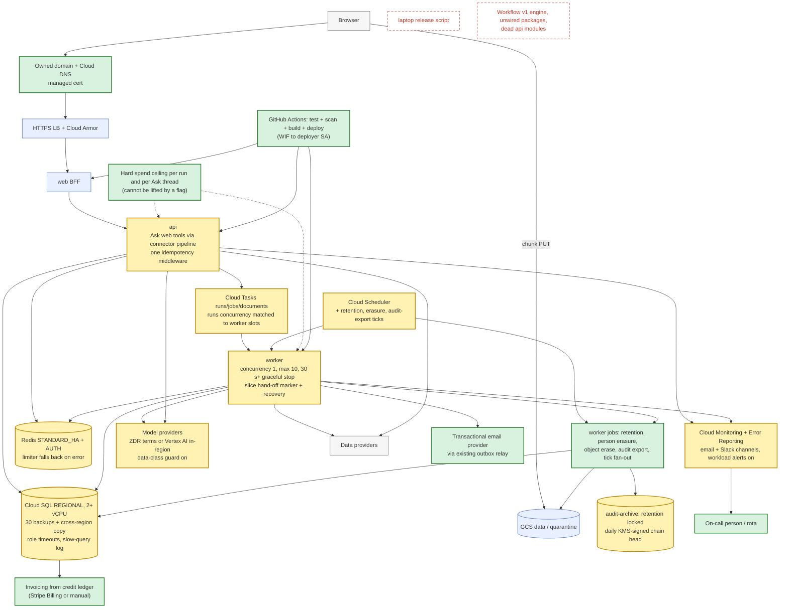
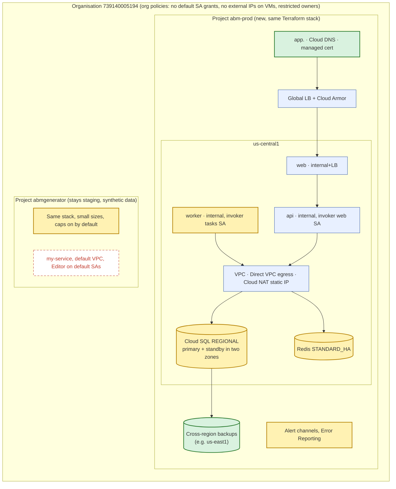

# 04 · Target architecture, delta, roadmap and decisions

The target keeps the current shape: one Next.js BFF, one Python program split into api and worker, Cloud Tasks, Cloud SQL with RLS, Cloud Storage. That shape is right for an early-stage product on Cloud Run. Nothing here needs Kubernetes, a service mesh or a microservice split. The changes are configuration, managed Google Cloud features, and a small number of new jobs inside the existing worker.

Legend: **green fill = added**, **yellow fill = changed**, plain = unchanged, **red dashed = removed**.

## 1. Target container diagram

## 2. Target deployment and network diagram

## 3. Before and after

| Area | Today | Target | Fixes |
|---|---|---|---|
| Environments | One project, called staging, holds client data, caps off | `abm-prod` project from the same stack; staging keeps synthetic data | SD-17 |
| Domain | `136-81-60-29.sslip.io` | Owned domain in Cloud DNS, managed cert | SD-14 |
| Spend control | Caps and token guard off; spend over reservation absorbed; pool not enforced | Caps on; hard ceiling per run and per Ask thread in the ledger claim; provider-console limits; hourly spend alert; pool enforced | SD-02, SD-20 |
| Billing | Manual pool, no invoices | Monthly invoice from `credit_entries`; Stripe Billing when self-serve | SD-20 |
| Alerting | 17 policies, 0 channels, no error tracker | Email + Slack channels, workload/SLO alerts on, Error Reporting, named on-call | SD-03, SD-27 |
| Database | Zonal, 1 vCPU, 7 backups, no timeouts, slow log off | Regional HA, 2+ vCPU, 30 backups + cross-region, role timeouts, 500 ms slow log, rewritten NOT EXISTS filters | SD-06, SD-19 |
| Redis | BASIC, no AUTH, paid calls fail closed | STANDARD_HA, AUTH, limiter falls back to an in-process bucket, references only in the index | SD-07 |
| Run durability | Runs ended while queued; dropped hand-offs | `next_slice_due_at` marker, recovery for RUNNING without a slice in flight, per-pause timeout names, slice 1500 s, concurrency 1, ≥30 s graceful stop | SD-08, SD-25 |
| Throughput | 6 slices; worker max 3 | Worker max 10 at concurrency 1, runs queue concurrency = worker slots; tick work fanned out as tasks; provider ceilings from contracts | SD-16 |
| Personal data | No DSAR, no retention, tenant plan keeps people data | Person erasure job + admin/staff UI; retention job per class; checkpoint pruning; `prepulled/` in tenant prefixes; erase objects via tasks | SD-04, SD-29, SD-31 |
| Ledger safety | Tenant deletion cascades credit ledger | FK `RESTRICT`, scrub jobs, FK-aware plan check | SD-01 |
| Model data | Guard off, ZDR unverified, sub-processors incomplete | ZDR or Vertex AI in-region; guard on per tenant data class; updated sub-processor list | SD-05 |
| Ask web tools | Direct calls, no ledger, no allow-list | Through `call_need`; query length cap; per-tenant switch | SD-15 |
| Audit | Unkeyed chain, capped verification, empty archive | Incremental verification, daily KMS-signed head exported to locked archive | SD-12 |
| Staff access | Invite-link bypass; MFA assumed; personal accounts | Invites go to invitee only; Workspace-only staff with enforced 2SV; group IAM | SD-11, SD-13 |
| SSO discovery | Admin-typed domains | DNS TXT verification, unique per active connection | SD-10 |
| Delivery | Laptop builds of dirty trees | CI-gated releases from a protected branch; container scanning on; weekly drift plan | SD-09, SD-35 |
| Code | Two engines, unwired packages, dead modules | One engine; unwired code moved out of `src/` | SD-28 |
| Migrations | DML silently no-op under FORCE | Lint rule + CONCURRENTLY indexes in separate revisions | SD-18 |

## 4. Roadmap

### Phase 1 · Fix now (next 2 weeks; mostly configuration)

| Step | Findings | Effort | Notes |
|---|---|---|---|
| Turn `RESEARCH_CAPS` and `TOKEN_GUARD` on in the live services; set provider and Anthropic console spend limits | SD-02 | S | Owner decision needed, see open questions |
| Add a hard per-run and per-thread dollar ceiling in the ledger claim and Ask loop | SD-02 | S | |
| Change `fk_credit_entries_job` to `RESTRICT`; scrub `research_jobs` in the tenant plan; FK-aware `check_plan` | SD-01 | S | Before anyone runs a tenant deletion |
| Create alert channels, set `alert_channels`, enable workload alerts and Error Reporting | SD-03 | S | |
| Provider limiter falls back to an in-process bucket on Redis errors; Redis ping in `/readyz` | SD-07 | S | Tier change comes in phase 2 |
| Require DNS TXT proof for SSO domains; unique domain per active connection | SD-10 | S | |
| Stop returning invite links to staff; require a support grant for staff invites | SD-11 | S | |
| Remove personal accounts from Owner and staff lists; enforce 2SV; group-based IAM | SD-13 | S | |
| Role `statement_timeout`, `idle_in_transaction_session_timeout`, slow-query log; rewrite three NOT EXISTS filters | SD-19 | S | |
| Migration lint for DML under FORCE RLS; check the 16 past migrations against the live DB | SD-18 | S | |
| Worker concurrency 1, graceful shutdown ≥ 30 s | SD-25 | S | |
| Delete `my-service`, default VPC, orphan secret; remove Editor from default SAs | SD-30 | S | |

### Phase 2 · Before the first enterprise customer

| Step | Findings | Effort |
|---|---|---|
| Separate production project from the same Terraform; staging gets synthetic data | SD-17 | M |
| Owned domain, Cloud DNS, cert; move IdP redirect URIs | SD-14 | S |
| Cloud SQL REGIONAL, 2+ vCPU, 30 backups, cross-region copy, restore drill with measured RTO/RPO | SD-06 | M |
| Redis STANDARD_HA with AUTH | SD-07 | S |
| CI-gated releases, container scanning, weekly drift plan | SD-09, SD-35 | M |
| Person erasure and retention jobs; checkpoint pruning; object erase via tasks; `prepulled/` prefix | SD-04, SD-29, SD-31 | L |
| ZDR or Vertex AI for tenant data; data-class guard on; sub-processor list | SD-05 | M |
| Ask web tools through the connector pipeline | SD-15 | S |
| Slice hand-off marker and recovery; per-pause timeout names | SD-08 | M |
| Incremental audit verification; signed heads to locked archive | SD-12 | M |
| Enforce credit pool; monthly invoice from ledger | SD-20 | M |
| Step-up on all admin writes; router-level staff auth | SD-21, SD-22 | S |
| LibreOffice in the sandbox; seccomp self-test | SD-38 | S |

### Phase 3 · Before scale (tens of tenants, tens of concurrent runs)

| Step | Findings | Effort |
|---|---|---|
| Worker max 10+ at concurrency 1; runs queue matched; tick fan-out per tenant as tasks; provider ceilings from contracts | SD-16 | M |
| Long-lived request load: raise api/web instances, cheaper run progress channel, move Ask embedding off the api | SD-33 | M |
| Shared breaker state in Redis; breaker on model calls | SD-26 | S |
| Correlation id through Cloud Tasks; Cloud Logging trace field; worker in 5xx alert | SD-27 | S |
| Remove Workflow v1 and unwired packages; delete dead modules | SD-28 | M |
| Partition event tables; move payload columns to GCS | SD-29 | M |
| One idempotency middleware; errors keep detail; one pagination style | SD-23, SD-24 | S |
| Pin model snapshots; regenerate routing doc | SD-36 | S |
| Per-tenant storage quota; resumable library upload | SD-32 | S |
| Lock order fix | SD-34 | S |
| Generate architecture facts from code in CI | SD-37 | S |
| Connection pooler (Cloud SQL managed pooling or PgBouncer) once total instances exceed ≈ 15 | lead 8 | M |
| Second-region recovery plan (cold standby from cross-region backups) | SD-06 | L |

## 5. Decision records

Each record: context, decision, alternatives considered, consequences.

### DR-1 · Separate production project
- **Context.** The only environment holds client data and runs with test settings (SD-17).
- **Decision.** Create `abm-prod` from `infra/stack` with prod tfvars; keep `abmgenerator` as staging.
- **Alternatives.** (a) Keep one project and separate by service names: shares IAM, quotas and blast radius. (b) Separate folder per customer: premature.
- **Consequences.** Two sets of secrets and provider keys; deploys go to staging first. Terraform already supports `envs/prod`.

### DR-2 · Highly available Cloud SQL rather than a new database
- **Context.** Zonal 1-vCPU instance is a single point of failure and saturated once (SD-06).
- **Decision.** Cloud SQL Enterprise, `REGIONAL`, 2 vCPU to start, 30 backups, cross-region backup location.
- **Alternatives.** AlloyDB (more performance, higher floor cost, migration work); read replicas only (does not fix zone failure).
- **Consequences.** Roughly doubles database cost; failover takes about a minute; app reconnects via the connector.

### DR-3 · A spend ceiling no switch can lift
- **Context.** Caps were turned off for testing and stayed off where customers run (SD-02).
- **Decision.** Keep the caps switch for estimates and plan limits, and add a platform ceiling per run and per Ask thread (multiple of the estimate) in the ledger claim. Add provider-console limits as the outer fence.
- **Alternatives.** Rely on the switch (already failed); rely on provider limits only (shared across tenants, too coarse); bill actuals (customers dislike surprises, still needs a ceiling).
- **Consequences.** Some long runs end at the ceiling and need a person to approve more, which the existing pause flow supports.

### DR-4 · Alerting on Cloud Monitoring first
- **Context.** Policies exist, nobody receives them (SD-03).
- **Decision.** Email to an on-call alias plus a Slack channel; Error Reporting for exceptions; PagerDuty or similar only when 24/7 support is sold.
- **Alternatives.** Sentry (better grouping, another vendor and data processor); Datadog (cost).
- **Consequences.** Zero new vendors; someone must own the rota.

### DR-5 · Person-keyed erasure job now, per-tenant encryption keys later
- **Context.** Personal data is copied into many tables and objects with no person index (SD-04).
- **Decision.** Build a person erasure job that scrubs a known list of tables, GCS prefixes and the Redis index, writes a tombstone and an audit event; enforce retention classes with a scheduled job. Before scale, encrypt tenant payload objects with per-tenant data keys so tenant deletion can also be done by destroying a key.
- **Alternatives.** Crypto-shredding only (does not cover person-level requests); manual SQL on request (unauditable).
- **Consequences.** Every new table holding personal data must register in the erasure plan; add a CI check.

### DR-6 · Releases only from CI
- **Context.** Live code is a laptop build of a commit plus a patch (SD-09).
- **Decision.** GitHub Actions builds, tests, scans and deploys through the existing deployer SA with Workload Identity Federation; the laptop script remains for emergencies but refuses a dirty tree and a commit without green CI.
- **Alternatives.** Cloud Build triggers (fine, but CI already exists in GitHub); Binary Authorization (good later, adds policy work).
- **Consequences.** Release speed depends on CI time (~minutes); hotfixes need a branch.

### DR-7 · Where tenant data meets models
- **Context.** Tenant files and people data go to Anthropic and Ollama Cloud with no verified retention terms (SD-05).
- **Decision.** For tenant data: Anthropic with zero-data-retention terms confirmed, or Claude on Vertex AI in the same region (code supports `LLM_ACCESS=vertex_ai`). Ollama Cloud only for tenants that accept it, enforced by the data-class guard.
- **Alternatives.** Self-hosted open models (operational cost); one provider only (less choice for users).
- **Consequences.** Model choice in the UI becomes per tenant policy.

### DR-8 · Keep Cloud Tasks for run slices
- **Context.** Hand-off between slices loses runs in edge cases (SD-08).
- **Decision.** Keep Cloud Tasks and fix the hand-off with an explicit "next slice due" marker, a recovery rule and per-pause task names.
- **Alternatives.** Cloud Workflows (another state machine to keep in step with LangGraph); Cloud Run Jobs per run (cold starts, harder approvals); Pub/Sub (no per-task deadlines or names).
- **Consequences.** Small change; same operational model.

### DR-9 · Redis stays, but degrades safely
- **Context.** A Redis outage stops all paid calls (SD-07).
- **Decision.** STANDARD_HA with AUTH, and a local fallback bucket for the provider limiter.
- **Alternatives.** Move rate limits into Postgres (adds load to the busiest component); remove the shared limiter (breaks provider quotas across instances).
- **Consequences.** Slightly higher Redis cost; during an outage, per-instance limits may briefly exceed the provider quota (bounded by the governor).

### DR-10 · Audit evidence outside the database
- **Context.** The hash chain can be rewritten by anyone who can write the table (SD-12).
- **Decision.** Verify incrementally; once a day sign the chain head per tenant with a KMS asymmetric key and write it with the day's events to the audit-archive bucket under a locked retention policy.
- **Alternatives.** Rely on Cloud Audit Logs (they do not cover application events); external ledger service (cost, vendor).
- **Consequences.** Tamper evidence that survives a database compromise; the retention lock cannot be undone, so set the period deliberately.
